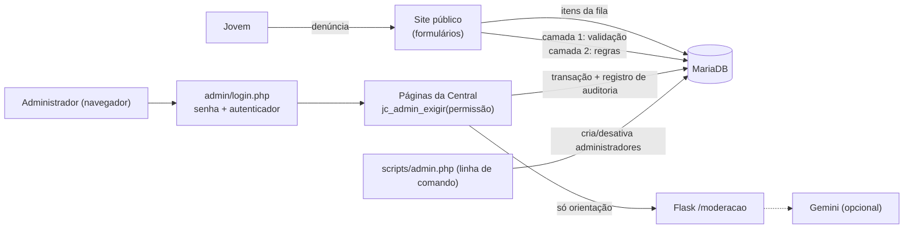
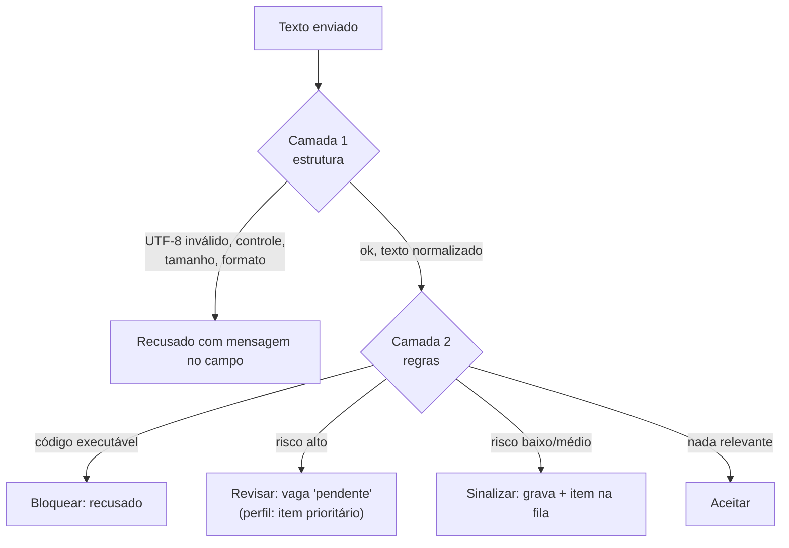

# Central administrativa, segurança e moderação (Stage 7)

Este documento descreve a **Central administrativa** (`admin/`), o **provisionamento pela linha de
comando** (`scripts/admin.php`), a **validação e moderação de conteúdo** (`includes/validacao.php`,
`includes/moderacao.php`), as **denúncias de vagas** e a **trilha de auditoria**. Versão: Stage 7
(11/10/2026), sobre a v4.00.

Princípios que guiam tudo o que está aqui:

- **Segurança no servidor.** Toda permissão, validação e regra é conferida no PHP. O JavaScript da
  Central só melhora a experiência (contadores, envio sem recarregar); sem ele, tudo funciona igual.
- **Menor privilégio e nada automático.** Nenhuma conta de jovem ou empresa vira administradora; não há
  senha padrão, cadastro público, URL secreta nem "conta admin" pronta. O único caminho é a linha de comando.
- **Decisão humana.** As regras automáticas só **sinalizam** (ou recusam código executável). Suspender
  contas e tirar vagas do ar por decisão é sempre ato de uma pessoa, com motivo e justificativa.
  A IA (Gemini) só **orienta**: nunca altera vaga, conta ou fila.
- **Nada é apagado.** A Central não exclui contas, vagas nem histórico e não tem ações em massa.
  Suspensão e rejeição são reversíveis e preservam os dados.
- **Tudo auditável.** Cada ação administrativa grava um registro encadeado por hash, com espelho no log.



## Sumário

1. [Instalação](#instalação)
2. [Linha de comando](#linha-de-comando-scriptsadminphp)
3. [Entrada, sessão e proteções](#entrada-sessão-e-proteções)
4. [Papéis e permissões](#papéis-e-permissões)
5. [Páginas da Central](#páginas-da-central)
6. [Contas: correção, suspensão e reativação](#contas-correção-suspensão-e-reativação)
7. [Vagas: estados de moderação](#vagas-estados-de-moderação)
8. [Validação e moderação de conteúdo](#validação-e-moderação-de-conteúdo)
9. [Fila de moderação e denúncias](#fila-de-moderação-e-denúncias)
10. [Análise complementar por IA](#análise-complementar-por-ia)
11. [Histórico (trilha de auditoria)](#histórico-trilha-de-auditoria)
12. [Logs](#logs)
13. [O site sem a migração](#o-site-sem-a-migração)
14. [Arquitetura dos arquivos](#arquitetura-dos-arquivos)
15. [Limitações e recomendações](#limitações-e-recomendações)
16. [Testes](#testes)

## Instalação

1. **Backup** do banco (phpMyAdmin → `jovemconnect` → Exportar).
2. Aplicar a migração `migrations/2026-10-11_stage7_admin_moderacao.sql` (phpMyAdmin → aba SQL → colar →
   Executar). Ela é **aditiva**: cria 5 tabelas e acrescenta colunas cujos padrões mantêm o comportamento
   atual (contas `ativa`, vagas `aprovada`). Detalhes em [MIGRACOES.md](MIGRACOES.md).
3. Criar o **primeiro administrador** no terminal (Prompt de Comando), na pasta do projeto:

   ```bat
   cd C:\xampp\htdocs\JovemConnect
   C:\xampp\php\php.exe scripts\admin.php criar --email=voce@exemplo.com --nome="Seu Nome"
   ```

   O comando mostra **uma única vez** a senha gerada (20 caracteres) e a chave do autenticador (TOTP).
   Cadastre a chave num app autenticador (Google/Microsoft Authenticator, Aegis, 2FAS...) — pela "chave
   manual" ou pelo endereço `otpauth://` — e guarde a senha num gerenciador de senhas. Nenhum dos dois vai
   para logs ou para o histórico.
4. Entrar em `http://localhost/JovemConnect/admin/login.php` com e-mail, senha e o código de 6 dígitos.

Requisitos: os mesmos do site (PHP 8.1+ recomendado; 7.4 e 8.0 em modo de compatibilidade desde a v4.58; mysqli). A extensão `intl` do PHP é **opcional**: com ela, nomes
digitados com acentos "decompostos" são normalizados (NFC); sem ela, continuam aceitos e exibidos
corretamente. Não há dependência nova (nem Composer, nem pip).

## Linha de comando (`scripts/admin.php`)

É a **única** forma de criar administradores. Só roda no terminal: pelo navegador responde 404, e a pasta
`scripts/` tem `.htaccess` que nega acesso. Toda operação que altera algo entra no histórico como ação de
"linha de comando" (sem administrador logado, IP `cli`).

| Comando | O que faz |
|---|---|
| `status` | diz se a migração foi aplicada e quantos administradores existem (ativos, sem autenticador) |
| `criar --email=... --nome="..."` | cria o **primeiro** administrador (senha gerada + autenticador) |
| `criar ... --adicional --confirmar="CRIAR ADMINISTRADOR"` | cria outro administrador; sem a confirmação **exata**, nada é criado |
| `listar` | lista os administradores (id, e-mail, nome, papel, ativo, MFA, último acesso) |
| `desativar --email=...` / `reativar --email=...` | desativa (encerra as sessões abertas) ou reativa uma conta administrativa |
| `redefinir-senha --email=...` | gera senha nova e encerra as sessões abertas |
| `redefinir-mfa --email=...` | gera chave nova do autenticador (a anterior deixa de valer) e encerra as sessões |
| `verificar-auditoria` | confere a cadeia de hashes e o espelho do log; código de saída 0 = íntegro, 1 = problema |

Opções:

- `--senha-stdin`: em vez de gerar, lê a senha digitada (mín. 12 caracteres, 5 diferentes, sem a parte do
  e-mail, fora da lista de senhas comuns). No Windows a digitação aparece na tela — prefira a senha gerada.
- `--sem-mfa`: cria (ou deixa) a conta **sem** o segundo fator. Não recomendado: fica registrado e a Central
  mostra um aviso permanente.

Se o e-mail também pertencer a um jovem ou a uma empresa, o comando avisa: as contas continuam **separadas**
(tabela `administradores` própria) e nada é concedido à conta do site.

Não existe exclusão de administrador: use `desativar` (o histórico continua apontando para a conta).

## Entrada, sessão e proteções

| Proteção | Como funciona |
|---|---|
| Senha | `password_hash`/`password_verify` (bcrypt); rehash automático quando o PHP muda o padrão |
| Segundo fator | TOTP (RFC 6238, 6 dígitos, 30 s, tolerância de ±1 intervalo). O mesmo código **não** é aceito duas vezes (`mfa_ultimo_passo`, gravado de forma atômica) |
| Limite de tentativas | 5 falhas por e-mail **ou** 20 por IP em 15 minutos bloqueiam novas tentativas; atraso progressivo de 0,5 s a 4 s a cada falha. A tabela `admin_tentativas` guarda só **hashes** SHA-256 do e-mail e do IP |
| Mensagem de erro | sempre "E-mail, senha ou código do autenticador incorretos" (não revela qual parte falhou nem se o e-mail existe; o tempo de resposta é igualado) |
| Cookie | sessão própria `JCADMIN`, separada da sessão do site; caminho restrito a `/…/admin/`, `HttpOnly`, `SameSite=Strict`, `Secure` em HTTPS, modo estrito de sessão; ID trocado no login (contra fixação) |
| Tempo de sessão | encerra após **15 min sem uso** (`JC_ADMIN_OCIOSO_SEG`, 120–3600) e **8 h desde a entrada** (`JC_ADMIN_MAX_SEG`, 900–43200), configuráveis no `.env` |
| Vínculo | a sessão é ligada ao navegador (hash do User-Agent) e à `sessao_versao` da conta: trocar a senha, redefinir o autenticador, desativar a conta ou "encerrar outras sessões" derruba as sessões abertas |
| Saída | `admin/logout.php` só por POST com token (um link de outro site não derruba a sessão) |
| CSRF | todo POST exige o token da sessão (`_csrf` ou cabeçalho `X-CSRF-Token`) e, se o navegador enviar `Origin`, ele precisa ser o próprio site |
| Reautenticação | suspender/reativar contas, corrigir textos de contas e vagas, trocar a senha e encerrar outras sessões exigem a senha (e o código) se a última confirmação tiver mais de **5 minutos** |
| Confirmação | toda ação que altera algo exige marcar "Confirmo..." e escrever uma **justificativa** (10 a 500 caracteres) |
| Cabeçalhos | `Content-Security-Policy` com *nonce* (sem scripts de terceiros), `X-Frame-Options: DENY`, `Cache-Control: no-store`, `X-Content-Type-Options: nosniff`, `Referrer-Policy: no-referrer` |
| Erros | mensagens claras sem detalhes técnicos; erro inesperado mostra "nada foi alterado" e o **código da requisição**, que localiza o erro em `logs/app.log` |
| Entrada sem registro | se não for possível gravar a entrada no histórico, o login é **cancelado** (não existe sessão administrativa sem registro) |

Recomendações para publicar fora do computador local: usar **HTTPS** (o cookie passa a ser `Secure`), restringir
`/admin/` por IP no Apache se possível e manter o PHP atualizado.

## Papéis e permissões

Há um papel, `administrador`, com as 14 permissões abaixo. A checagem é sempre no servidor, por
`jc_admin_exigir('permissão')`, no início de cada página e de cada ação. Um papel desconhecido no banco não
entra; uma permissão desconhecida no código dá erro (nunca libera por engano).

| Permissão | Para quê | Onde é exigida |
|---|---|---|
| `painel.ver` | ver os indicadores | `admin/index.php` |
| `contas.ver` | buscar e ver contas (sem dados sensíveis) | `admin/contas.php`, `admin/conta.php` (GET) |
| `contas.editar` | corrigir campos não sensíveis | `admin/conta.php` (POST `editar`) |
| `contas.suspender` | suspender e reativar contas | `admin/conta.php` (POST `suspender`/`reativar`) |
| `vagas.ver` | buscar e ver vagas e o histórico de moderação | `admin/vagas.php`, `admin/vaga.php` (GET) |
| `vagas.editar` | corrigir título, descrição, salário e carga horária | `admin/vaga.php` (POST `editar`) |
| `vagas.moderar` | aprovar, revisar, rejeitar e suspender vagas | `admin/vaga.php` (POST `moderar`) |
| `moderacao.ver` | ver a fila e as denúncias | `admin/moderacao.php` (GET) |
| `moderacao.decidir` | decidir um item da fila | `admin/moderacao.php` (POST) |
| `ia.consultar` | pedir a análise complementar por IA | `admin/ia_moderacao.php` |
| `auditoria.ver` | ver o histórico | `admin/auditoria.php` (GET) |
| `auditoria.verificar` | conferir a integridade do histórico | `admin/auditoria.php` (POST) |
| `seguranca.ver` | ver eventos de segurança e tentativas de login | `admin/seguranca.php` |
| `configuracoes.ver` | ver o ambiente e gerenciar a própria conta | `admin/configuracoes.php` |

Para criar um papel mais restrito (ex.: só moderação), acrescente-o em `jc_admin_papeis()`
(`includes/admin/autorizacao.php`) com a lista de permissões e altere o papel da conta **pela linha de
comando** — nunca por migração ou SQL solto. Nenhuma tela da Central permite mudar o próprio papel.

## Páginas da Central

| Página | Conteúdo |
|---|---|
| Painel (`index.php`) | totais agregados (jovens, empresas, vagas por estado, candidaturas, fila por risco, denúncias, logins que falharam/sucessos/negados em 24 h, e-mails e IPs bloqueados agora) e as últimas ações administrativas. **Nenhum dado pessoal** |
| Contas (`contas.php`) | busca por ID, nome ou e-mail (o `%` é tratado como texto), filtros por tipo, estado da conta (ativa/suspensa) e data de cadastro; 20 por página; e-mail parcialmente oculto na lista |
| Conta (`conta.php`) | dados de identificação, conteúdo **público** do perfil (para a moderação), vagas recentes (empresa), histórico administrativo daquela conta, formulários de correção e de suspensão/reativação e o botão da análise por IA. **Nunca mostra** CPF, data de nascimento, telefone, CEP/endereço completo, hash de senha nem o currículo (o CNPJ da empresa aparece, por ser identificação pública da empresa) |
| Vagas (`vagas.php`) | busca por título/ID, filtros por estado de moderação, empresa, área, empresa suspensa e datas |
| Vaga (`vaga.php`) | texto da vaga, local de trabalho, estado, sinais das regras, histórico de moderação, correção de texto, moderação e o botão da análise por IA |
| Moderação (`moderacao.php`) | fila (pendentes por padrão, risco alto primeiro; também resolvidos), filtros por estado, origem (regra/denúncia), risco e tipo de recurso; o detalhe de um item mostra o **conteúdo atual** do campo, lido do registro original, e as regras explicadas |
| Histórico (`auditoria.php`) | todos os registros, com filtros; botão "Conferir integridade agora" |
| Segurança (`seguranca.php`) | contagens de logins que falharam/deram certo e bloqueios ativos por e-mail/IP (o banco só tem hashes: mostra quantas vezes, não quem), as falhas e negações registradas no histórico e os últimos eventos do `logs/seguranca.log`, com filtro por tipo (já sem dados sensíveis) |
| Configurações (`configuracoes.php`) | estado do ambiente (migração, Flask, IA configurada ou não — sem mostrar segredos), trocar a própria senha, encerrar as outras sessões |

A interface usa HTML semântico, rótulos em todos os campos, foco visível, mensagens com `role="status"`/`role="alert"`,
tabelas com `caption`/`scope`, navegação por teclado, contraste AA e layout responsivo (testado em 375 px). Não usa
`alert()`/`confirm()`: as confirmações são caixas de seleção no próprio formulário.

## Contas: correção, suspensão e reativação

**Correção** (`contas.editar`): só campos não sensíveis — jovem: nome, cidade, área de interesse, resumo;
empresa: nome, área de atuação, descrição, cidade, site, LinkedIn. Usa **a mesma validação** dos formulários do
site (camada 1 + bloqueio de código executável). Só grava o que mudou; o histórico guarda os **nomes** dos
campos alterados, nunca os valores.

**Suspensão** (`contas.suspender`): motivo de uma lista fechada (fraude, spam, conteúdo ofensivo,
discriminação, personificação, risco de segurança, pedido do titular, outro) + justificativa + "Confirmo" +
reautenticação. **Reativação**: motivo (revisão concluída, engano, situação regularizada, outro) + justificativa.

| Efeito | Jovem suspenso | Empresa suspensa |
|---|---|---|
| Sessões abertas | encerradas na próxima página (AJAX recebe 403 JSON com o aviso) | idem |
| Login | recusado depois da senha correta, com mensagem própria | idem |
| Conteúdo | some para as empresas: listas de candidatos, painel, perfil e currículo (404) | as vagas somem para os jovens: lista, detalhe, painel, Match, candidatura e favoritar |
| Para os outros | — | em "Minhas candidaturas", a vaga aparece como "Vaga indisponível", com dica de segurança |
| Dados | **nada é apagado** (perfil, currículo, candidaturas, favoritos) | **nada é apagado** (vagas, candidaturas) |
| Reativação | tudo volta a aparecer | tudo volta a aparecer |

A Central **não exclui** contas (a exclusão continua sendo uma escolha do próprio usuário no site) e não tem
ações em massa.

## Vagas: estados de moderação

O estado de moderação (`vagas.moderacao_status`) é **separado** dos dados da vaga: moderar não altera título,
local de trabalho, contrato ou candidaturas.

| Estado | Visível para jovens? | Quando |
|---|---|---|
| `aprovada` | sim | padrão (todas as vagas existentes ficam assim com a migração); risco baixo |
| `sinalizada` | sim | risco médio na criação; continua no ar com item na fila |
| `pendente` ("Em revisão") | não | risco alto na criação, ou decisão "revisar" |
| `rejeitada` ("Não publicada") | não | decisão humana |
| `suspensa` | não | decisão humana |

| Ação | De | Para | Motivos |
|---|---|---|---|
| Aprovar | pendente, sinalizada, rejeitada, suspensa | aprovada | revisão concluída, vaga corrigida, sinalização indevida |
| Revisar | aprovada, sinalizada, rejeitada, suspensa | pendente | motivos de restrição (abaixo) |
| Rejeitar | aprovada, pendente, sinalizada | rejeitada | idem |
| Suspender | aprovada, pendente, sinalizada | suspensa | idem |

Motivos de restrição (`jc_moderacao_motivos_vaga()`, mostrados à empresa em linguagem simples): em revisão
pela equipe, cobrança do candidato, dados sensíveis, conteúdo enganoso, discriminação, linguagem inadequada,
spam, contato externo indevido, outro.

Transições fora da tabela são recusadas. **Nada volta ao ar sozinho**: só uma decisão "Aprovar" republica. A empresa
não edita vagas (a v4.00 não tem edição de vaga: ela pode excluir e publicar outra); quando o problema é só de texto,
a própria Central pode corrigi-lo ("Corrigir o texto da vaga", com reautenticação) e depois aprovar. A empresa vê em "Minhas vagas" o selo ("Em revisão", "Não publicada",
"Suspensa") e o motivo em linguagem simples. Ao moderar, o administrador pode marcar "resolver os itens
pendentes desta vaga" — tudo numa transação só, junto com o registro do histórico.

Vagas fora do ar e vagas de empresas suspensas são filtradas no servidor em todas as consultas públicas
(`jc_vagas_visiveis_sql`, `includes/conta_status.php`).

## Validação e moderação de conteúdo

Duas camadas, aplicadas no servidor em todos os formulários (cadastro e perfil de jovem e empresa, formação,
experiências, habilidades, locais de trabalho, vagas, currículo por IA, denúncias e correções da Central):



### Camada 1 — validação estrutural (`includes/validacao.php`)

- UTF-8 obrigatório; normalização Unicode **NFC** (com `intl`); `\r\n` vira `\n`.
- Removidos sem aviso: espaços invisíveis (U+200B, U+2060, U+FEFF, U+00AD) e controles de direção do texto
  (U+202A–U+202E, U+2066–U+2069), usados para burlar filtros e disfarçar o texto exibido.
- Recusados: os demais caracteres de controle (NUL, ESC...) e quebra de linha em campos de uma linha.
- Aceitos: acentos, cedilha, nomes estrangeiros, outros alfabetos e a pontuação comum. Nada é traduzido nem
  "corrigido".
- O escape na saída (`htmlspecialchars`/`textContent`) e as consultas parametrizadas continuam obrigatórios.

Mapa de campos (`jc_campos()`): cada campo editável tem tipo, obrigatoriedade, limites e uma **política de
moderação**. `tecnico` = só o bloqueio de código executável (campos que não vão para a fila).

| Campo | Rótulo | Tipo | Obrig. | Tamanho | Política |
|---|---|---|---|---|---|
| `jovem.nome` | Nome | nome | sim | 2–100 | nome |
| `jovem.area_interesse` | Área de interesse | linha | — | 100 | curto |
| `jovem.resumo` | Resumo profissional | texto | — | 2000 | perfil_texto |
| `jovem.habilidade` | Habilidade | linha | — | 80 | curto |
| `jovem.cidade` | Cidade | linha | — | 100 | tecnico |
| `jovem.formacao_titulo` | Formação | linha | — | 150 | curto |
| `jovem.formacao_instituicao` | Instituição | linha | — | 150 | curto |
| `jovem.formacao_conclusao` | Conclusão | linha | — | 20 | tecnico |
| `jovem.formacao_area` | Área do curso | linha | — | 100 | curto |
| `jovem.formacao_livre` | Formação (texto digitado) | linha | — | 100 | curto |
| `jovem.exp_titulo` | Título da experiência | linha | sim | 150 | curto |
| `jovem.exp_local` | Local da experiência | linha | — | 150 | curto |
| `jovem.exp_periodo` | Período | linha | — | 50 | tecnico |
| `jovem.exp_descricao` | Descrição da experiência | texto | — | 1000 | perfil_texto |
| `empresa.nome` | Nome da empresa | nome_org | sim | 2–150 | nome |
| `empresa.area_atuacao` | Área de atuação | linha | — | 100 | curto |
| `empresa.descricao` | Sobre a empresa | texto | — | 2000 | empresa_texto |
| `empresa.site` | Site oficial | url | — | 255 | link |
| `empresa.linkedin` | LinkedIn | url_livre | — | 255 | link |
| `empresa.cidade` | Cidade | linha | — | 100 | tecnico |
| `local.nome` · `local.logradouro` · `local.numero` · `local.complemento` · `local.bairro` · `local.cidade` | Local de trabalho | linha | — | 100/150/10/100/100/100 | tecnico |
| `vaga.titulo` | Título da vaga | linha | sim | 2–150 | vaga_titulo |
| `vaga.descricao` | Descrição da vaga | texto | sim | 5000 | vaga_texto |
| `vaga.salario` | Salário | linha | — | 50 | curto |
| `vaga.carga_horaria` | Carga horária | linha | — | 20 | tecnico |
| `vaga.requisito` | Requisito (cada linha) | texto | — | 150 | vaga_item |
| `vaga.beneficio` | Benefício (cada linha) | texto | — | 100 | vaga_item |
| `vaga.cidade` | Cidade | linha | — | 100 | tecnico |
| `denuncia.detalhe` | Detalhes da denúncia | texto | — | 500 | tecnico |
| `admin.justificativa` | Justificativa | texto | sim | 10–500 | — |
| `admin.nome` | Nome do administrador | nome | sim | 2–100 | — |

Tipos: `nome` (letras de qualquer alfabeto, espaço, apóstrofo, hífen, ponto); `nome_org` (nome de empresa:
recusa só `< > { } [ ] \ | `` ` `` e exige 2 letras/dígitos — "C&A Modas Ltda." passa); `linha` (uma linha);
`texto` (várias linhas); `url` (só `http`/`https`, sem credenciais); `url_livre` (perfil do LinkedIn).

Compatibilidade: os cortes silenciosos que já existiam (ex.: tamanho máximo de alguns campos do perfil) foram
mantidos; mensagens novas só onde antes não havia limite (ex.: título de vaga acima de 150 caracteres, que
antes gerava erro de banco). Na edição de perfil, só os campos **alterados** são validados — dados antigos que
não seguem as regras novas não impedem salvar o resto.

### Camada 2 — regras de moderação (`includes/moderacao.php`)

As regras rodam sobre o texto já validado e sobre um **esqueleto resistente a disfarces** (sem acento,
`0→o 1→i 3→e 4→a 5→s 7→t @→a $→s`, letras separadas juntadas, repetições reduzidas). Se a regra só casa no
esqueleto, entra também `evasao.filtro` e o risco sobe. **Negações** próximas na mesma oração ("não cobramos
taxa", "nunca pedimos sua senha") desarmam as regras de cobrança e de dados pessoais. Os riscos foram
calibrados para evitar falsos positivos: `alto` só para assinaturas muito específicas.

| Decisão | Quando | Efeito |
|---|---|---|
| `aceitar` | nenhum sinal | grava normalmente |
| `sinalizar` | risco baixo ou médio | grava normalmente + item na fila (vaga de risco médio fica `sinalizada`, no ar) |
| `revisar` | risco alto | vaga fica `pendente` (fora do ar) até a revisão humana; em perfis, item de prioridade alta |
| `bloquear` | **só** código executável (exploração técnica) ou erro estrutural | envio recusado, com orientação no campo |

Nenhuma regra suspende contas nem bloqueia por probabilidade: o bloqueio automático vale apenas para
marcação executável, que é objetiva.

| Regra | Categoria | Risco | Políticas | O que indica |
|---|---|---|---|---|
| `tecnico.marcacao_ativa` | Código malicioso | bloquear | todas | marcação HTML executável ou que embute conteúdo (script, iframe, object, embed...) — também escrita em entidades HTML |
| `tecnico.evento_html` | Código malicioso | bloquear | todas | atributo de evento HTML (`onload=`, `onerror=`...) |
| `tecnico.url_script` | Código malicioso | bloquear | todas | endereço `javascript:`/`vbscript:`/`data:text/html` |
| `tecnico.sql` | Sondagem técnica | baixo | textos | padrão típico de injeção de SQL (sem efeito: consultas parametrizadas) |
| `fraude.cobranca` | Fraude / cobrança | alto | vaga, empresa | pede pagamento do candidato (taxa de inscrição, depósito, kit) |
| `fraude.cobranca_indicio` | Possível cobrança | médio | vaga, empresa | pode estar cobrando uniforme, curso, crachá ou inscrição |
| `fraude.dados_sensiveis` | Dados sensíveis | alto | vaga, empresa | pede senha, cartão, dados bancários, código de verificação ou documentos por fora |
| `fraude.phishing` | Possível golpe | médio | vaga, empresa | pede para confirmar dados ou conta por um link |
| `fraude.renda_irreal` | Ganho irreal | médio | vaga, empresa | promete ganho fácil ou garantido |
| `fraude.piramide` | Pirâmide | médio | vaga, empresa | linguagem de pirâmide ou multinível |
| `fraude.ganho_desproporcional` | Ganho irreal | médio | vaga | valor por hora/dia/semana/mês muito acima do realista (limites: 150/h, 400/dia, 3.000/semana, 20.000/mês) |
| `vaga.anuncio_comercial` | Não parece vaga | médio | vaga | propaganda/venda em vez de oferta de trabalho |
| `vaga.titulo_enganoso` | Título enganoso | médio | título | promessa de dinheiro ou chamariz em vez do cargo |
| `contato.externo` | Contato externo | baixo | vaga | telefone, e-mail ou aplicativo de mensagem no texto da vaga |
| `privacidade.contato_exposto` | Dado pessoal exposto | baixo | perfil | telefone ou e-mail num texto público do perfil |
| `privacidade.documento` | Documento exposto | médio | textos | número com formato de CPF num texto público |
| `discriminacao.exclusao` | Discriminação | alto | vaga, empresa | exclui por sexo, raça/cor, religião, orientação, gravidez, deficiência ou origem |
| `discriminacao.exclusividade` | Possível discriminação | médio | vaga | restringe a um sexo, estado civil ou aparência (vagas afirmativas legítimas são aprovadas na revisão) |
| `discriminacao.aparencia` | Possível discriminação | médio | vaga | exige aparência |
| `discriminacao.gravidez` | Discriminação | alto | vaga | exigência ligada a gravidez ou esterilização (Lei 9.029/95) |
| `discriminacao.estado_civil` | Possível discriminação | médio | vaga | exige estado civil ou não ter filhos |
| `ofensa.palavrao` | Linguagem ofensiva | médio | textos | palavrão ou insulto |
| `ofensa.odio` | Discurso de ódio | alto | textos | termo pejorativo contra grupo ou apologia de ódio |
| `ofensa.assedio` | Assédio | médio | vaga, perfil, empresa | linguagem sexualizada ou pedido de fotos do corpo |
| `ameaca` | Ameaça | alto | textos | ameaça de violência dirigida a alguém |
| `spam.caractere_repetido` · `spam.palavra_repetida` · `spam.maiusculas` · `spam.repetitivo` | Spam | baixo | textos | repetições e texto quase todo em maiúsculas |
| `link.encurtador` · `link.ip` · `link.punycode` | Link suspeito | médio | textos, links | destino escondido, IP ou domínio disfarçado |
| `link.arquivo` | Link perigoso | alto | textos, links | link para programa executável (`.apk`, `.exe`...) |
| `link.campo_indevido` · `link.excesso` · `link.inseguro` | Links | médio/baixo | — | link onde não cabe, mais de 3 links, link sem HTTPS |
| `personificacao.equipe` | Personificação | médio | nomes | nome que imita a equipe ou a marca JovemConnect |
| `ia.manipulacao` | Manipular IA | baixo | textos | texto que tenta dar ordens a uma IA (só sinaliza) |
| `evasao.filtro` | Disfarce | sobe o risco | — | termo reconhecido só depois de desfazer um disfarce |
| `flood.vagas` | Spam | médio | — | 10 ou mais vagas da mesma empresa na última hora |

Termos técnicos (HTML, `<div>`, SQL, `SELECT`, C#, Node.js) **não** são problema: só a marcação executável é
bloqueada; marcação inofensiva como `<b>` é gravada como texto e exibida escapada. Referência de falso
positivo: os 346 textos realistas do `database/seed_demo.sql` passam todos como "aceitar"
(ver [Testes](#testes)).

## Fila de moderação e denúncias

- Cada sinal de regra cria (ou atualiza, somando `ocorrencias`) **um item por recurso + campo + origem**.
  O item guarda tipo/ID do recurso, campo, autor, regras, risco e o **hash SHA-256** do texto avaliado —
  **nunca uma cópia do texto**. O moderador lê o conteúdo atual no registro original, numa página autorizada.
- Decisões: "Sem violação (conteúdo mantido)", "Violação confirmada (medida aplicada)" ou "Conteúdo
  corrigido", sempre com justificativa; para vagas, a decisão pode aplicar junto uma ação de moderação
  (rejeitar, suspender...) na mesma transação. Item decidido não aceita nova decisão.

**Denúncias** (só jovem logado, botão "Algo errado com esta vaga?" no detalhe da vaga):

| Motivo | Risco do item |
|---|---|
| Golpe ou fraude · Pede pagamento · Pede dados pessoais | alto |
| Discriminação · Conteúdo ofensivo | médio |
| Informação enganosa · Outro | baixo |

- Uma denúncia por jovem e vaga (chave única) e no máximo 10 por dia por jovem.
- Detalhe opcional (até 500 caracteres, mesma validação; código é recusado).
- A denúncia **nunca esconde a vaga sozinha**: entra na fila; quem decide é a administração.
  A empresa não fica sabendo quem denunciou.
- `denuncias.vaga_id` não tem chave estrangeira de propósito: se a empresa excluir a vaga, a denúncia
  continua como evidência. `jovem_id` tem: se o jovem excluir a conta, as denúncias dele saem junto.

## Análise complementar por IA

Botão "Pedir análise complementar por IA" na ficha da vaga e na ficha da conta (`ia.consultar`). Fluxo:

1. O PHP monta só os **textos públicos** (vaga: título, descrição, salário, requisitos, benefícios; jovem: área de
   interesse, resumo, habilidades, experiências; empresa: área de atuação e descrição), **mascara** e-mails,
   números longos (telefone, CPF, cartão) e reduz links ao domínio.
2. Envia ao Flask local (`POST /moderacao` no endereço de `jc_ia_url()`: `127.0.0.1`, porta 5000 ou a escolhida ao iniciar), que consulta o Gemini **se** houver chave no
   servidor. As instruções mandam tratar o texto como **dado** (proteção contra "prompt injection").
3. A resposta é **validada**: risco e categorias só de listas fechadas, resumo curto sem marcação; fora do
   formato é descartada. A análise do mesmo texto é reaproveitada por até 1 hora (o administrador é avisado).
4. A Central mostra a **orientação** ao lado das regras automáticas. Nada é alterado: nem a vaga, nem a fila,
   nem a conta.

Limite: 10 consultas a cada 5 minutos por sessão. Cada consulta entra no histórico (`ia.consulta`) com o
resultado e o motivo (`risco_alto`, `sem_chave`, `servico_fora`, `timeout`, `limite`, `resposta_invalida`,
`limite_sessao`...), sem o texto enviado nem a resposta. Sem chave, com o Flask parado, com erro ou demora do
Gemini, aparece um aviso claro e as regras continuam valendo. A integração existente (Match, análise
contextual, assistente) **não foi alterada**; a rota `/moderacao` é nova e independente.

## Histórico (trilha de auditoria)

Tabela `admin_auditoria`, **somente inclusão**. Cada registro: quando (relógio do banco), quem (`admin_id`, ou
vazio para a linha de comando/tentativas sem login), ação, recurso (tipo + ID), resultado (`sucesso`, `falha`,
`negado`), código do motivo, justificativa (e-mails e números longos mascarados), **nomes** dos campos
alterados, código da requisição (`req_id`, o mesmo de `app.log`/`seguranca.log`) e IP anonimizado (último bloco
zerado).

Ações registradas: entrada (sucesso e falha), saída, confirmação de identidade, sessão encerrada, outras sessões
encerradas, senha alterada, acesso negado, envio recusado (CSRF), conta corrigida/suspensa/reativada, vaga
corrigida/moderada, item da fila decidido, consulta à IA, conferência do histórico e as operações da linha de
comando.

**Integridade:**

- `hash = SHA-256(hash do registro anterior + campos deste registro)` (o primeiro usa 64 zeros). Alterar ou
  apagar um registro do meio quebra a cadeia.
- **Espelho** em `logs/seguranca.log`: cada registro gera a linha `admin.<ação>` com o ID do registro (`registro`)
  e o começo do hash (`elo`), gravada **só depois do COMMIT**. Comparar o espelho com a tabela revela registros
  **apagados no fim** (que a cadeia sozinha não denuncia) e registros trocados por alguém que refez a cadeia.
- **Conferência**: na Central ("Conferir integridade agora", também registrada) ou no terminal
  (`php scripts/admin.php verificar-auditoria`, código de saída 1 em caso de problema). Ambas apontam o número do
  primeiro registro com problema.
- **Atomicidade**: a ação e o seu registro entram na mesma transação, protegida por uma trava nomeada do banco
  (`GET_LOCK`) que garante uma linha por vez na cadeia. Se o histórico não puder ser gravado, a ação é desfeita
  ("nada foi alterado").
- A Central não tem tela ou ação para editar ou apagar o histórico, e o código do site não contém `UPDATE`,
  `DELETE` nem `TRUNCATE` dessa tabela.

O que foi demonstrado na réplica (bloco E dos testes): alteração de um registro → detectada no registro exato;
remoção no meio → detectada no seguinte e pelo espelho; remoção do último → detectada pelo espelho; alteração com
a cadeia inteira recalculada → detectada pelo espelho; falha na gravação do histórico → ação desfeita; histórico
ocupado por mais de 10 s → nada feito, mensagem clara.

Limite honesto: quem tiver acesso de escrita **ao banco e aos arquivos de log** consegue forjar os dois. Para
proteção máxima: (1) o usuário do banco usado pelo site deve ter só `SELECT, INSERT` em `admin_auditoria`
(ex.: `GRANT SELECT, INSERT ON jovemconnect.admin_auditoria TO 'site'@'localhost';`, sem `UPDATE/DELETE`);
(2) copiar periodicamente o `seguranca.log` para fora do servidor; (3) manter backups.

## Logs

Eventos novos (formato e proteções em [LOGS.md](LOGS.md)):

| Evento | Arquivo | Quando |
|---|---|---|
| `admin.<ação>` (ex.: `admin.conta.suspensa`) | seguranca.log | espelho de cada registro do histórico, com `registro` e `elo` |
| `admin.login_csrf` | seguranca.log | formulário de entrada da Central desatualizado |
| `admin.auditoria_erro` · `admin.erro_inesperado` · `cli.admin_erro` | app.log | falha ao gravar o histórico / erro inesperado na Central / na linha de comando |
| `login.bloqueado` | seguranca.log | jovem ou empresa suspensos tentaram entrar |
| `conta.sessao_encerrada` | seguranca.log | sessão aberta de conta suspensa foi encerrada |
| `denuncia.criada` · `denuncia.limite` · `denuncia.recusada` · `denuncia.erro` | seguranca.log / app.log | denúncias |
| `moderacao.sinalizado` · `moderacao.erro_fila` | app.log | item criado/atualizado na fila; falha ao gravar na fila |
| `vaga.recusada` | app.log | vaga recusada pela validação (só os nomes dos campos) |
| `moderacao.analise` · `gemini.falha` (`rota=moderacao`) | ia.log | análise complementar pelo Flask |

Nunca vão para os logs: senha, segredo ou código do autenticador, cookie, token CSRF, chave do Gemini, e-mails,
telefones, o texto avaliado ou a resposta da IA.

## O site sem a migração

O código verifica se as tabelas e colunas da Stage 7 existem (`jc_stage7_disponivel()`, `includes/esquema.php`).
Sem a migração:

- o site público funciona como na v4.00: sem suspensão de contas, sem estados de moderação, sem fila, sem
  denúncias (o formulário nem aparece);
- a validação estrutural e o bloqueio de código executável (camada 1 e regras de bloqueio, que não dependem do
  banco) continuam valendo nos formulários;
- a Central mostra "ainda não foi instalada" e a linha de comando avisa que falta a migração, sem criar nada.

## Arquitetura dos arquivos

| Arquivo | Responsabilidade |
|---|---|
| `includes/validacao.php` | camada 1: mapa de campos, normalização e validação estrutural |
| `includes/moderacao.php` | camada 2: regras, decisões, fila (`jc_mod_registrar`), denúncias |
| `includes/conta_status.php` | visibilidade (vagas visíveis, jovens ativos) e encerramento de sessão de conta suspensa |
| `includes/esquema.php` | detecção da migração da Stage 7 |
| `includes/admin/nucleo.php` | carrega os módulos da Central e o tratamento de erro |
| `includes/admin/sessao.php` | sessão `JCADMIN`, prazos, cabeçalhos, CSRF, redirecionamentos |
| `includes/admin/autorizacao.php` | permissões, papéis, `jc_admin_exigir`, senha, reautenticação |
| `includes/admin/limite.php` | limite de tentativas de login (hashes) |
| `includes/admin/totp.php` | segundo fator (TOTP) |
| `includes/admin/auditoria.php` | histórico encadeado, transações, espelho no log, conferências |
| `includes/admin/servicos.php` | consultas e operações (contas, vagas, fila, histórico, indicadores) |
| `includes/admin/layout.php` | estrutura visual e utilitários de tela (escape, datas, paginação) |
| `admin/*.php` | páginas (uma por tela); cada uma começa com `jc_admin_exigir()` |
| `scripts/admin.php` + `scripts/.htaccess` | provisionamento pela linha de comando |
| `Vagas/denunciar.php` | denúncia de vaga |
| `IA/recomendar.py` (rota `/moderacao`) | análise complementar por IA |
| `assets/css/admin.css` · `assets/js/admin.js` | aparência e melhorias progressivas da Central |

Pontos de integração no site: `includes/config.php` (encerra a sessão de conta suspensa), os dois
`processar_login.php` (recusam conta suspensa), as consultas públicas de vagas (filtro de visibilidade) e os
formulários (camadas 1 e 2).

## Limitações e recomendações

- **Um papel só** (`administrador`). Papéis mais restritos exigem uma pequena mudança de código (ver acima).
- **Recuperação de acesso** de administrador só pela linha de comando (`redefinir-senha`, `redefinir-mfa`), de
  propósito: não há "esqueci minha senha" na Central.
- O **segredo do autenticador** fica no banco em texto (base32), como em muitos sistemas TOTP: quem lê o banco
  pode gerar códigos. Proteja o acesso ao banco; uma evolução possível é cifrá-lo com uma chave do `.env`.
- **Detecção ≠ prevenção**: a cadeia de hashes e o espelho revelam adulterações, não as impedem — por isso a
  recomendação de permissões restritas no banco e de cópia externa do log.
- As regras de moderação são **determinísticas**: reconhecem padrões, não intenção. Haverá falsos positivos e
  falsos negativos; por isso "alto" só tira vagas do ar até a revisão humana e nada suspende contas sozinho.
- A **análise por IA** depende de chave do Gemini no servidor e do Flask rodando; sem eles, só as regras.
- Fora do escopo desta etapa e registrados como pendências: a **falha da recuperação de senha do site**
  ([SEG-01](SEGURANCA_E_PRIVACIDADE.md#seg-01), aguarda autorização), o **login público sem limite de
  tentativas** e a caixa "perfil verificado" que a própria empresa pode marcar (ver
  [MANUTENCAO_E_EVOLUCAO.md](MANUTENCAO_E_EVOLUCAO.md#pendências-que-exigem-mudança-de-código)).

## Testes

Executados na réplica de desenvolvimento (nunca no banco real), com o Gemini **simulado** e chave falsa. Resultado
da bateria final (11/10/2026, 36 min): **todos os blocos da Stage 7 aprovados** e a regressão das stages anteriores
igual à da v4.00, sem e com a migração ([TESTES.md](TESTES.md#stage-7-11102026)).

| Bloco | Arquivo (réplica) | O que cobre | Resultado |
|---|---|---|---|
| F0 | `f0_sem_migracao.py` | código novo com o banco da v4.00: site como antes; Central e linha de comando avisam e não criam nada | 25/25 |
| A | `a_admin_auth.py` | provisionamento, login, MFA, limite de tentativas, sessão, CSRF, reautenticação, permissões | 51/51 |
| interface | `ui_admin.py` | navegador real: acessibilidade, foco, teclado, 375 px, sem erros de JavaScript | 13/13 |
| B | `b_contas.py` | busca, filtros, privacidade da ficha, correção, suspensão e reativação e seus efeitos | 48/48 |
| C | `c_vagas.py` | estados de moderação, local de trabalho preservado, fila, denúncias, IA na ficha | 39/39 |
| D | `d_validacao.py` | 40 exemplos nas funções + formulários reais + IA (fora do ar, sem chave, válida, manipulada, inválida, limite, cache, perfil) | 74/74 |
| E | `e_auditoria.py` | registros completos, espelho, sem segredos, adulterações, atomicidade, sem tela de exclusão | 46/46 |
| seed | `f_seed_estatico.py` | seed analisado **sem executar**: colunas existem; 346 textos sem bloqueio nem sinalização | 5/5 |
| F | `rodar_s7.sh` | regressão completa das stages anteriores **sem** e **com** a migração | igual à v4.00 |

Como nas stages anteriores, os scripts de teste ficam na réplica e não fazem parte do projeto; o roteiro de
verificação manual no XAMPP está em [INSTALACAO_E_EXECUCAO.md](INSTALACAO_E_EXECUCAO.md#10-verificar-o-funcionamento).
