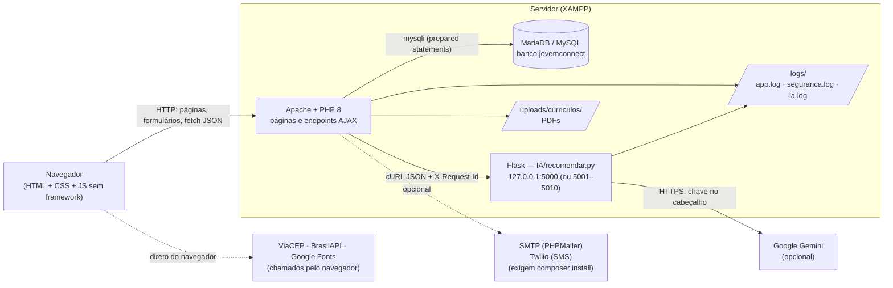
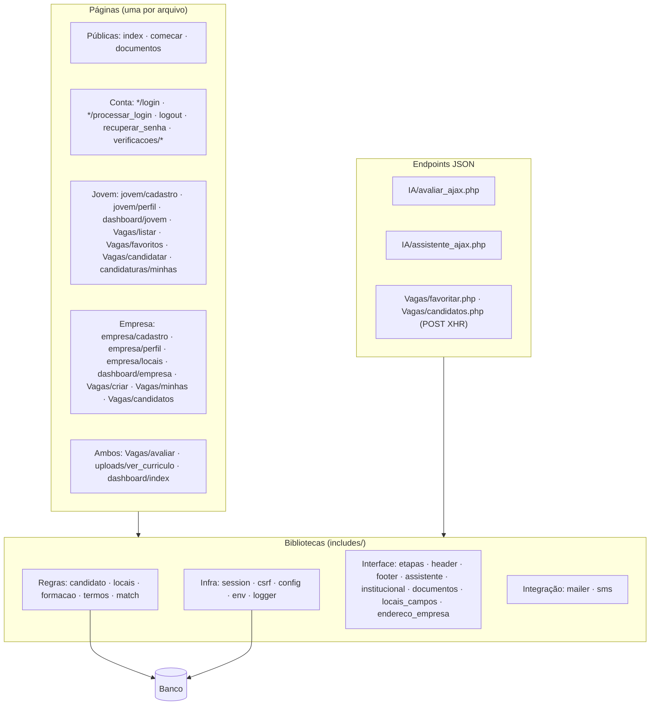
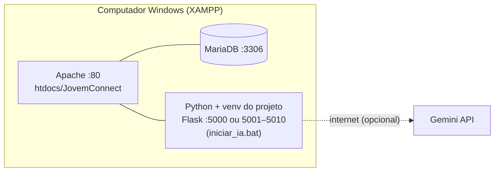

# Arquitetura do JovemConnect

> Revisado na auditoria de documentação de 10/10/2026 (versão **v4.00**). **[C]** confirmado no código ·
> **[T]** verificado por teste na réplica · **[I]** inferido · **[NC]** não confirmado.
> Correção em relação à versão anterior deste documento: a nota do Match **não** usa habilidades nem
> experiência (eram citadas aqui por engano) — ver [IA_E_MATCH.md](IA_E_MATCH.md).

## Visão geral

- O **PHP** monta as páginas, controla login/sessão e aplica todas as regras de acesso. O navegador nunca
  fala direto com o Flask nem com o Gemini [C: nenhum `fetch` para a porta 5000; o Flask só escuta em
  `127.0.0.1`].
- O **Flask** recebe do PHP dados já reduzidos ao mínimo. Fora do ar, o site continua funcionando: o Match é
  calculado em PHP e o assistente usa respostas prontas [C][T].
- **Não há roteador nem framework**: cada arquivo `.php` é uma página ou endpoint, e os arquivos de
  `includes/` são bibliotecas incluídas com `require_once` [C].

## Camadas

## Ciclo de uma requisição típica

```mermaid
sequenceDiagram
    autonumber
    participant N as Navegador
    participant P as Página PHP
    participant C as includes/csrf.php + session.php
    participant K as includes/config.php
    participant B as Banco
    participant LG as includes/logger.php
    N->>P: GET/POST (cookie PHPSESSID)
    P->>C: require_once → jc_session_start()
    C-->>P: sessão (HttpOnly, SameSite=Lax, strict mode)
    P->>K: require_once → logger, .env, conexão $conn
    alt banco indisponível
        K-->>N: 503 texto "temporariamente indisponível"
    end
    P->>P: confere $_SESSION (jovem_id / empresa_id)
    alt POST que altera estado
        P->>C: csrf_require()
        alt token inválido
            C->>LG: csrf.recusado (seguranca.log)
            C-->>N: 403 (HTML ou JSON)
        end
    end
    P->>B: prepared statements
    alt exceção não tratada
        K->>LG: erro.inesperado (app.log)
        K-->>N: 500 genérico
    end
    P->>LG: eventos de negócio (app.log / seguranca.log)
    P-->>N: HTML, JSON ou 302 (PRG)
```

## Pastas e responsabilidades

| Pasta / arquivo | Papel |
|---|---|
| `index.php`, `comecar.php`, `documentos.php` | Página inicial, escolha do tipo de conta, Termos/Privacidade em página própria |
| `jovem/`, `empresa/` | Login, processamento do login, cadastro, perfil, exclusão de conta; `empresa/locais.php` |
| `Vagas/` | Listagem, detalhe, criação, remoção, candidatura, candidatos, favoritos, página de análise do Match |
| `candidaturas/minhas.php` | Candidaturas do jovem |
| `dashboard/` | Painéis do jovem e da empresa; `index.php` só redireciona |
| `verificacoes/` | Escolha e verificação de e-mail e telefone |
| `uploads/` | Envio e entrega protegida do currículo; `uploads/curriculos/` guarda os PDFs (`.htaccess` nega acesso direto) |
| `IA/` | Endpoints AJAX de IA e o serviço Flask `recomendar.py` |
| `includes/config.php` | Conexão com o banco (variáveis `DB_*` do `.env`), tratamento de exceções sem expor detalhes |
| `includes/env.php` | Lê o `.env` da raiz sem sobrescrever variáveis do sistema |
| `includes/session.php`, `includes/csrf.php` | Sessão endurecida e token CSRF (formulários: campo `csrf_token`; AJAX: cabeçalho `X-CSRF-Token`) |
| `includes/logger.php` | Logs JSON com redação de dados pessoais (veja [LOGS.md](LOGS.md) e [LOGS_E_DIAGNOSTICO.md](LOGS_E_DIAGNOSTICO.md)) |
| `includes/etapas.php` | Formulário em etapas (cadastros) |
| `includes/termos.php`, `includes/documentos.php`, `includes/institucional.php` | Versão e registro do aceite; texto dos Termos/Privacidade; modais do rodapé |
| `includes/candidato.php` | Regra única de acesso da empresa aos dados de um candidato |
| `includes/match.php` | Match tradicional em PHP (cópia do algoritmo do Flask), detalhamento por categoria, cliente HTTP do Flask |
| `includes/locais.php`, `includes/locais_campos.php`, `includes/endereco_empresa.php` | Endereço principal, locais de trabalho, "local efetivo" de cada vaga |
| `includes/formacao.php` | Formação estruturada (nível → curso/ano → situação) |
| `includes/assistente.php` | Assistente, painel de acessibilidade, botões flutuantes, modais e envio único de formulários |
| `includes/header.php`, `includes/footer.php` | Cabeçalho/rodapé usados por `candidaturas/minhas.php` e pelas páginas de verificação |
| `includes/auth.php`, `functions.php`, `verificacoes/validacoes_nomes.php`, `processar_login.php` (raiz) | **Legado sem uso efetivo** (ver [MANUTENCAO_E_EVOLUCAO.md](MANUTENCAO_E_EVOLUCAO.md)) |
| `assets/css/style.css`, `assets/img/` | Folha de estilo única (29 seções) e imagens |
| `schema.sql`, `migrations/`, `database/seed_demo.sql` | Estrutura do banco, migrações aditivas, dados de demonstração |
| `iniciar_ia.bat`, `requirements.txt` | Inicialização do Flask no Windows e dependências Python |
| `logs/` | Arquivos de log (protegidos por `.htaccess`) |
| `admin/` (Stage 7) | Central administrativa: uma página por tela, todas começando com `jc_admin_exigir('permissão')` |
| `includes/admin/` (Stage 7) | Núcleo da Central: sessão `JCADMIN`, permissões, limite de tentativas, TOTP, histórico encadeado, serviços, layout |
| `includes/validacao.php`, `includes/moderacao.php` (Stage 7) | Camada 1 (validação estrutural, mapa de campos) e camada 2 (regras de moderação, fila, denúncias) |
| `includes/conta_status.php`, `includes/esquema.php` (Stage 7) | Visibilidade de vagas/jovens, encerramento de sessão de conta suspensa; detecção da migração da Stage 7 |
| `scripts/admin.php` (Stage 7) | Provisionamento de administradores **só pela linha de comando** (`scripts/.htaccess` nega a web) |
| `assets/css/admin.css`, `assets/js/admin.js` (Stage 7) | Aparência e melhorias progressivas da Central (sem dependências externas) |

## Decisões de arquitetura que aparecem no código

| Decisão | Onde | Consequência |
|---|---|---|
| Uma conexão `mysqli` global (`$conn`) por requisição | `includes/config.php` | Simples; sem pool nem ORM. Exceções do mysqli ficam ativas (padrão do PHP 8.1+, e ligadas explicitamente com `mysqli_report` desde a v4.58, para valer também no 7.4/8.0), por isso ramos `if (!$stmt->execute())` não são alcançados [C]. |
| Regras de acesso centralizadas em funções | `includes/candidato.php` (`jc_empresa_acesso_candidato`, `jc_empresa_pode_ver_candidato`) | A mesma regra vale no perfil, no currículo e no Match [C][T]. |
| Algoritmo do Match duplicado em Python e PHP | `IA/recomendar.py::avaliar`, `includes/match.php::jc_match_calcular` | O site funciona sem Flask; exige manter os dois iguais (paridade testada na réplica: 1.205 entradas, 0 divergências [T]). |
| Colunas opcionais detectadas em tempo de execução | `includes/endereco_empresa.php`, `includes/locais.php`, `includes/termos.php` (`SHOW COLUMNS`) | O site funciona antes e depois das migrações [C][T]. |
| PRG (POST → redirect → GET) | cadastros, perfis, vagas, candidaturas | Evita reenvio de formulário; mensagens por `?saved=`, `?ok=`, `?result=` [C]. |
| Envio único de formulários | atributo `data-envio-unico` + `includes/assistente.php` | Botão travado após o primeiro envio válido [C][T]. |
| Logs JSON separados por finalidade | `includes/logger.php`, `log_ia` no Flask | `app.log` (funcionamento), `seguranca.log` (auditoria, IP anonimizado), `ia.log` (Flask) [C][T]. |
| (Stage 7) Administração separada do site | tabela `administradores`, sessão `JCADMIN`, pasta `admin/` | Nenhuma conta de jovem/empresa ganha privilégio; a sessão do site e a da Central não se misturam [C][T]. |
| (Stage 7) Um único portão de autorização | `jc_admin_exigir()` (`includes/admin/autorizacao.php`) | Login, prazos, versão da sessão, papel, permissão e CSRF conferidos no mesmo lugar, no servidor [C][T]. |
| (Stage 7) Ação + registro de auditoria na mesma transação, com trava nomeada | `jc_admin_transacao()`, `jc_admin_auditar()` | Ou entram os dois, ou nenhum; a cadeia de hashes fica em ordem [C][T]. |
| (Stage 7) Validação e moderação centralizadas por mapa de campos | `jc_campos()`, `jc_mod_formulario()`, `jc_mod_lista()` | Os formulários do site e as correções da Central usam as mesmas regras [C][T]. |
| (Stage 7) Estado de moderação separado dos dados da vaga | `vagas.moderacao_status` + `jc_vagas_visiveis_sql()` | Moderar não altera local de trabalho nem candidaturas; nada volta ao ar sem decisão humana [C][T]. |
| (Stage 7) IA de moderação só consultiva | `admin/ia_moderacao.php` → Flask `/moderacao` | Resposta validada e exibida; nunca grava nada [C][T]. |

## Autenticação e autorização

| Camada | Mecanismo | Onde |
|---|---|---|
| Identidade | sessão PHP com `jovem_id`/`jovem_nome` ou `empresa_id`/`empresa_nome` | gravadas em `*/processar_login.php` e nos cadastros |
| Página protegida | teste inline `if (!isset($_SESSION['jovem_id']))` → 302 para o login (cada página faz o seu; `verificar_autenticacao()` de `includes/auth.php` existe mas **não é chamada**) | páginas de `jovem/`, `empresa/`, `Vagas/`, `dashboard/` |
| Endpoint JSON | 401 sem sessão | `IA/avaliar_ajax.php`, `Vagas/favoritar.php` |
| Tipo de usuário | a página testa a chave do tipo esperado (jovem × empresa) | idem |
| Dono do registro | `WHERE … empresa_id = ?` / `jovem_id = ?` com o ID **da sessão**, nunca do formulário | vagas, candidaturas, locais, formações, habilidades, experiências, Match |
| Empresa × candidato | `jc_empresa_acesso_candidato` / `jc_empresa_pode_ver_candidato` | `includes/candidato.php` |
| CSRF | `csrf_require()` em todo POST que altera estado | `includes/csrf.php` |
| Verificação de e-mail/telefone | **não bloqueia nada** — é só informativa | `verificacoes/` |
| (Stage 7) Conta suspensa | sessão encerrada no próximo acesso; login recusado depois da senha correta | `includes/config.php` → `jc_conta_verificar_sessao`; `*/processar_login.php` |
| (Stage 7) Central administrativa | sessão `JCADMIN` + senha + TOTP; 14 permissões por papel; reautenticação para ações sensíveis | `includes/admin/*`; ver [ADMINISTRACAO_E_MODERACAO.md](ADMINISTRACAO_E_MODERACAO.md) |

Os fluxos com diagramas estão em [FLUXOS_E_FLUXOGRAMAS.md](FLUXOS_E_FLUXOGRAMAS.md#f-05--autenticação-e-controle-de-permissões).

## Tratamento de erros

| Situação | Comportamento | Onde |
|---|---|---|
| Banco fora do ar | HTTP 503, texto curto; evento `banco.indisponivel` | `includes/config.php` |
| Exceção não tratada (inclui erros SQL, porque o mysqli lança exceções) | HTTP 500 com página/JSON genérico; `erro.inesperado` em `app.log` com tipo, arquivo:linha, `errno`/`sqlstate` (sem SQL) | `jc_excecao_nao_tratada` + `jc_log_excecao` |
| Duplicidade (código 1062) | capturada nos cadastros e na candidatura → mensagem amigável | `jovem/cadastro.php`, `empresa/cadastro.php`, `Vagas/candidatar.php` |
| Validação de formulário | mensagens na própria página ou `?saved=`/`?error=`; PRG | páginas de formulário |
| CSRF inválido | 403 HTML ou JSON; `csrf.recusado` | `includes/csrf.php` |
| Flask indisponível | Match local; assistente com respostas prontas; currículo 503; `flask.falha` | `includes/match.php`, `IA/*` |
| Gemini com erro | `{disponivel:false}`; motivo em `ia.log` (`gemini.falha`) | `IA/recomendar.py` |
| E-mail/SMS sem biblioteca ou credencial | função retorna `false`; detalhe só no `error_log` do PHP | `includes/mailer.php`, `includes/sms.php` |
| Warnings/notices do PHP | seguem `display_errors` do servidor (não há `set_error_handler`) | — |

## Configuração dos serviços

| Serviço | Como é configurado |
|---|---|
| PHP → banco | `DB_*` do `.env` (lido por `includes/env.php`; variáveis do sistema têm prioridade) |
| PHP → e-mail/SMS | `SMTP_*`, `TWILIO_*` no `.env` + `composer install` |
| PHP → Flask | `jc_ia_url()` (`includes/ia_endereco.php`): `127.0.0.1` + a porta que a IA gravou em `logs/ia_porta.json` (5000 ou a primeira livre de `JC_IA_PORTAS_EXTRAS`), conferida no `/ping` (sem IA confirmada: `null`, tratado como IA fora do ar); usado por `jc_flask_post`, `chamarFlask`/`flaskOnline`, `IA/avaliar_ajax.php`, `Vagas/curriculoIA.php` e `admin/ia_moderacao.php` |
| Flask → Gemini | `GEMINI_API_KEY`, `GEMINI_MODEL`, `GEMINI_TIMEOUT` (ambiente ou `.env`, lido por `_config`) |
| Logs | `JC_LOG_DIR`, `JC_LOG_MAX_MB`, `JC_LOG_DIAS` (PHP e Flask) |
| Contato | constante `JC_CONTATO_EMAIL` no código (`includes/documentos.php`) |

Detalhes: [CONFIGURACAO.md](CONFIGURACAO.md).

## Pontos de acoplamento e possíveis gargalos

| Ponto | Por que importa |
|---|---|
| Algoritmo do Match em dois lugares | qualquer mudança precisa ser feita igual em `recomendar.py` e `match.php` (senão `match.divergencia`) |
| `includes/assistente.php` | além do chat, contém o envio único de formulários, modais, `jcIcone`, `jcAviso` e acessibilidade: é carregado por quase todas as páginas; um erro de JS ali afeta o site inteiro |
| `includes/csrf.php` + `csrf_js()` | o wrapper de `fetch` é a única forma de os endpoints AJAX receberem o token |
| `includes/locais.php` (`jc_local_efetivo`) | define a cidade usada no Match, na listagem e na página de análise |
| `includes/candidato.php` | uma mudança altera, ao mesmo tempo, perfil, currículo e Match |
| `assets/css/style.css` (3.153 linhas, regras sobrescritas mais adiante) | ordem da cascata importa; ver [ARQUIVOS_E_FUNCOES.md](ARQUIVOS_E_FUNCOES.md) |
| Sessão PHP com arquivo bloqueante | chamadas longas (`curriculo`, até 6 s) seguram a sessão; `match`, `contexto` e o assistente liberam com `session_write_close()` |
| Listagens sem paginação | `Vagas/listar.php`, painéis e `Vagas/candidatos.php` crescem com o banco |
| Flask rodando no servidor de desenvolvimento (`app.run`) | adequado ao uso local; não é um servidor de produção (sem gerenciador de processos, reinício ou limites) [C] |
| Cache da análise contextual em memória | perde-se a cada reinício do Flask |

## Cadastro em etapas

`jovem/cadastro.php` e `empresa/cadastro.php` têm **um único formulário** dividido em 4 seções. Com
JavaScript, `includes/etapas.php` mostra uma etapa por vez ("Etapa X de 4", barra de progresso,
Voltar/Continuar), valida cada etapa antes de avançar, mostra os erros ao lado dos campos e monta o resumo
para revisão. Sem JavaScript, todas as etapas aparecem juntas e o formulário funciona igual [C][T].

O servidor **sempre** valida tudo de novo; com erro, a página reabre na etapa do primeiro erro registrado e
mantém o que foi digitado (menos as senhas). E-mail/CPF/CNPJ repetido é barrado antes do INSERT e também
pela chave única do banco. O aceite dos Termos é uma caixa que nunca vem marcada; versão e data ficam em
`termos_versao` / `termos_aceitos_em` (se a migração existir) [C][T].

## Quem vê o quê (empresa × candidato)

Regra em `includes/candidato.php`, usada no perfil (`jovem/perfil.php?id=`), no currículo
(`uploads/ver_curriculo.php`) e na análise do Match (`Vagas/avaliar.php`, `IA/avaliar_ajax.php`). A empresa
vê o candidato quando:

1. o jovem se candidatou a uma vaga **desta** empresa; ou
2. o jovem deixou ligado "Permitir que empresas encontrem seu currículo nas buscas" (`perfil_publico = 1`,
   que é o **padrão** do banco para toda conta nova [C]).

Sem relação: resposta "Perfil indisponível" (HTTP 404, igual para "não existe"), registrada como
`acesso.negado` em `logs/seguranca.log` [C][T].

A empresa nunca recebe CPF, CEP, endereço, telefone ou data de nascimento (só a idade). O **e-mail** só
aparece no caso 1. A consulta SQL da visão da empresa já seleciona apenas essas colunas [C][T].

## Match

- Nota de 0 a 100 por **regras fixas** em 5 critérios — localização (25), área (25), curso técnico (25),
  escolaridade × contrato (15) e tipo de contrato (10) — mais um ajuste de −10. Habilidades, experiência e
  distância **não** entram na nota [C][T].
- Regras idênticas em `IA/recomendar.py` (`/avaliar`) e em `includes/match.php`; com o Flask fora do ar, o
  PHP calcula a mesma nota [C][T].
- O "local efetivo" da vaga é o local de trabalho escolhido na vaga ou, se não houver, o endereço principal da
  empresa; vagas antigas usam a cidade/UF digitadas nelas [C].
- A **análise contextual** (Gemini) só explica a nota; nunca a altera [C][T].

Detalhes completos em [IA_E_MATCH.md](IA_E_MATCH.md).

## Assistente

`includes/assistente.php` → `IA/assistente_ajax.php` → Flask `/assistente` → Gemini. Detalhes, limites e
testes em [ASSISTENTE_E_IA.md](ASSISTENTE_E_IA.md) e [IA_E_MATCH.md](IA_E_MATCH.md#assistente).

## Quando a IA falha

| Situação | O que o usuário vê |
|---|---|
| Sem `GEMINI_API_KEY` | Match tradicional; assistente com respostas prontas; sem análise contextual |
| Flask fora do ar | Nota calculada no PHP; assistente com respostas prontas; **sugestões de currículo do perfil indisponíveis** ("IA temporariamente indisponível.") |
| Gemini com erro, limite ou lento | Match sem análise contextual; assistente com respostas prontas e aviso |

## Implantação

Desde a v4.56, `iniciar_jovemconnect.bat` liga o Apache e o MySQL do XAMPP, cria o banco se precisar e chama o
`iniciar_ia.bat`; `parar_jovemconnect.bat` desfaz isso no fim do uso (ver
[INSTALACAO_E_EXECUCAO.md](INSTALACAO_E_EXECUCAO.md#início-rápido-v456)).

O ambiente de referência é **Windows + XAMPP** [I: `iniciar_ia.bat`, caminhos `C:\xampp\htdocs`, uso de
`Assets/` com maiúscula que só funciona em sistema de arquivos sem distinção de maiúsculas]. Publicar em
Linux exige ajustes listados em [MANUTENCAO_E_EVOLUCAO.md](MANUTENCAO_E_EVOLUCAO.md#publicar-fora-do-xampp).

## Banco de dados

Estrutura completa em `schema.sql` (instalação nova). Mudanças em bancos já em uso entram por migrações
**aditivas** em `migrations/` (veja [MIGRACOES.md](MIGRACOES.md)). São 15 tabelas: `jovens`, `empresas`,
`empresa_locais`, `vagas` (+ `requisitos_vaga`, `beneficios_vaga`), `candidaturas`, `favoritos`,
`habilidades_jovem`, `formacao_jovem`, `experiencias_jovem`, `avaliacoes_ia` e três sem uso no código
(`mensagens_chat`, `freelances`, `propostas_freelance`). Excluir uma conta remove os registros ligados a ela
(chaves estrangeiras com `ON DELETE CASCADE`) e o arquivo do currículo. Dicionário de dados completo e
diagrama ER em [BANCO_DE_DADOS.md](BANCO_DE_DADOS.md).
