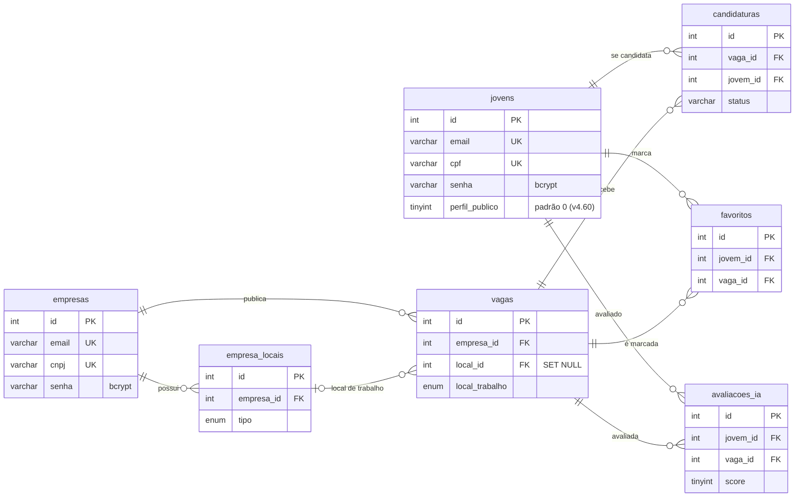
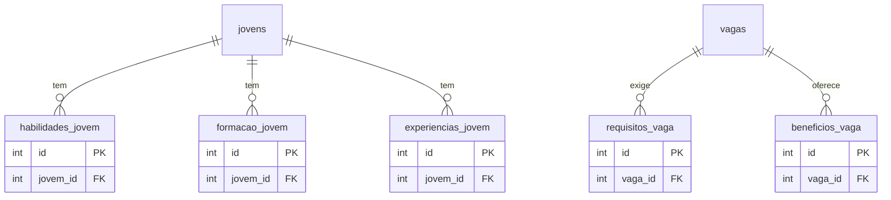
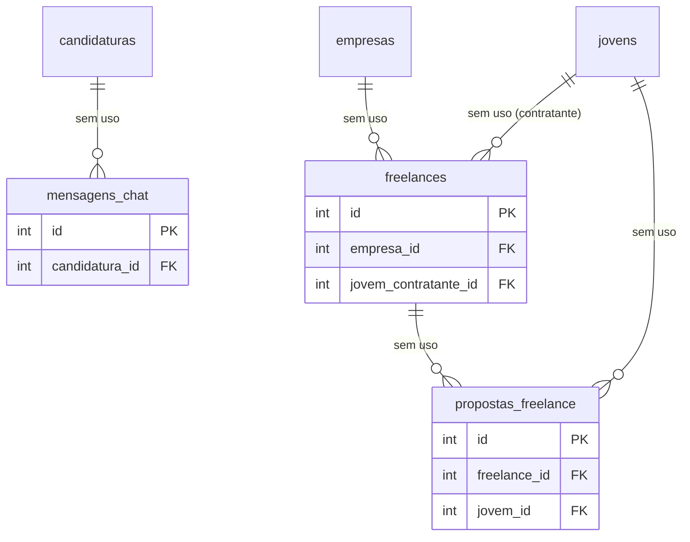
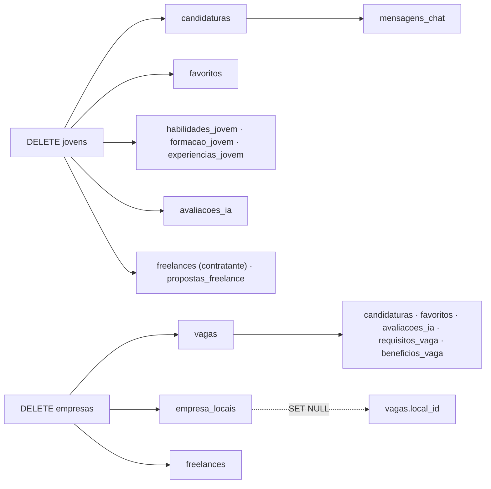

# Banco de dados

> Auditoria de 10/10/2026, versão **v4.00**. O dicionário de dados abaixo foi **extraído do
> `information_schema`** de um banco vazio criado a partir do `schema.sql` do projeto (49 comandos, 0 falhas)
> na réplica de desenvolvimento, que usa um servidor compatível com MySQL. Por isso os tipos aparecem sem a
> largura de exibição (`int` em vez de `INT(11)`); no MariaDB do XAMPP a forma exibida pode mudar, o tipo é o
> mesmo. **Nenhum banco real foi acessado ou alterado.** Valores dos dados de exemplo não são reproduzidos.

## Visão geral

- Motor **InnoDB**, charset **`utf8mb4`**, colação `utf8mb4_unicode_ci` [C: `schema.sql`].
- 15 tabelas: 12 usadas pelo código e 3 definidas mas **sem nenhum uso** (`mensagens_chat`, `freelances`,
  `propostas_freelance`) [C: busca textual em PHP, Python, JS e documentação].
- Todas as chaves estrangeiras usam `ON DELETE CASCADE`, exceto `vagas.local_id` (`SET NULL`) [C].
- Conexão: `includes/config.php` (`DB_HOST`, `DB_USER`, `DB_PASS`, `DB_NAME`, `DB_CHARSET`; padrões
  `localhost`, `root`, vazio, `jovemconnect`, `utf8mb4`).
- Colunas opcionais das migrações são detectadas em tempo de execução (`SHOW COLUMNS`/`SHOW TABLES`) por
  `includes/endereco_empresa.php`, `includes/locais.php` e `includes/termos.php` — o site funciona antes e
  depois das migrações [C][T].
- **Stage 7** (11/10/2026): a migração `2026-10-11_stage7_admin_moderacao.sql` cria 5 tabelas
  (`administradores`, `admin_tentativas`, `admin_auditoria`, `moderacao_itens`, `denuncias` — 20 no total) e
  acrescenta `conta_status`/`conta_status_em` em `jovens` e `empresas` e `moderacao_status`/`moderacao_motivo`/
  `moderacao_em` em `vagas`. É detectada por `jc_stage7_disponivel()` (`includes/esquema.php`, uma consulta ao
  `information_schema`). Ver [dicionário das tabelas da Stage 7](#tabelas-da-stage-7) e
  [ADMINISTRACAO_E_MODERACAO.md](ADMINISTRACAO_E_MODERACAO.md).

## Diagrama entidade-relacionamento

### Núcleo: contas, vagas e candidaturas



### Detalhes do perfil e da vaga



### Tabelas definidas no `schema.sql` e sem uso no código



Chaves únicas que garantem regras de negócio: `uq_candidatura (vaga_id, jovem_id)` — uma candidatura por
vaga; `uq_favorito (jovem_id, vaga_id)`; `uq_avaliacao (jovem_id, vaga_id)` — um cache por par;
`uq_email_jovem`, `uq_cpf`, `uq_email_empresa`, `uq_cnpj`.

## O que a exclusão apaga (cascata)



O PDF do currículo é apagado pelo PHP (`jovem/excluir_conta.php`), não pelo banco [C].

Stage 7: `DELETE jovens` apaga também as **denúncias** feitas por aquele jovem (`fk_den_jovem`, CASCADE).
`denuncias.vaga_id`, `moderacao_itens` e `admin_auditoria` **não têm chave estrangeira** para as contas e vagas,
de propósito: se a empresa excluir uma vaga ou o usuário excluir a conta, a denúncia, o item da fila e o histórico
administrativo continuam como evidência (nenhuma dessas tabelas guarda cópia do conteúdo: a fila guarda só o hash
do texto e o histórico só nomes de campos e códigos).

## Migrações, em ordem

| Ordem | Arquivo | O que faz | Detectada por |
|---|---|---|---|
| 1 | `migrations/2026-10-06_stage3_endereco_empresa.sql` | `empresas`: `cep`, `logradouro`, `numero`, `complemento`, `bairro` | `empresa_tem_endereco()` |
| 2 | `migrations/2026-10-08_stage51_locais_trabalho.sql` (requer a 1) | cria `empresa_locais`; `vagas.local_trabalho`, `vagas.local_id` + FK `fk_vaga_local` | `jc_locais_disponiveis()` |
| 3 | `migrations/2026-10-10_stage6_aceite_termos.sql` | `jovens` e `empresas`: `termos_versao`, `termos_aceitos_em` | `jc_termos_registrar()` |
| 4 | `migrations/2026-10-11_stage7_admin_moderacao.sql` (requer as anteriores) | cria `administradores` (vazia), `admin_tentativas`, `admin_auditoria`, `moderacao_itens`, `denuncias`; `jovens`/`empresas`: `conta_status` (padrão `ativa`), `conta_status_em`; `vagas`: `moderacao_status` (padrão `aprovada`), `moderacao_motivo`, `moderacao_em` + índice `idx_vaga_moderacao` | `jc_stage7_disponivel()` |

Todas são **aditivas** (só criam) e trazem a reversão em comentário. Como aplicar: [MIGRACOES.md](MIGRACOES.md).
**Não há tabela de controle de migrações**: antes de aplicar, rode `database/diagnostico_somente_leitura.sql`
(só consulta; mostra cada migração como `aplicada`, `PENDENTE` ou `PARCIAL`) ou confira na aba Estrutura.

Itens do `schema.sql` que **não têm migração própria** (só existem em bancos criados a partir de um
`schema.sql` recente) [C]: `candidaturas.etapa`, as tabelas `mensagens_chat`, `freelances`,
`propostas_freelance` e as colunas de verificação/recuperação (`email_verificado`, `codigo_*`, `expiracao_*`,
`telefone_verificado`), adicionadas por `ALTER TABLE` no meio do arquivo. Bancos antigos sem essas colunas de
verificação dariam erro nas páginas de verificação e recuperação [I].

## Cuidados com o `schema.sql`

- **Só instalação nova, em banco vazio.** Desde o Lote B da remediação (12/10/2026) o arquivo não tem nenhum
  comando `DROP`, `DELETE`, `TRUNCATE` ou `INSERT`: cria as 20 tabelas e não grava nenhum registro.
- **Trava "só banco vazio":** logo no início o arquivo confere se o banco escolhido tem alguma tabela. Se
  tiver (do JovemConnect ou de outro sistema), a importação para ali com o erro
  `#1146 … PARE - use num banco NOVO e VAZIO - nada foi alterado` e nenhum comando de estrutura é executado:
  cada `CREATE`/`ALTER` está dentro de `SET @jc_sql = IF(@jc_banco_vazio, "…")` e só roda (por
  `PREPARE`/`EXECUTE`) se o banco estava vazio no início — por isso nada muda nem em ferramentas que continuam
  depois de erros (`mysql --force`). O texto de cada comando é o mesmo das migrações. Testado na réplica em
  bancos parcialmente criados, de outro sistema, de versão anterior e completos, nos dois modos: nada mudou.
  Atualização de banco existente = [MIGRACOES.md](MIGRACOES.md).
- **Histórico (até a v4.50):** o arquivo começava com `DROP TABLE IF EXISTS` de 11 tabelas. Reimportado sobre
  um banco com dados, apagava 6 tabelas filhas (`avaliacoes_ia`, `beneficios_vaga`, `requisitos_vaga`,
  `experiencias_jovem`, `formacao_jovem`, `habilidades_jovem`) e parava ao tentar apagar `candidaturas`, porque
  `mensagens_chat` ainda tinha chave estrangeira para ela (SEG-11/AUD-002). Uma cópia antiga do arquivo
  continua perigosa.
- **Sem dados de exemplo:** as linhas de exemplo antigas (uma empresa com senha conhecida, um jovem com senha em
  texto puro e um registro com aparência de dados pessoais reais — SEG-20) foram retiradas. Para demonstração
  use `database/seed_demo.sql` ([SEED_DEMO.md](SEED_DEMO.md)). Bancos criados com o arquivo antigo podem ainda
  ter essas linhas: a Consulta 3 de `database/diagnostico_somente_leitura.sql` conta as duas contas de exemplo
  (e-mails `@teste.com`); o registro com aparência de dados reais (`jovens`, id 6 no arquivo antigo) e as linhas
  ligadas a ele precisam ser conferidos pelo proprietário.

## Observações de modelagem

| Item | Observação |
|---|---|
| `jovens.formacao` | O comentário do schema diz "texto legado", mas o cadastro e o perfil continuam gravando a formação principal nele [C]. |
| `jovens.curriculo` | Comentado como "Caminho do PDF gerado"; guarda o nome do arquivo enviado (`curriculo_{id}.pdf`) [C]. |
| `candidaturas.status` | `VARCHAR`; a lista válida (5 valores) está só no PHP (`Vagas/candidatos.php`) [C]. |
| `candidaturas.etapa` | ENUM nunca lido nem gravado pelo código [C]. |
| `vagas` | Sem coluna de status/encerramento [C]. A Stage 7 acrescentou `moderacao_status` (estado de **moderação**, separado dos dados da vaga), que não é um encerramento pela empresa. |
| `vagas.tipo_contrato`, `vagas.area` | Texto livre no banco; as opções vêm só do formulário [C]. |
| `avaliacoes_ia.analise` | Comentado como "Texto retornado pela IA"; normalmente é o texto padrão por faixa [C]. |
| `vagas.cep` | Comentado como "para cálculo de distância pela IA"; não há cálculo de distância [C]. |
| `habilidades_jovem` | Sem chave única: o `INSERT IGNORE` do perfil não evita repetição; quem evita é o SELECT anterior [C]. |
| Códigos `codigo_*` | Em texto puro (SEG-08). |

## Dicionário de dados

Coluna "Sensível": classificação desta auditoria (dado pessoal, segredo ou texto livre).
"Usada por": arquivos onde a busca encontrou SQL com a tabela; consultas com nome de tabela dinâmico
(`{$tabela}` = `jovens`/`empresas`) estão incluídas. A rastreabilidade por função está em
[MATRIZ_DE_DEPENDENCIAS.md](MATRIZ_DE_DEPENDENCIAS.md#arquivo--função--tabela).

### `jovens`

Conta do jovem (login, dados pessoais, formação principal, área de interesse, visibilidade, currículo, verificação e aceite dos termos).

| Coluna | Tipo | Nulo | Padrão | Chave | Extra | Comentário no schema | Sensível |
|---|---|---|---|---|---|---|---|
| `id` | `int` | não | — | PRI | auto_increment | — | — |
| `nome` | `varchar(100)` | não | — | — | — | — | dado pessoal |
| `email` | `varchar(100)` | não | — | UNI | — | — | dado pessoal |
| `senha` | `varchar(255)` | não | — | — | — | — | hash bcrypt |
| `cpf` | `varchar(14)` | não | — | UNI | — | — | dado pessoal |
| `data_nascimento` | `date` | sim | — | — | — | — | dado pessoal |
| `cidade` | `varchar(100)` | sim | — | — | — | — | dado pessoal |
| `estado` | `varchar(50)` | sim | — | — | — | — | — |
| `cep` | `varchar(9)` | sim | — | — | — | — | dado pessoal |
| `telefone` | `varchar(20)` | sim | — | — | — | — | dado pessoal |
| `escolaridade_status` | `enum('cursando','completo')` | não | `cursando` | — | — | — | — |
| `escolaridade_tipo` | `enum('regular','tecnico')` | não | `regular` | — | — | — | — |
| `escolaridade_curso` | `varchar(100)` | sim | — | — | — | Nome do curso técnico, se houver | — |
| `formacao` | `varchar(100)` | sim | — | — | — | Texto legado — usar formacao_jovem para novos registros | — |
| `clt` | `tinyint(1)` | não | `0` | — | — | 1 = já trabalhou em regime CLT | — |
| `resumo_profissional` | `text` | sim | — | — | — | — | texto livre do jovem |
| `area_interesse` | `varchar(100)` | sim | — | — | — | — | — |
| `perfil_publico` | `tinyint(1)` | não | `0` (antes da v4.60: `1`) | — | — | 1 = visível para empresas (só por escolha do jovem; padrão privado) | — |
| `curriculo` | `varchar(255)` | sim | — | — | — | Caminho do PDF gerado | aponta para PDF com dados pessoais; desde a v4.60 o nome tem uma parte aleatória (`curriculo_{id}_{16 hex}.pdf`) |
| `ultimo_login` | `datetime` | sim | — | — | — | — | — |
| `criado_em` | `timestamp` | não | `CURRENT_TIMESTAMP` | — | — | — | — |
| `atualizado_em` | `timestamp` | não | `CURRENT_TIMESTAMP` | — | on update CURRENT_TIMESTAMP | — | — |
| `email_verificado` | `tinyint(1)` | sim | `0` | — | — | — | — |
| `codigo_verificacao` | `varchar(6)` | sim | — | — | — | — | código em texto puro |
| `expiracao_codigo` | `datetime` | sim | — | — | — | — | — |
| `telefone_verificado` | `tinyint(1)` | sim | `0` | — | — | — | — |
| `codigo_telefone` | `varchar(6)` | sim | — | — | — | — | código em texto puro |
| `expiracao_telefone` | `datetime` | sim | — | — | — | — | — |
| `codigo_recuperacao` | `varchar(6)` | sim | — | — | — | — | código em texto puro |
| `expiracao_recuperacao` | `datetime` | sim | — | — | — | — | — |
| `termos_versao` | `varchar(20)` | sim | — | — | — | Versão dos Termos/Privacidade aceita no cadastro | — |
| `termos_aceitos_em` | `datetime` | sim | — | — | — | Quando a caixa de aceite foi marcada e enviada | — |

**Índices:** `PRIMARY` (único: id); `uq_cpf` (único: cpf); `uq_email_jovem` (único: email)

**Chaves estrangeiras:** nenhuma.

**Usada por (operações SQL encontradas no arquivo):** `IA/avaliar_ajax.php` (SELECT); `Vagas/avaliar.php` (SELECT); `Vagas/candidatos.php` (SELECT); `Vagas/curriculoIA.php` (SELECT/UPDATE); `dashboard/empresa.php` (SELECT); `includes/candidato.php` (SELECT); `includes/match.php` (SELECT); `includes/termos.php` (SHOW/UPDATE); `jovem/cadastro.php` (INSERT/SELECT); `jovem/excluir_conta.php` (DELETE/SELECT); `jovem/perfil.php` (SELECT/UPDATE); `jovem/processar_login.php` (SELECT/UPDATE); `recuperar_senha.php` (SELECT/UPDATE); `uploads/curriculos.php` (UPDATE); `uploads/ver_curriculo.php` (SELECT); `verificacoes/escolher_verificacao.php` (SELECT); `verificacoes/verificar_email.php` (SELECT/UPDATE); `verificacoes/verificar_telefone.php` (SELECT/UPDATE)

**Visibilidade do perfil (v4.60, SEG-03).** Contas novas nascem **privadas**: o cadastro grava
`perfil_publico = 0` explicitamente, então nenhuma migração é necessária — vale também em bancos criados com o
`schema.sql` antigo (padrão `1`). O jovem liga a visibilidade em "Configurações de Visibilidade", no perfil.
**Contas que já existem não foram alteradas.** Comandos opcionais, para o responsável decidir (faça antes o
backup verificado de [MIGRACOES.md](MIGRACOES.md)):

```sql
-- quantas contas estão visíveis hoje (só leitura)
SELECT COUNT(*) AS publicos FROM jovens WHERE perfil_publico = 1;
-- alinhar o padrão da coluna num banco antigo (não muda nenhuma conta)
ALTER TABLE jovens ALTER COLUMN perfil_publico SET DEFAULT 0;
-- tornar privadas TODAS as contas visíveis (decisão de produto: o banco não registra quem escolheu
-- ficar visível e quem só herdou o padrão antigo; avise os usuários: cada um pode religar no perfil)
UPDATE jovens SET perfil_publico = 0 WHERE perfil_publico = 1;
```

### `empresas`

Conta da empresa (login, CNPJ, área de atuação, endereço principal, verificação e aceite dos termos).

| Coluna | Tipo | Nulo | Padrão | Chave | Extra | Comentário no schema | Sensível |
|---|---|---|---|---|---|---|---|
| `id` | `int` | não | — | PRI | auto_increment | — | — |
| `nome_empresa` | `varchar(150)` | não | — | — | — | — | — |
| `email` | `varchar(100)` | não | — | UNI | — | — | contato |
| `senha` | `varchar(255)` | não | — | — | — | — | hash bcrypt |
| `cnpj` | `varchar(18)` | não | — | UNI | — | — | dado da empresa |
| `cidade` | `varchar(100)` | sim | — | — | — | — | — |
| `estado` | `varchar(50)` | sim | — | — | — | — | — |
| `telefone` | `varchar(20)` | sim | — | — | — | — | contato |
| `cep` | `varchar(9)` | sim | — | — | — | Somente dígitos | — |
| `logradouro` | `varchar(150)` | sim | — | — | — | — | — |
| `numero` | `varchar(10)` | sim | — | — | — | — | — |
| `complemento` | `varchar(100)` | sim | — | — | — | — | — |
| `bairro` | `varchar(100)` | sim | — | — | — | — | — |
| `area_atuacao` | `varchar(100)` | sim | — | — | — | — | — |
| `descricao` | `text` | sim | — | — | — | Missão e visão da empresa | — |
| `site_oficial` | `varchar(255)` | sim | — | — | — | — | — |
| `linkedin` | `varchar(255)` | sim | — | — | — | — | — |
| `perfil_verificado` | `tinyint(1)` | não | `0` | — | — | — | — |
| `criado_em` | `timestamp` | não | `CURRENT_TIMESTAMP` | — | — | — | — |
| `atualizado_em` | `timestamp` | não | `CURRENT_TIMESTAMP` | — | on update CURRENT_TIMESTAMP | — | — |
| `email_verificado` | `tinyint(1)` | sim | `0` | — | — | — | — |
| `codigo_verificacao` | `varchar(6)` | sim | — | — | — | — | código em texto puro |
| `expiracao_codigo` | `datetime` | sim | — | — | — | — | — |
| `telefone_verificado` | `tinyint(1)` | sim | `0` | — | — | — | — |
| `codigo_telefone` | `varchar(6)` | sim | — | — | — | — | código em texto puro |
| `expiracao_telefone` | `datetime` | sim | — | — | — | — | — |
| `codigo_recuperacao` | `varchar(6)` | sim | — | — | — | — | código em texto puro |
| `expiracao_recuperacao` | `datetime` | sim | — | — | — | — | — |
| `termos_versao` | `varchar(20)` | sim | — | — | — | Versão dos Termos/Privacidade aceita no cadastro | — |
| `termos_aceitos_em` | `datetime` | sim | — | — | — | Quando a caixa de aceite foi marcada e enviada | — |

**Índices:** `PRIMARY` (único: id); `uq_cnpj` (único: cnpj); `uq_email_empresa` (único: email)

**Chaves estrangeiras:** nenhuma.

**Usada por (operações SQL encontradas no arquivo):** `Vagas/candidatar.php` (SELECT); `Vagas/favoritos.php` (SELECT); `Vagas/listar.php` (SELECT); `candidaturas/minhas.php` (SELECT); `dashboard/empresa.php` (SELECT); `dashboard/jovem.php` (SELECT); `empresa/cadastro.php` (INSERT/SELECT); `empresa/excluir_conta.php` (DELETE); `empresa/perfil.php` (SELECT/UPDATE); `empresa/processar_login.php` (SELECT); `includes/endereco_empresa.php` (SELECT/SHOW); `includes/locais.php` (SELECT); `includes/termos.php` (SHOW/UPDATE); `recuperar_senha.php` (SELECT/UPDATE); `verificacoes/escolher_verificacao.php` (SELECT); `verificacoes/verificar_email.php` (SELECT/UPDATE); `verificacoes/verificar_telefone.php` (SELECT/UPDATE)

### `empresa_locais`

Outros locais de trabalho da empresa (escritório, filial, unidade, outro). Migração Stage 5.1.

| Coluna | Tipo | Nulo | Padrão | Chave | Extra | Comentário no schema | Sensível |
|---|---|---|---|---|---|---|---|
| `id` | `int` | não | — | PRI | auto_increment | — | — |
| `empresa_id` | `int` | não | — | MUL | — | — | — |
| `tipo` | `enum('escritorio','filial','unidade','outro')` | não | `escritorio` | — | — | — | — |
| `nome` | `varchar(100)` | sim | — | — | — | Ex: Unidade Augusta | — |
| `cep` | `varchar(9)` | sim | — | — | — | Somente dígitos | — |
| `logradouro` | `varchar(150)` | sim | — | — | — | — | — |
| `numero` | `varchar(10)` | sim | — | — | — | — | — |
| `complemento` | `varchar(100)` | sim | — | — | — | — | — |
| `bairro` | `varchar(100)` | sim | — | — | — | — | — |
| `cidade` | `varchar(100)` | sim | — | — | — | — | — |
| `estado` | `varchar(50)` | sim | — | — | — | — | — |
| `criado_em` | `timestamp` | não | `CURRENT_TIMESTAMP` | — | — | — | — |
| `atualizado_em` | `timestamp` | não | `CURRENT_TIMESTAMP` | — | on update CURRENT_TIMESTAMP | — | — |

**Índices:** `PRIMARY` (único: id); `idx_local_empresa` (não único: empresa_id)

**Chaves estrangeiras:** `empresa_id` → `empresas.id` (ON DELETE CASCADE)

**Usada por (operações SQL encontradas no arquivo):** `empresa/locais.php` (DELETE/SELECT/UPDATE); `includes/locais.php` (INSERT/SELECT/SHOW)

### `vagas`

Vagas publicadas pelas empresas, com local de trabalho efetivo.

| Coluna | Tipo | Nulo | Padrão | Chave | Extra | Comentário no schema | Sensível |
|---|---|---|---|---|---|---|---|
| `id` | `int` | não | — | PRI | auto_increment | — | — |
| `empresa_id` | `int` | não | — | MUL | — | — | — |
| `titulo` | `varchar(150)` | não | — | — | — | — | — |
| `descricao` | `text` | sim | — | — | — | — | — |
| `cidade` | `varchar(100)` | sim | — | MUL | — | — | — |
| `estado` | `varchar(50)` | sim | — | — | — | — | — |
| `cep` | `varchar(9)` | sim | — | — | — | Para cálculo de distância pela IA | — |
| `local_trabalho` | `enum('empresa','local')` | sim | — | — | — | empresa = endereço principal; local = vagas.local_id; NULL = vaga antiga | — |
| `local_id` | `int` | sim | — | MUL | — | — | — |
| `salario` | `varchar(50)` | sim | — | — | — | Mantido como VARCHAR (ex: 1.200,00 ou A combinar) | — |
| `tipo_contrato` | `varchar(50)` | sim | — | — | — | Ex: Jovem Aprendiz, Estágio | — |
| `carga_horaria` | `varchar(20)` | sim | — | — | — | Ex: 20h/semana | — |
| `area` | `varchar(100)` | sim | — | MUL | — | Ex: Administrativo, TI, Vendas | — |
| `criado_em` | `timestamp` | não | `CURRENT_TIMESTAMP` | — | — | — | — |
| `atualizado_em` | `timestamp` | não | `CURRENT_TIMESTAMP` | — | on update CURRENT_TIMESTAMP | — | — |

**Índices:** `PRIMARY` (único: id); `idx_vaga_area` (não único: area); `idx_vaga_cidade` (não único: cidade); `idx_vaga_empresa` (não único: empresa_id); `idx_vaga_local` (não único: local_id)

**Chaves estrangeiras:** `empresa_id` → `empresas.id` (ON DELETE CASCADE); `local_id` → `empresa_locais.id` (ON DELETE SET NULL)

**Usada por (operações SQL encontradas no arquivo):** `IA/avaliar_ajax.php` (SELECT); `Vagas/avaliar.php` (SELECT); `Vagas/candidatar.php` (SELECT); `Vagas/candidatos.php` (SELECT); `Vagas/criar.php` (INSERT); `Vagas/favoritar.php` (SELECT); `Vagas/favoritos.php` (SELECT); `Vagas/listar.php` (SELECT); `Vagas/minhas.php` (DELETE/SELECT); `candidaturas/minhas.php` (SELECT); `dashboard/empresa.php` (SELECT); `dashboard/jovem.php` (SELECT); `empresa/locais.php` (SELECT); `empresa/perfil.php` (SELECT); `includes/candidato.php` (SELECT); `includes/locais.php` (SELECT/SHOW/UPDATE); `includes/match.php` (SELECT)

### `requisitos_vaga`

Requisitos da vaga (um por linha; vêm do campo separado por vírgulas).

| Coluna | Tipo | Nulo | Padrão | Chave | Extra | Comentário no schema | Sensível |
|---|---|---|---|---|---|---|---|
| `id` | `int` | não | — | PRI | auto_increment | — | — |
| `vaga_id` | `int` | não | — | MUL | — | — | — |
| `requisito` | `varchar(150)` | não | — | — | — | — | — |

**Índices:** `PRIMARY` (único: id); `idx_req_vaga` (não único: vaga_id)

**Chaves estrangeiras:** `vaga_id` → `vagas.id` (ON DELETE CASCADE)

**Usada por (operações SQL encontradas no arquivo):** `Vagas/criar.php` (INSERT); `Vagas/listar.php` (SELECT); `includes/match.php` (SELECT)

### `beneficios_vaga`

Benefícios da vaga (um por linha).

| Coluna | Tipo | Nulo | Padrão | Chave | Extra | Comentário no schema | Sensível |
|---|---|---|---|---|---|---|---|
| `id` | `int` | não | — | PRI | auto_increment | — | — |
| `vaga_id` | `int` | não | — | MUL | — | — | — |
| `beneficio` | `varchar(100)` | não | — | — | — | — | — |

**Índices:** `PRIMARY` (único: id); `idx_ben_vaga` (não único: vaga_id)

**Chaves estrangeiras:** `vaga_id` → `vagas.id` (ON DELETE CASCADE)

**Usada por (operações SQL encontradas no arquivo):** `Vagas/criar.php` (INSERT); `Vagas/listar.php` (SELECT)

### `candidaturas`

Candidatura de um jovem a uma vaga e seu status.

| Coluna | Tipo | Nulo | Padrão | Chave | Extra | Comentário no schema | Sensível |
|---|---|---|---|---|---|---|---|
| `id` | `int` | não | — | PRI | auto_increment | — | — |
| `vaga_id` | `int` | não | — | MUL | — | — | — |
| `jovem_id` | `int` | não | — | MUL | — | — | — |
| `status` | `varchar(30)` | não | `Recebido` | — | — | Recebido / Visualizado / Em análise / Aprovado / Reprovado | — |
| `etapa` | `enum('candidatado','em_analise','aceito_chat','contratado','recusado')` | sim | `candidatado` | — | — | — | — |
| `criado_em` | `timestamp` | não | `CURRENT_TIMESTAMP` | — | — | — | — |

**Índices:** `PRIMARY` (único: id); `idx_cand_jovem` (não único: jovem_id); `uq_candidatura` (único: vaga_id,jovem_id)

**Chaves estrangeiras:** `jovem_id` → `jovens.id` (ON DELETE CASCADE); `vaga_id` → `vagas.id` (ON DELETE CASCADE)

**Usada por (operações SQL encontradas no arquivo):** `Vagas/candidatar.php` (INSERT/SELECT); `Vagas/candidatos.php` (SELECT/UPDATE); `Vagas/listar.php` (SELECT); `Vagas/minhas.php` (SELECT); `candidaturas/minhas.php` (SELECT); `dashboard/empresa.php` (SELECT); `includes/candidato.php` (SELECT)

### `favoritos`

Vagas marcadas com estrela pelo jovem.

| Coluna | Tipo | Nulo | Padrão | Chave | Extra | Comentário no schema | Sensível |
|---|---|---|---|---|---|---|---|
| `id` | `int` | não | — | PRI | auto_increment | — | — |
| `jovem_id` | `int` | não | — | MUL | — | — | — |
| `vaga_id` | `int` | não | — | MUL | — | — | — |
| `criado_em` | `timestamp` | não | `CURRENT_TIMESTAMP` | — | — | — | — |

**Índices:** `PRIMARY` (único: id); `idx_fav_vaga` (não único: vaga_id); `uq_favorito` (único: jovem_id,vaga_id)

**Chaves estrangeiras:** `jovem_id` → `jovens.id` (ON DELETE CASCADE); `vaga_id` → `vagas.id` (ON DELETE CASCADE)

**Usada por (operações SQL encontradas no arquivo):** `Vagas/favoritar.php` (DELETE/INSERT/SELECT); `Vagas/favoritos.php` (SELECT); `Vagas/listar.php` (SELECT)

### `habilidades_jovem`

Habilidades do jovem.

| Coluna | Tipo | Nulo | Padrão | Chave | Extra | Comentário no schema | Sensível |
|---|---|---|---|---|---|---|---|
| `id` | `int` | não | — | PRI | auto_increment | — | — |
| `jovem_id` | `int` | não | — | MUL | — | — | — |
| `habilidade` | `varchar(80)` | não | — | — | — | — | — |

**Índices:** `PRIMARY` (único: id); `idx_hab_jovem` (não único: jovem_id)

**Chaves estrangeiras:** `jovem_id` → `jovens.id` (ON DELETE CASCADE)

**Usada por (operações SQL encontradas no arquivo):** `IA/avaliar_ajax.php` (SELECT); `Vagas/curriculoIA.php` (SELECT); `includes/match.php` (SELECT); `jovem/cadastro.php` (INSERT); `jovem/perfil.php` (DELETE/INSERT/SELECT)

### `formacao_jovem`

Formações adicionais do jovem (a principal fica em `jovens`).

| Coluna | Tipo | Nulo | Padrão | Chave | Extra | Comentário no schema | Sensível |
|---|---|---|---|---|---|---|---|
| `id` | `int` | não | — | PRI | auto_increment | — | — |
| `jovem_id` | `int` | não | — | MUL | — | — | — |
| `titulo` | `varchar(150)` | não | — | — | — | Ex: Ensino Médio, Técnico em Adm | — |
| `instituicao` | `varchar(150)` | sim | — | — | — | — | — |
| `conclusao` | `varchar(20)` | sim | — | — | — | Ex: Dezembro/2025 ou Em andamento | — |
| `area` | `varchar(100)` | sim | — | — | — | Área do curso técnico | — |

**Índices:** `PRIMARY` (único: id); `idx_form_jovem` (não único: jovem_id)

**Chaves estrangeiras:** `jovem_id` → `jovens.id` (ON DELETE CASCADE)

**Usada por (operações SQL encontradas no arquivo):** `IA/avaliar_ajax.php` (SELECT); `Vagas/curriculoIA.php` (SELECT); `includes/match.php` (SELECT); `jovem/perfil.php` (DELETE/INSERT/SELECT)

### `experiencias_jovem`

Experiências do jovem.

| Coluna | Tipo | Nulo | Padrão | Chave | Extra | Comentário no schema | Sensível |
|---|---|---|---|---|---|---|---|
| `id` | `int` | não | — | PRI | auto_increment | — | — |
| `jovem_id` | `int` | não | — | MUL | — | — | — |
| `titulo` | `varchar(150)` | não | — | — | — | — | — |
| `local` | `varchar(150)` | sim | — | — | — | — | — |
| `periodo` | `varchar(50)` | sim | — | — | — | Ex: Jan/2024 – Mar/2024 | — |
| `descricao` | `text` | sim | — | — | — | — | texto livre do jovem |

**Índices:** `PRIMARY` (único: id); `idx_exp_jovem` (não único: jovem_id)

**Chaves estrangeiras:** `jovem_id` → `jovens.id` (ON DELETE CASCADE)

**Usada por (operações SQL encontradas no arquivo):** `includes/match.php` (SELECT); `jovem/perfil.php` (DELETE/INSERT/SELECT)

### `avaliacoes_ia`

Cache da nota do Match por par jovem × vaga.

| Coluna | Tipo | Nulo | Padrão | Chave | Extra | Comentário no schema | Sensível |
|---|---|---|---|---|---|---|---|
| `id` | `int` | não | — | PRI | auto_increment | — | — |
| `jovem_id` | `int` | não | — | MUL | — | — | — |
| `vaga_id` | `int` | não | — | MUL | — | — | — |
| `score` | `tinyint` | não | `0` | — | — | 0–100 | — |
| `analise` | `text` | sim | — | — | — | Texto retornado pela IA | — |
| `criado_em` | `timestamp` | não | `CURRENT_TIMESTAMP` | — | — | — | — |

**Índices:** `PRIMARY` (único: id); `idx_av_vaga` (não único: vaga_id); `uq_avaliacao` (único: jovem_id,vaga_id)

**Chaves estrangeiras:** `jovem_id` → `jovens.id` (ON DELETE CASCADE); `vaga_id` → `vagas.id` (ON DELETE CASCADE)

**Usada por (operações SQL encontradas no arquivo):** `IA/avaliar_ajax.php` (INSERT/SELECT/UPDATE (ON DUPLICATE KEY)); `Vagas/listar.php` (SELECT)

### `mensagens_chat`

**Não usada pelo código** (definida no `schema.sql`, sem nenhuma leitura/escrita).

| Coluna | Tipo | Nulo | Padrão | Chave | Extra | Comentário no schema | Sensível |
|---|---|---|---|---|---|---|---|
| `id` | `int` | não | — | PRI | auto_increment | — | — |
| `candidatura_id` | `int` | não | — | MUL | — | — | — |
| `remetente_tipo` | `enum('jovem','empresa')` | não | — | — | — | — | — |
| `remetente_id` | `int` | não | — | — | — | — | — |
| `mensagem` | `text` | não | — | — | — | — | — |
| `tipo_mensagem` | `enum('texto','card_endereco')` | sim | `texto` | — | — | — | — |
| `criado_em` | `timestamp` | sim | `CURRENT_TIMESTAMP` | — | — | — | — |

**Índices:** `PRIMARY` (único: id); `candidatura_id` (não único: candidatura_id)

**Chaves estrangeiras:** `candidatura_id` → `candidaturas.id` (ON DELETE CASCADE)

**Usada por:** nenhum arquivo do código (busca textual em PHP, Python e JS).

### `freelances`

**Não usada pelo código**.

| Coluna | Tipo | Nulo | Padrão | Chave | Extra | Comentário no schema | Sensível |
|---|---|---|---|---|---|---|---|
| `id` | `int` | não | — | PRI | auto_increment | — | — |
| `empresa_id` | `int` | sim | — | MUL | — | — | — |
| `jovem_contratante_id` | `int` | sim | — | MUL | — | — | — |
| `titulo` | `varchar(150)` | não | — | — | — | — | — |
| `descricao` | `text` | não | — | — | — | — | — |
| `categoria` | `varchar(50)` | não | — | — | — | — | — |
| `orcamento_maximo` | `decimal(10,2)` | não | — | — | — | — | — |
| `prazo_dias` | `int` | não | — | — | — | — | — |
| `status` | `enum('aberto','em_andamento','concluido','cancelado')` | sim | `aberto` | — | — | — | — |
| `criado_em` | `timestamp` | sim | `CURRENT_TIMESTAMP` | — | — | — | — |

**Índices:** `PRIMARY` (único: id); `empresa_id` (não único: empresa_id); `jovem_contratante_id` (não único: jovem_contratante_id)

**Chaves estrangeiras:** `empresa_id` → `empresas.id` (ON DELETE CASCADE); `jovem_contratante_id` → `jovens.id` (ON DELETE CASCADE)

**Usada por:** nenhum arquivo do código (busca textual em PHP, Python e JS).

### `propostas_freelance`

**Não usada pelo código**.

| Coluna | Tipo | Nulo | Padrão | Chave | Extra | Comentário no schema | Sensível |
|---|---|---|---|---|---|---|---|
| `id` | `int` | não | — | PRI | auto_increment | — | — |
| `freelance_id` | `int` | não | — | MUL | — | — | — |
| `jovem_id` | `int` | não | — | MUL | — | — | — |
| `valor_proposto` | `decimal(10,2)` | não | — | — | — | — | — |
| `taxa_percentual` | `decimal(4,2)` | não | — | — | — | — | — |
| `taxa_valor` | `decimal(10,2)` | não | — | — | — | — | — |
| `valor_liquido` | `decimal(10,2)` | não | — | — | — | — | — |
| `prazo_dias` | `int` | não | — | — | — | — | — |
| `mensagem` | `text` | não | — | — | — | — | — |
| `status` | `enum('pendente','aceita','recusada')` | sim | `pendente` | — | — | — | — |
| `criado_em` | `timestamp` | sim | `CURRENT_TIMESTAMP` | — | — | — | — |

**Índices:** `PRIMARY` (único: id); `freelance_id` (não único: freelance_id); `jovem_id` (não único: jovem_id)

**Chaves estrangeiras:** `freelance_id` → `freelances.id` (ON DELETE CASCADE); `jovem_id` → `jovens.id` (ON DELETE CASCADE)

**Usada por:** nenhum arquivo do código (busca textual em PHP, Python e JS).

## Tabelas da Stage 7

Fonte: `migrations/2026-10-11_stage7_admin_moderacao.sql` (o mesmo bloco está no fim do `schema.sql`).
Todas InnoDB, `utf8mb4_unicode_ci`.

### `administradores`

Contas da Central administrativa, **separadas** de jovens e empresas. Nasce vazia; só a linha de comando
(`scripts/admin.php`) insere.

| Coluna | Tipo | Nulo | Padrão | Chave | Comentário | Sensível |
|---|---|---|---|---|---|---|
| `id` | `int` | não | — | PRI (auto) | — | — |
| `email` | `varchar(100)` | não | — | UNI `uq_admin_email` | — | dado pessoal |
| `nome` | `varchar(100)` | não | — | — | — | dado pessoal |
| `senha_hash` | `varchar(255)` | não | — | — | `password_hash()`; a senha nunca é gravada | segredo (hash) |
| `papel` | `varchar(30)` | não | **sem padrão** | — | definido só pelo provisionamento | — |
| `ativo` | `tinyint(1)` | não | `0` | — | 0 até o provisionamento ativar | — |
| `mfa_segredo` | `varchar(64)` | sim | — | — | segredo TOTP (base32); NULL = sem MFA | **segredo** |
| `mfa_ultimo_passo` | `bigint` | sim | — | — | último intervalo TOTP aceito (anti-reuso) | — |
| `sessao_versao` | `int` | não | `1` | — | muda ao trocar senha/MFA ou desativar: derruba sessões | — |
| `ultimo_login_em`, `senha_alterada_em` | `datetime` | sim | — | — | — | — |
| `criado_em` | `timestamp` | não | `CURRENT_TIMESTAMP` | — | — | — |

### `admin_tentativas`

Tentativas de login na Central, para o limite de tentativas. **Só hashes**: não é possível saber quem tentou.

| Coluna | Tipo | Nulo | Padrão | Chave | Comentário |
|---|---|---|---|---|---|
| `id` | `bigint` | não | — | PRI (auto) | — |
| `chave_hash` | `char(64)` | não | — | `idx_tent_chave` (+ `criado_em`) | SHA-256 do e-mail digitado |
| `ip_hash` | `char(64)` | não | — | `idx_tent_ip` (+ `criado_em`) | SHA-256 do IP |
| `sucesso` | `tinyint(1)` | não | `0` | — | — |
| `criado_em` | `datetime` | não | — | — | relógio do banco |

### `admin_auditoria`

Histórico das ações administrativas, **somente inclusão**, encadeado por hash.

| Coluna | Tipo | Nulo | Chave | Comentário |
|---|---|---|---|---|
| `id` | `bigint` | não | PRI (auto) | — |
| `criado_em` | `datetime` | não | `idx_aud_admin`, `idx_aud_acao` | relógio do banco |
| `admin_id` | `int` | sim | `idx_aud_admin` | NULL = linha de comando ou tentativa sem login |
| `acao` | `varchar(60)` | não | `idx_aud_acao` | ex.: `conta.suspensa`, `vaga.moderada`, `cli.admin_criado` |
| `recurso_tipo`, `recurso_id` | `varchar(30)`, `int` | sim | `idx_aud_recurso` | jovem, empresa, vaga, moderacao_item, administrador |
| `resultado` | `varchar(20)` | não | — | sucesso, falha, negado |
| `motivo_codigo` | `varchar(60)` | sim | — | código do motivo |
| `justificativa` | `varchar(500)` | sim | — | texto do administrador, com e-mails e números longos mascarados |
| `campos` | `varchar(300)` | sim | — | **nomes** dos campos alterados (nunca os valores) |
| `req_id` | `varchar(32)` | sim | — | correlação com `logs/app.log` e `logs/seguranca.log` |
| `ip_anon` | `varchar(45)` | sim | — | IP com o último bloco zerado; `cli` na linha de comando |
| `hash_anterior`, `hash` | `char(64)` | não | — | SHA-256 do registro anterior / deste registro |

Sem chave estrangeira (sobrevive à exclusão de contas e vagas). Recomendação: o usuário do banco do site com
só `SELECT, INSERT` nesta tabela.

### `moderacao_itens`

Fila de moderação. **Não copia o texto avaliado** (só o hash).

| Coluna | Tipo | Nulo | Padrão | Comentário |
|---|---|---|---|---|
| `id` | `int` | não | — | PRI (auto) |
| `recurso_tipo`, `recurso_id` | `varchar(20)`, `int` | não | — | vaga, jovem, empresa (`idx_mod_recurso`) |
| `campo` | `varchar(40)` | não | — | chave do mapa de validação (ex.: `vaga.descricao`) ou `denuncia` |
| `autor_tipo`, `autor_id` | `varchar(10)`, `int` | sim | — | quem escreveu o conteúdo |
| `origem` | `varchar(20)` | não | — | `regra` ou `denuncia` |
| `regras` | `varchar(255)` | sim | — | códigos das regras que sinalizaram |
| `risco` | `enum('baixo','medio','alto')` | não | — | — |
| `estado` | `enum('pendente','resolvido')` | não | `pendente` | `idx_mod_fila` (+ risco, criado_em) |
| `decisao`, `justificativa`, `decidido_por`, `decidido_em` | — | sim | — | preenchidos na decisão |
| `conteudo_hash` | `char(64)` | sim | — | SHA-256 do texto avaliado |
| `ocorrencias` | `int` | não | `1` | soma quando o mesmo recurso+campo+origem é sinalizado de novo |
| `criado_em`, `atualizado_em` | `timestamp` | não | `CURRENT_TIMESTAMP` | — |

### `denuncias`

Denúncias de vagas feitas por jovens.

| Coluna | Tipo | Nulo | Chave | Comentário |
|---|---|---|---|---|
| `id` | `int` | não | PRI (auto) | — |
| `vaga_id` | `int` | não | UNI `uq_denuncia` (+ jovem_id) | **sem FK**: a denúncia sobrevive à exclusão da vaga |
| `jovem_id` | `int` | não | `idx_den_jovem`; FK → `jovens.id` CASCADE | — |
| `motivo` | `varchar(30)` | não | — | golpe, pagamento, dados_pessoais, discriminacao, ofensivo, enganosa, outro |
| `detalhe` | `varchar(500)` | sim | — | texto opcional do jovem (validado) — dado do denunciante |
| `item_id` | `int` | sim | — | item da fila |
| `criado_em` | `timestamp` | não | — | `CURRENT_TIMESTAMP` |

### Colunas novas em tabelas existentes

| Tabela | Coluna | Tipo | Padrão | Comentário |
|---|---|---|---|---|
| `jovens`, `empresas` | `conta_status` | `enum('ativa','suspensa')` | `ativa` | suspensa = sem acesso, decidido pela administração |
| `jovens`, `empresas` | `conta_status_em` | `datetime` | NULL | última mudança do estado |
| `vagas` | `moderacao_status` | `enum('aprovada','pendente','sinalizada','rejeitada','suspensa')` | `aprovada` | aprovada/sinalizada = visível; as demais = oculta para os jovens (`idx_vaga_moderacao`) |
| `vagas` | `moderacao_motivo` | `varchar(60)` | NULL | código do motivo mostrado à empresa |
| `vagas` | `moderacao_em` | `datetime` | NULL | última decisão de moderação |
