# Fluxos e fluxogramas

> Auditoria de 10/10/2026, versão **v4.00**. Os diagramas seguem os caminhos reais do código (arquivos,
> funções, tabelas e parâmetros com os nomes encontrados). **[C]** confirmado no código · **[T]** verificado
> por teste na réplica · **[I]** inferido. Fluxos que **não existem** estão registrados como ausentes, sem
> diagrama fictício. Cada fluxo responde a 10 perguntas: (1) evento, (2) quem recebe, (3) validações,
> (4) permissões, (5) funções/serviços, (6) banco, (7) respostas, (8) erros, (9) falha de dependência,
> (10) estado final.

## Sumário

- [F-00 — Fluxograma mestre](#f-00--fluxograma-mestre)
- [F-01 — Entrada no site e navegação pública](#f-01--entrada-no-site-e-navegação-pública)
- [F-02 — Cadastro de jovem](#f-02--cadastro-de-jovem)
- [F-03 — Cadastro de empresa](#f-03--cadastro-de-empresa)
- [F-04 — Login, logout, verificação e recuperação de acesso](#f-04--login-logout-verificação-e-recuperação-de-acesso)
- [F-05 — Autenticação e controle de permissões](#f-05--autenticação-e-controle-de-permissões)
- [F-06 — Edição de perfil](#f-06--edição-de-perfil)
- [F-07 — Criação, publicação e remoção de vagas](#f-07--criação-publicação-e-remoção-de-vagas)
- [F-08 — Visualização e pesquisa de vagas](#f-08--visualização-e-pesquisa-de-vagas)
- [F-09 — Candidatura a uma vaga](#f-09--candidatura-a-uma-vaga)
- [F-10 — Visualização e gerenciamento de candidaturas](#f-10--visualização-e-gerenciamento-de-candidaturas)
- [F-11 — Acesso de empresas aos perfis de candidatos](#f-11--acesso-de-empresas-aos-perfis-de-candidatos)
- [F-12 — Match Inteligente](#f-12--match-inteligente)
- [F-13 — Fluxo interno da análise de compatibilidade](#f-13--fluxo-interno-da-análise-de-compatibilidade)
- [F-14 — Integração com o serviço de IA](#f-14--integração-com-o-serviço-de-ia)
- [F-15 — Assistente](#f-15--assistente)
- [F-16 — Aceite dos termos e da política de privacidade](#f-16--aceite-dos-termos-e-da-política-de-privacidade)
- [F-17 — Exclusão de contas](#f-17--exclusão-de-contas)
- [F-18 — Falhas e indisponibilidade de serviços externos](#f-18--falhas-e-indisponibilidade-de-serviços-externos)

---

## F-00 — Fluxograma mestre

Jornada de ponta a ponta, concisa. Os processos complexos têm diagrama próprio (indicado entre parênteses).

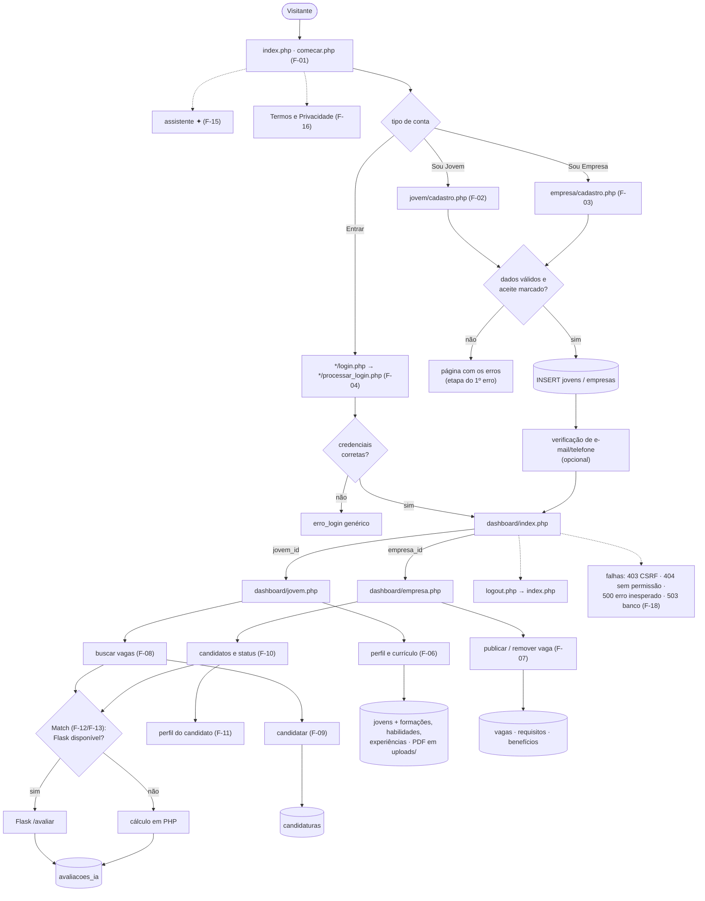

---

## F-01 — Entrada no site e navegação pública

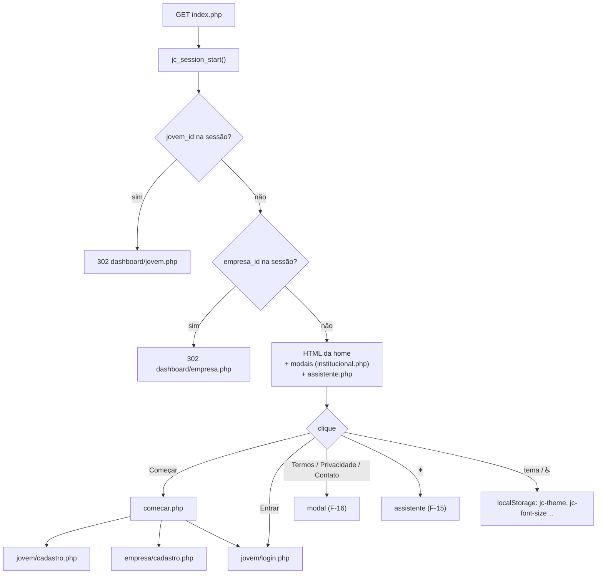

| # | Resposta |
|---|---|
| 1 | Visitante abre `index.php`, `comecar.php` ou `documentos.php`. |
| 2 | `index.php` e `comecar.php` (sessão via `jc_session_start`); `documentos.php` não usa sessão. |
| 3 | `documentos.php?doc=` só aceita `termos`/`privacidade` (inválido → `termos`). |
| 4 | Usuário logado é redirecionado ao painel do seu tipo. |
| 5 | `includes/institucional.php` (modais), `includes/assistente.php` (chat, acessibilidade), `includes/documentos.php`. |
| 6 | Nenhuma. |
| 7 | HTML; 302 para painéis; aviso JS em `?conta=excluida`. |
| 8 | Nenhum erro de servidor esperado. |
| 9 | Sem JavaScript os modais da home não abrem; com `localStorage` bloqueado o script final do `index.php` para antes do "revelar ao rolar" e partes da página podem ficar invisíveis [I]; sem Google Fonts, fonte do sistema. |
| 10 | Nada gravado no servidor; preferências de tema/acessibilidade no navegador. |

---

## F-02 — Cadastro de jovem

**No navegador**

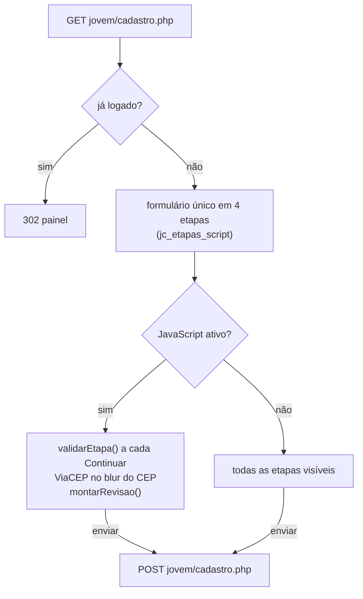

**No servidor** — o envio do formulário chega por POST em `jovem/cadastro.php`:

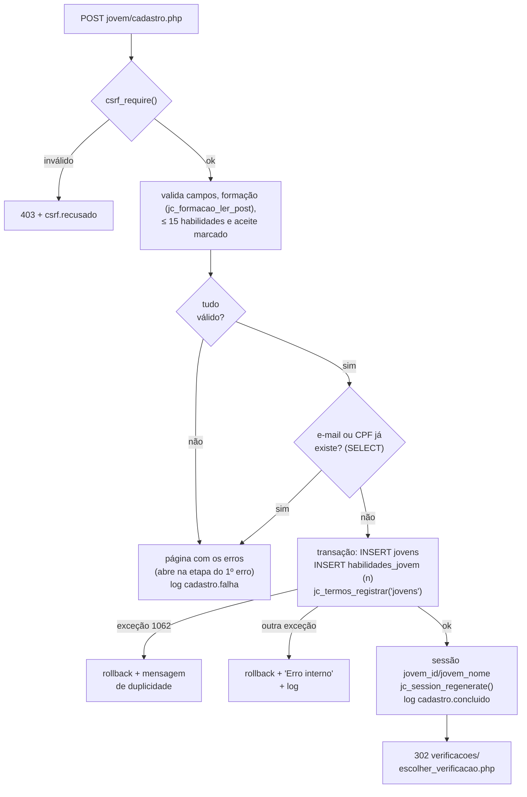

| # | Resposta |
|---|---|
| 1 | "Sou Jovem" em `comecar.php` ou link direto. |
| 2 | `jovem/cadastro.php` (GET e POST). |
| 3 | Navegador: obrigatórios, CPF 11 dígitos, e-mail, senha ≥ 8 e confirmação. Servidor: tudo de novo + formação estruturada, até 15 habilidades, resumo ≤ 1.000, cidade "Cidade - UF", aceite. |
| 4 | Só visitante (logado → painel). |
| 5 | `csrf_require`, `jc_formacao_ler_post`, `jc_termos_registrar`, `jc_session_regenerate`, `jc_log`; ViaCEP no navegador. |
| 6 | SELECT `jovens` (duplicidade, CPF com e sem máscara); transação com INSERT `jovens` + `habilidades_jovem` + UPDATE do aceite. |
| 7 | 302 para a verificação; ou a página com erros (senhas não são repreenchidas). |
| 8 | 403 CSRF; duplicidade (1062); erro interno com rollback. |
| 9 | ViaCEP fora → cidade digitada à mão; sem a migração de termos → conta criada sem registro do aceite. |
| 10 | Conta com `perfil_publico = 0` (padrão desde a v4.60; antes, `1`), `email_verificado = 0`, sessão aberta. [T: suíte cadastro 50/50, sobre a versão anterior] |

---

## F-03 — Cadastro de empresa

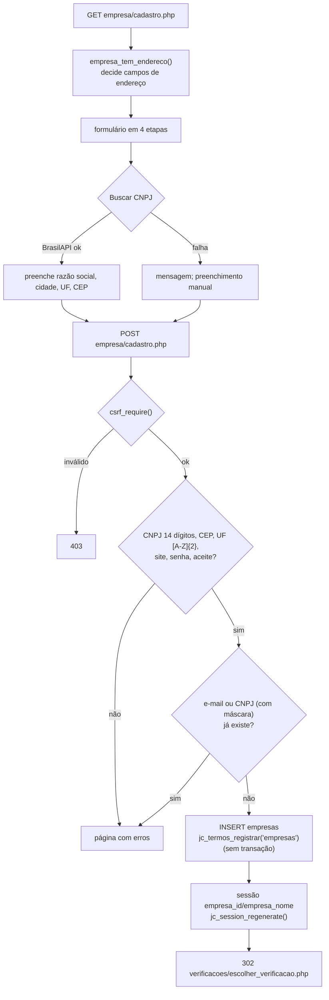

| # | Resposta |
|---|---|
| 1 | "Sou Empresa". |
| 2 | `empresa/cadastro.php`. |
| 3 | CNPJ, CEP (8 dígitos), UF, site (com `https://` só para validar), senha, aceite; duplicidade de e-mail/CNPJ. |
| 4 | Só visitante. |
| 5 | `empresa_tem_endereco`, `jc_termos_registrar`, `jc_session_regenerate`; BrasilAPI e ViaCEP no navegador. |
| 6 | `SHOW COLUMNS empresas`; SELECT; INSERT `empresas` (14 colunas com a migração de endereço, 9 sem); UPDATE do aceite. |
| 7 | 302 para a verificação ou página com erros. |
| 8 | 403; 1062; erro interno. Sem transação: falha no aceite após o INSERT deixa a conta criada [I]. |
| 9 | BrasilAPI/ViaCEP fora → manual. |
| 10 | Conta da empresa e sessão aberta. [T: suíte cadastro] |

---

## F-04 — Login, logout, verificação e recuperação de acesso

### Login e logout

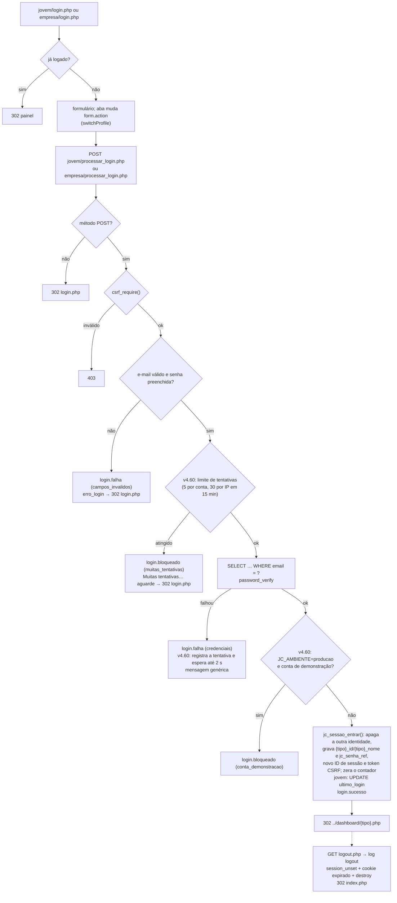

### Verificação de e-mail e telefone (opcional)

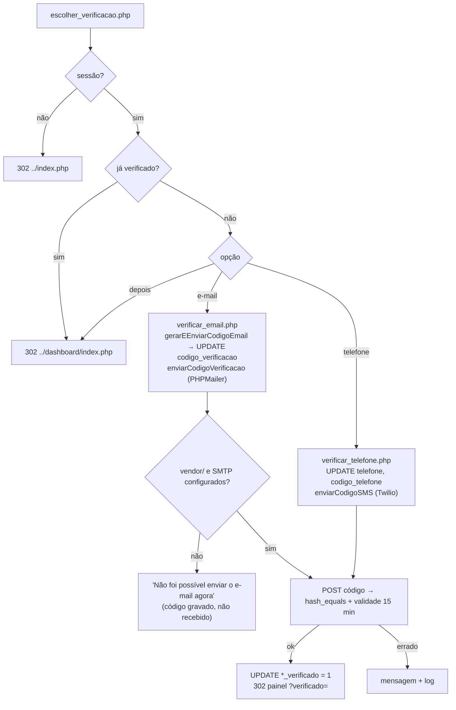

### Recuperação de senha (com a falha SEG-01)

> A falha SEG-01 foi **corrigida no Lote A** (12/10/2026): a autorização fica presa à conta do pedido e o código é
> de uso único. Na v4.60 entraram o intervalo e o teto de pedidos de código (resposta igual, sem revelar contas)
> e o cancelamento do código depois de 5 erros. O diagrama abaixo registra a versão v4.00, com a falha.

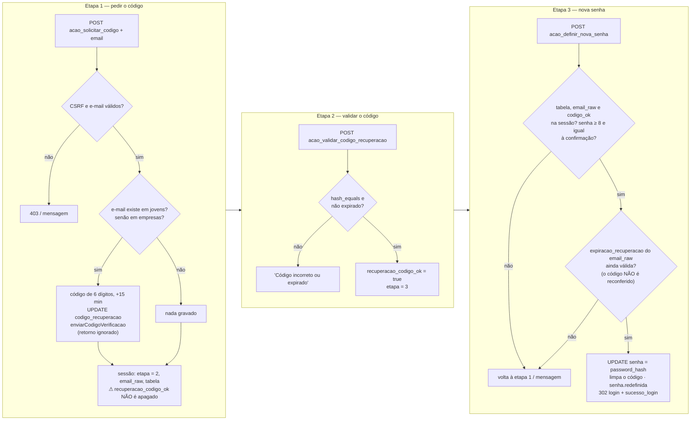

| # | Login/logout | Verificação | Recuperação |
|---|---|---|---|
| 1 | envio do formulário de login; clique em "Sair" | após cadastro ou pelo link do painel | link "Esqueceu a senha?" |
| 2 | `*/processar_login.php`; `logout.php` | `verificacoes/*.php` | `recuperar_senha.php` (3 etapas no mesmo arquivo) |
| 3 | CSRF, e-mail válido, senha preenchida, `password_verify` | CSRF, `hash_equals`, validade, `normalizarTelefoneE164` | CSRF, e-mail, `hash_equals`, validade, senha ≥ 8 |
| 4 | visitante; logout para qualquer um (GET, sem CSRF) | conta da sessão | qualquer pessoa (via sessão) |
| 5 | `jc_session_regenerate`, `jc_log_seguranca` | `gerarEEnviarCodigoEmail`, `enviarCodigoVerificacao`, `enviarCodigoSMS` | `enviarCodigoVerificacao`, `mascararEmail` |
| 6 | SELECT `jovens`/`empresas`; UPDATE `jovens.ultimo_login` | UPDATE `codigo_*`, `expiracao_*`, `*_verificado`, `telefone` | UPDATE `codigo_recuperacao`, `expiracao_recuperacao`, `senha` |
| 7 | 302 painel / login com `erro_login` | HTML com mensagens; 302 painel `?verificado=` | HTML da etapa; 302 login com `sucesso_login` |
| 8 | 403, credenciais inválidas, 500 | código errado/expirado, 403 | código errado/expirado, 403 |
| 9 | banco fora → 503 | **sem `vendor/` nada é enviado** | sem `vendor/`, tela diz "Mandamos um código" mas nada foi enviado |
| 10 | sessão do tipo autenticado / sessão destruída | `*_verificado = 1` (não libera nada a mais) | senha trocada; sessões abertas continuam válidas |

[T: login/logout em S3 regressão e S4 navegação; recuperação: SEG-01 em `t_doc.py` comprovou a falha.]

---

## F-05 — Autenticação e controle de permissões

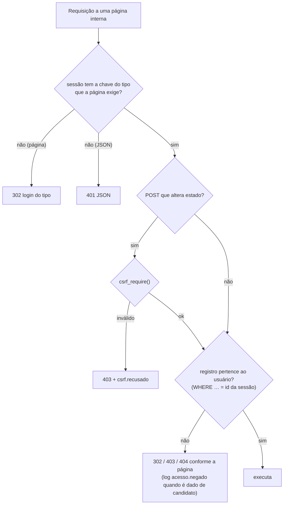

| # | Resposta |
|---|---|
| 1 | Qualquer acesso a páginas de `jovem/`, `empresa/`, `Vagas/`, `dashboard/`, `uploads/`, `IA/`. |
| 2 | A própria página (não há middleware; `verificar_autenticacao()` não é usada). |
| 3 | Presença de `jovem_id`/`empresa_id`; parâmetros inteiros (`intval`/`FILTER_VALIDATE_INT`). |
| 4 | Tipo de usuário; dono (`empresa_id`/`jovem_id` da sessão no `WHERE`); `jc_empresa_acesso_candidato` para dados de jovens. |
| 5 | `jc_session_start`, `csrf_require`, `jc_log_seguranca`. |
| 6 | Consultas com o ID da sessão. |
| 7 | 302 para login/painel, 401/403/404, ou a resposta normal. |
| 8 | Ver acima. |
| 9 | Banco fora → 503. |
| 10 | Acesso concedido apenas ao que é do usuário. [T: S3 regressão, perfil 36/36] |

Limitações: a verificação de e-mail não bloqueia nada; uma sessão pode ter os dois tipos (SEG-13); não há expiração por inatividade.

---

## F-06 — Edição de perfil

### Jovem — `jovem/perfil.php` e `uploads/curriculos.php`

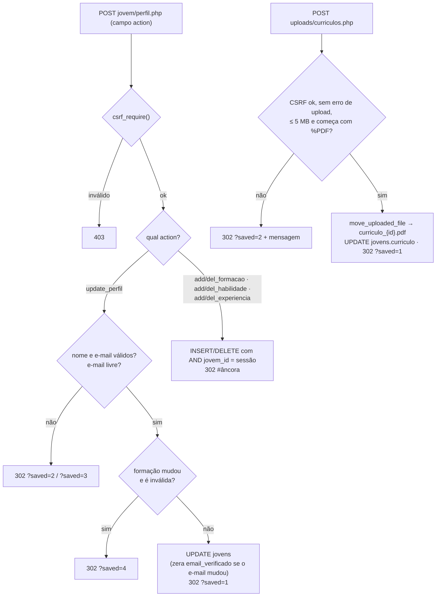

### Empresa — `empresa/perfil.php` e `empresa/locais.php`

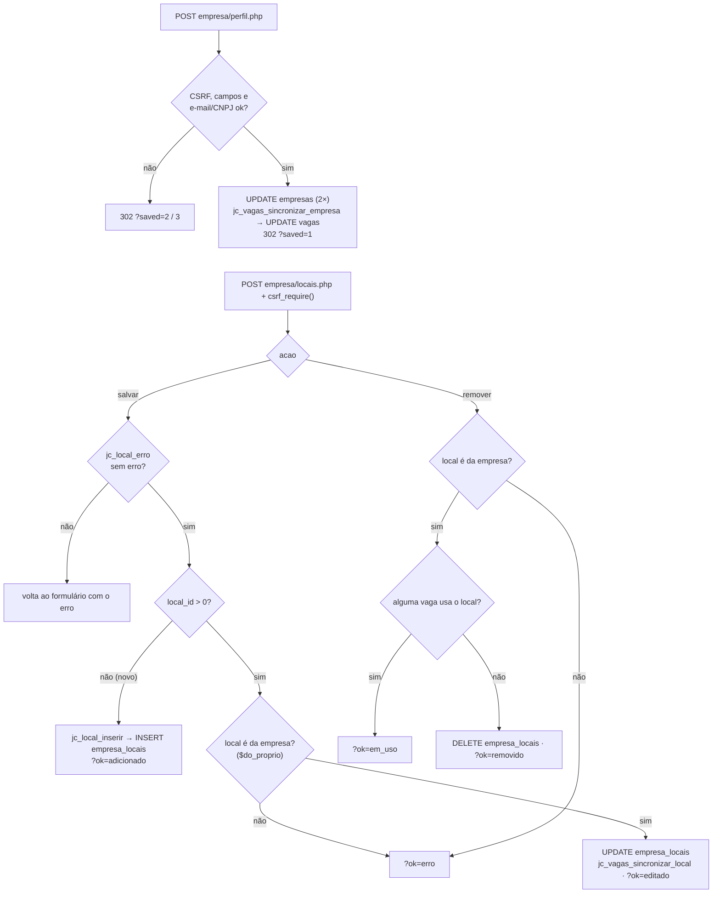

| # | Resposta |
|---|---|
| 1 | Botões "Salvar…", "+", "Remover", envio de PDF, formulário de locais. |
| 2 | `jovem/perfil.php`, `uploads/curriculos.php`, `empresa/perfil.php`, `empresa/locais.php`. |
| 3 | Nome/e-mail, unicidade de e-mail/CNPJ, formação (`jc_formacao_inalterado`/`jc_formacao_ler_post`), ano `(19\|20)\d{2}`, habilidade ≤ 80, PDF ≤ 5 MB com `%PDF`, `jc_local_erro`. |
| 4 | Somente o dono (ID da sessão); locais com `$do_proprio`. |
| 5 | `jc_formacao_*`, `jc_vagas_sincronizar_empresa`, `jc_vagas_sincronizar_local`, `jc_local_inserir`, `jc_locais_disponiveis`. |
| 6 | UPDATE `jovens`/`empresas`; INSERT/DELETE `formacao_jovem`, `habilidades_jovem`, `experiencias_jovem`; INSERT/UPDATE/DELETE `empresa_locais`; UPDATE `vagas`. |
| 7 | 302 com `?saved=1..4`, `?ok=…`, toasts. |
| 8 | 403 CSRF; duplicidade por corrida vira 500 (sem `catch` do 1062); `type="url"` no site pode impedir o envio do formulário da empresa. |
| 9 | Sem a migração de locais, `empresa/locais.php` mostra "ainda não estão disponíveis"; PDF maior que `post_max_size` → 403 do CSRF [I]. |
| 10 | Perfil atualizado; vagas "no endereço da empresa" acompanham o endereço. [T: formação 46/46, perfil 36/36, S5.1 90/90, S3 parte B] |

---

## F-07 — Criação, publicação e remoção de vagas

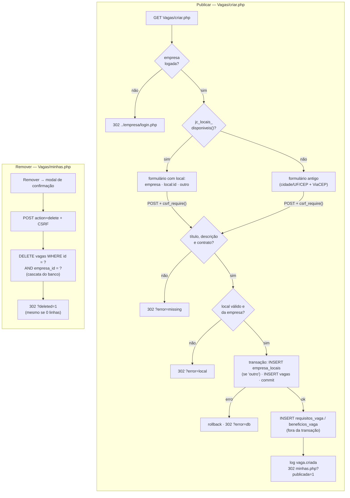

| # | Resposta |
|---|---|
| 1 | "Criar Vaga" / "Remover". |
| 2 | `Vagas/criar.php`; `Vagas/minhas.php`. |
| 3 | 3 obrigatórios; local (`jc_local_erro`); **sem** lista branca de contrato/área nem limite de tamanho no servidor (SEG-19). |
| 4 | Empresa; local e vaga precisam ser da empresa. |
| 5 | `jc_locais_disponiveis`, `jc_local_erro`, `jc_local_inserir`, `jc_log`. |
| 6 | INSERT `vagas`, `empresa_locais`, `requisitos_vaga`, `beneficios_vaga`; DELETE `vagas` com cascata. |
| 7 | 302 + toasts "Vaga publicada!" / "Vaga removida com sucesso.". |
| 8 | `?error=missing/local/db`; 403. |
| 9 | ViaCEP fora (modo antigo) → preenchimento manual. |
| 10 | Vaga visível para todos os jovens; remoção apaga o histórico. [T: S3 regressão, S5.1] |

**Ausentes:** edição de vaga, pausa, encerramento e expiração — não há código nem coluna de status (não há
diagrama para esses fluxos).

---

## F-08 — Visualização e pesquisa de vagas

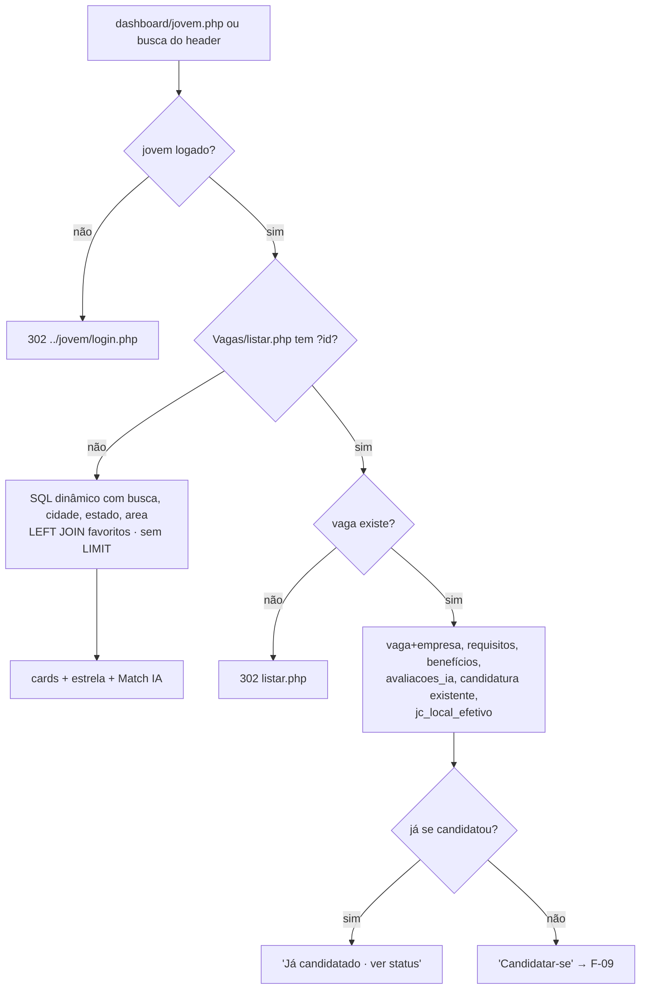

| # | Resposta |
|---|---|
| 1 | Painel, busca, clique num card. |
| 2 | `Vagas/listar.php`, `dashboard/jovem.php`. |
| 3 | `trim`, UF maiúscula, `intval(id)`, `voltar` em lista fixa. |
| 4 | Somente jovem (empresas não usam esta página). |
| 5 | `jc_local_efetivo`; `fetch` para `favoritar.php` e `avaliar_ajax.php`. |
| 6 | SELECT `vagas`, `empresas`, `favoritos`, `requisitos_vaga`, `beneficios_vaga`, `avaliacoes_ia`, `candidaturas`, `empresa_locais`. |
| 7 | HTML. |
| 8 | Vaga inexistente → listagem; erro de banco → 500. |
| 9 | Sem a migração de locais, usa cidade/UF da vaga/empresa. |
| 10 | Nada alterado. Limitações: filtros de chips descartam cidade/UF; sem paginação. [T: S3, S4 navegação] |

---

## F-09 — Candidatura a uma vaga

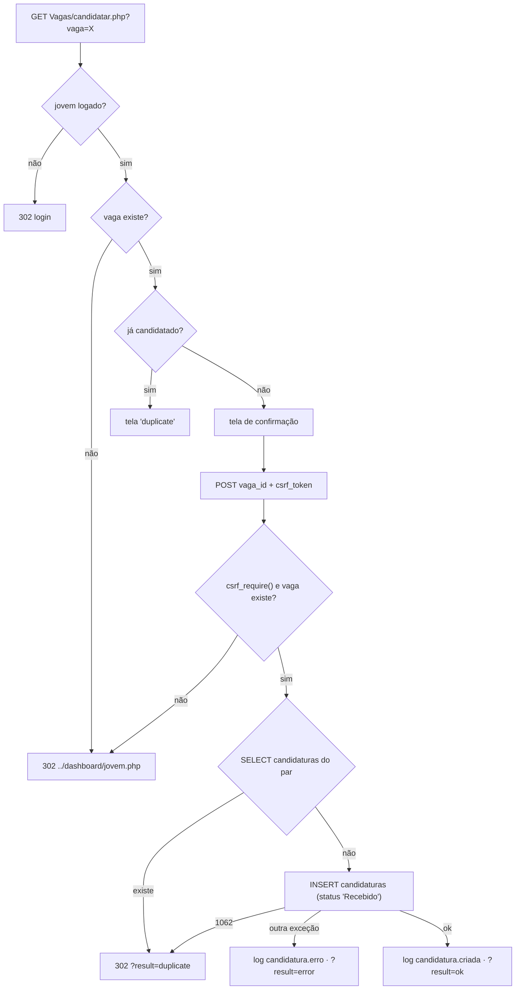

| # | Resposta |
|---|---|
| 1 | "Candidatar-se" nos detalhes ou nos favoritos. |
| 2 | `Vagas/candidatar.php`. |
| 3 | CSRF, `vaga_id` > 0, vaga existe, duplicidade (SELECT + `uq_candidatura`). |
| 4 | Jovem (o ID vem da sessão). |
| 5 | `csrf_require`, `jc_log`. |
| 6 | SELECT `vagas`, `empresas`, `candidaturas`; INSERT `candidaturas`. |
| 7 | 302 para `?result=ok|duplicate|error` (PRG). |
| 8 | 403; duplicidade; erro. `?result=ok` pode ser forjado na URL (só visual). |
| 9 | Banco fora → 503. |
| 10 | Candidatura "Recebido", visível ao jovem e à empresa; **nenhuma notificação**. [T: S3 regressão] |

---

## F-10 — Visualização e gerenciamento de candidaturas

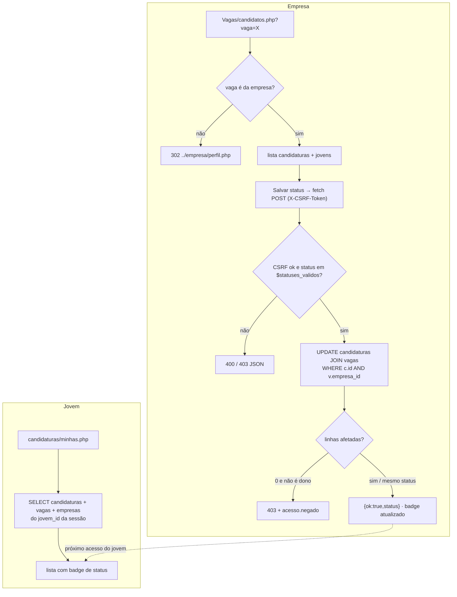

| # | Resposta |
|---|---|
| 1 | Menu "Minhas candidaturas"; "Ver/Gerenciar candidatos". |
| 2 | `candidaturas/minhas.php`; `Vagas/candidatos.php` (GET e POST XHR/form). |
| 3 | `candidatura_id` > 0; status em 5 valores; sem JS o formulário `<noscript>` envia sempre "Em análise". |
| 4 | Jovem vê só as próprias; empresa só das próprias vagas. |
| 5 | `csrf_require(true)`, `jc_log`, `jc_log_seguranca`. |
| 6 | SELECT; UPDATE `candidaturas.status`. |
| 7 | HTML; JSON `{ok,status}`; 302 `?saved=1` sem JS. |
| 8 | 400, 403. |
| 9 | — |
| 10 | Status alterado; jovem vê ao abrir a página (sem notificação; "Visualizado" não é automático; jovem não pode retirar). [T: S3 regressão] |

O painel da empresa (`dashboard/empresa.php`) mostra só candidatos com `perfil_publico = 1` e, se não houver
nenhum, até 12 jovens públicos da área da empresa (modo de sugestão) [C].

---

## F-11 — Acesso de empresas aos perfis de candidatos

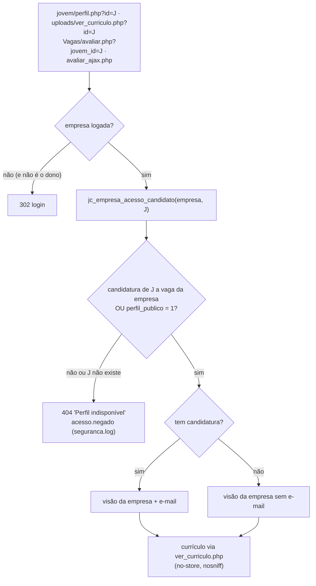

| # | Resposta |
|---|---|
| 1 | Clique num candidato ou numa sugestão do painel. |
| 2 | `jovem/perfil.php`, `uploads/ver_curriculo.php`, `Vagas/avaliar.php`, `IA/avaliar_ajax.php`. |
| 3 | `id` inteiro > 0. |
| 4 | Regra de `includes/candidato.php` (dono da vaga + relação, ou perfil público). |
| 5 | `jc_empresa_acesso_candidato`, `jc_empresa_pode_ver_candidato`, `jc_candidato_indisponivel`. |
| 6 | SELECT `jovens` (só colunas da visão da empresa), `candidaturas`, `vagas`, `formacao_jovem`, `habilidades_jovem`, `experiencias_jovem`. |
| 7 | HTML do perfil; PDF inline; 404 igual para inexistente e negado. |
| 8 | 404. |
| 9 | PDF ausente no disco → 404 "Currículo não encontrado.". |
| 10 | Nunca expõe CPF, CEP, endereço, telefone ou data de nascimento (só idade). Ver SEG-03 sobre o padrão público. [T: perfil 36/36] |

---

## F-12 — Match Inteligente

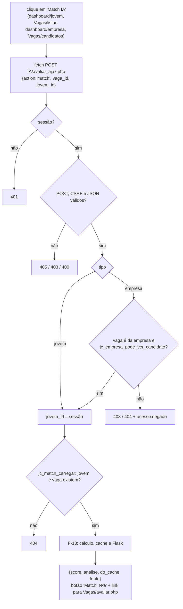

| # | Resposta |
|---|---|
| 1 | Botão "Match IA"/"Avaliar Match com IA". |
| 2 | `IA/avaliar_ajax.php` (action `match`, padrão). |
| 3 | Método, CSRF (cabeçalho), JSON, IDs > 0. |
| 4 | Jovem: só ele mesmo; empresa: vaga própria + relação com o candidato. |
| 5 | `jc_match_carregar`, `jc_match_calcular`, `jc_flask_post`, `jc_match_texto_estatico`. |
| 6 | SELECT `jovens`, `vagas`, local; SELECT/INSERT … ON DUPLICATE `avaliacoes_ia`. |
| 7 | JSON; o botão mostra a nota; erro aparece no botão por 3,5 s. |
| 8 | 400, 401, 403, 404, 405. |
| 9 | Flask fora → nota calculada em PHP (`fonte:"local"`), sem diferença para o usuário. |
| 10 | Cache do par criado/atualizado. [T: S5.1 match 90/90, fallback 7/7 ×2] |

---

## F-13 — Fluxo interno da análise de compatibilidade

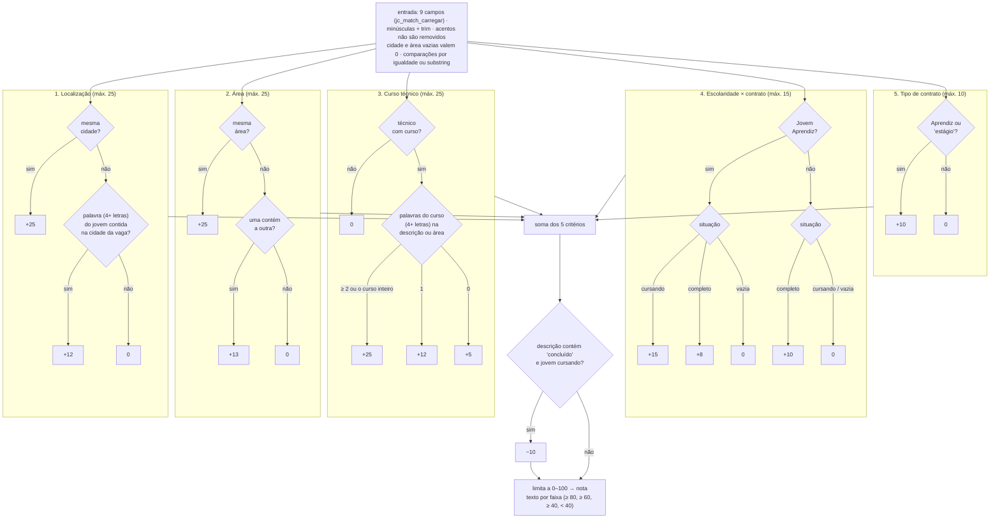

Na página `Vagas/avaliar.php` o navegador chama `action:"analise"` (sempre em PHP:
`jc_match_categorias`, `jc_match_ajuste`, `jc_match_destaques`) e, ao abrir o detalhe, `action:"contexto"`
(F-14). Tabela completa dos critérios em [IA_E_MATCH.md](IA_E_MATCH.md#match--algoritmo-exato).

| # | Resposta |
|---|---|
| 1 | Chamada interna de F-12 ou abertura de `Vagas/avaliar.php`. |
| 2 | `IA/recomendar.py::avaliar` ou `includes/match.php::jc_match_calcular` (idênticos). |
| 3 | Campos tratados como texto; vazio = 0 no critério. |
| 4 | Herdadas de F-12. |
| 5 | Funções acima. |
| 6 | Nenhuma no cálculo; o cache é tratado em `avaliar_ajax.php`. |
| 7 | `score`, `motivos`, `analise`; na página: categorias, ajuste, pontos fortes, limitações. |
| 8 | Entrada não-texto no Flask → 500 da rota → PHP usa o cálculo local [I]. |
| 9 | Flask fora → mesmo cálculo em PHP. |
| 10 | Nota determinística. [T: paridade 0 divergências em 1.205 casos; MATCH-01..05] |

---

## F-14 — Integração com o serviço de IA

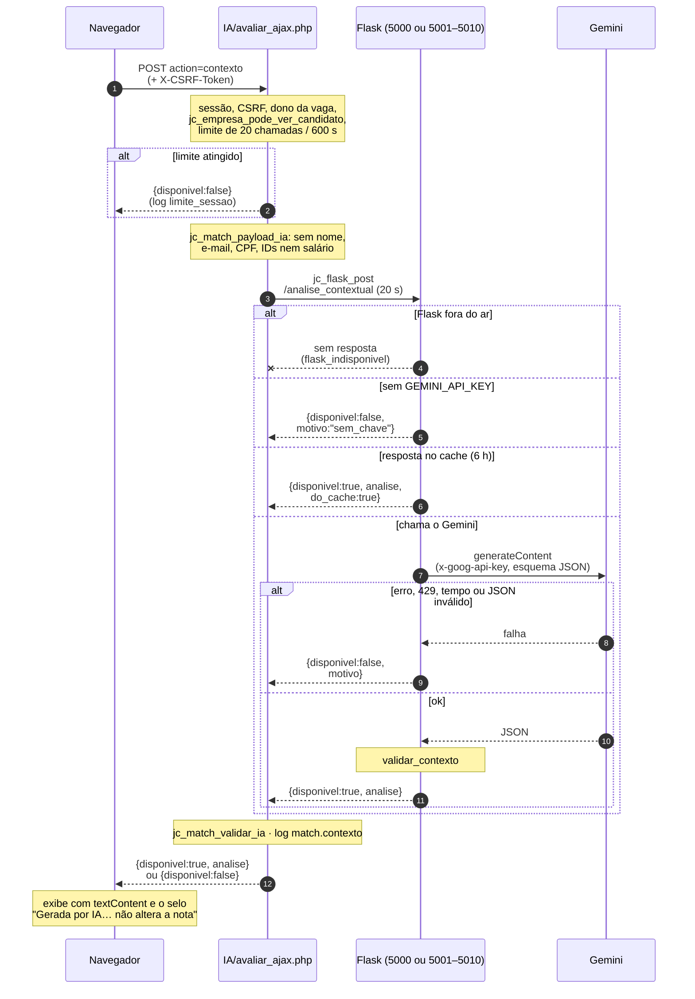

| # | Resposta |
|---|---|
| 1 | Abrir "Ver análise detalhada" (contexto); Match de par novo (`/avaliar`); IA Advisor (`/curriculo`); assistente (`/assistente`). |
| 2 | `IA/avaliar_ajax.php`, `IA/assistente_ajax.php` → rotas do Flask. |
| 3 | PHP: sessão, CSRF, tamanho; Flask: JSON objeto, limites de tamanho; resposta do Gemini validada no Flask e no PHP. |
| 4 | As do PHP; o Flask não autentica (SEG-06). |
| 5 | `jc_flask_post`, `jc_match_payload_ia`, `jc_match_validar_ia`; `_ctx_chamar_gemini`, `validar_contexto`. |
| 6 | Só leitura (`jovens`, `vagas`, `habilidades_jovem`, `experiencias_jovem`, `formacao_jovem`, `requisitos_vaga`, `avaliacoes_ia`). |
| 7 | JSON. |
| 8 | Motivos: `entrada_invalida`, `sem_chave`, `chave_invalida`, `modelo_indisponivel`, `limite`, `timeout`, `indisponivel`, `resposta_invalida`, `flask_indisponivel`, `limite_sessao`. |
| 9 | Sempre degrada para "não disponível" sem afetar a nota. |
| 10 | Nada gravado no banco. [T: contexto 33/33 com Gemini simulado] |

---

## F-15 — Assistente

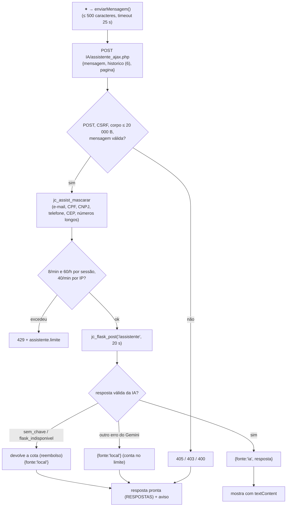

| # | Resposta |
|---|---|
| 1 | Enviar mensagem no painel ✦ (visitantes também). |
| 2 | `IA/assistente_ajax.php` → Flask `assistente()`. |
| 3 | Ver diagrama; histórico ≤ 6 × 600; `pagina` `^[a-z]{2,20}$`. |
| 4 | Nenhuma autenticação; perfil (visitante/jovem/empresa) só como contexto. |
| 5 | `jc_assist_texto`, `jc_assist_mascarar`, `jc_flask_post`; `_assist_limpar_resposta`. |
| 6 | Nenhuma. |
| 7 | JSON; texto na tela; aviso "Resposta automática…" e "Removemos dados pessoais…" quando for o caso. |
| 8 | 400, 403, 405, 429. |
| 9 | Respostas prontas. |
| 10 | Conversa só na memória da página; log só com metadados. A IA **não executa ações**. [T: assistente 34/34] |

---

## F-16 — Aceite dos termos e da política de privacidade

```mermaid
flowchart TD
    A["clique em Termos / Privacidade<br/>(rodapé da home ou link do cadastro)"] --> J{"JavaScript?"}
    J -- "sim" --> M["modal: resumo + versão (jc_documento_resumo, jc_documento_versao)"]
    J -- "não" --> PG["documentos.php?doc=… em nova aba"]
    M --> SM{"Saiba mais?"}
    SM -- "sim" --> TC["texto completo no mesmo modal"]
    M --> PG
    C["Etapa 4 do cadastro:<br/>caixa aceite_termos (no próprio cadastro)"] --> V{"marcada?"}
    V -- "não" --> ER["erro 'aceite' — conta não é criada"]
    V -- "sim" --> R["jc_termos_registrar(tabela, id)"]
    R --> COL{"coluna termos_aceitos_em existe?"}
    COL -- "sim" --> UP["UPDATE termos_versao, termos_aceitos_em = NOW()"]
    COL -- "não" --> SK["sem registro (site continua)"]
```

| # | Resposta |
|---|---|
| 1 | Abrir um documento; enviar o cadastro. |
| 2 | `includes/institucional.php`, `documentos.php`, `includes/termos.php`. |
| 3 | `doc` em lista branca; `$_POST['aceite_termos'] === '1'`. |
| 4 | Nenhuma. |
| 5 | `jc_documento_*` (`includes/documentos.php`), `jc_termos_colunas`, `jc_termos_registrar`. |
| 6 | `SHOW COLUMNS`; UPDATE `jovens`/`empresas`. |
| 7 | Modal, página própria ou erro no cadastro. |
| 8 | Aceite ausente. |
| 9 | Sem a migração: conta criada sem registro do aceite. |
| 10 | Versão e data do aceite gravadas. Os textos são **minutas**. Abrir o documento não registra nada. [T: termos 38/38, modais 65/65] |

---

## F-17 — Exclusão de contas

```mermaid
flowchart TD
    A["perfil → modal → POST excluir_conta.php<br/>confirmar=1 + csrf_token"] --> S{"sessão do tipo?"}
    S -- "não" --> L["302 login.php"]
    S -- "sim" --> M{"POST com confirmar=1?"}
    M -- "não" --> P["302 perfil.php"]
    M -- "sim" --> C{"csrf_require()"}
    C -- "inválido" --> F["403"]
    C -- "ok" --> J{"jovem?"}
    J -- "sim" --> PDF["apaga uploads/curriculos/curriculo_{id}.pdf"]
    J -- "não" --> D
    PDF --> D["DELETE jovens|empresas WHERE id = sessão<br/>(cascata do banco)"]
    D --> LG["log conta.excluida · sessão e cookie destruídos"]
    LG --> I["302 ../index.php?conta=excluida"]
```

| # | Resposta |
|---|---|
| 1 | "Excluir conta" no perfil. |
| 2 | `jovem/excluir_conta.php`, `empresa/excluir_conta.php`. |
| 3 | CSRF e `confirmar=1`; **não pede a senha** (SEG-16). |
| 4 | Somente a própria conta (ID da sessão). |
| 5 | `csrf_require`, `jc_log_seguranca`. |
| 6 | SELECT `jovens.curriculo`; DELETE `jovens`/`empresas` + cascata (ver [BANCO_DE_DADOS.md](BANCO_DE_DADOS.md#o-que-a-exclusão-apaga-cascata)). |
| 7 | 302 para a home com aviso. |
| 8 | 403; erro de banco → 500 (o PDF já pode ter sido apagado). |
| 9 | — |
| 10 | Conta e dados ligados removidos; não há retenção nem período de arrependimento. [T: S3 regressão] |

---

## F-18 — Falhas e indisponibilidade de serviços externos

```mermaid
flowchart TD
    A["Requisição"] --> DB{"banco disponível?"}
    DB -- "não" --> D503["503 texto (banco.indisponivel)"]
    DB -- "sim" --> X{"exceção não tratada?"}
    X -- "sim" --> E500["500 genérico (erro.inesperado)"]
    X -- "não" --> S{"usa serviço externo?"}
    S -- "Flask /avaliar" --> F1{"responde em 6 s?"}
    F1 -- "não" --> FL["cálculo PHP (flask.falha)"]
    S -- "Flask /curriculo" --> F2{"responde?"}
    F2 -- "não" --> C503["503 'Servidor de IA indisponível.'"]
    S -- "Gemini (contexto/assistente)" --> G{"chave + Flask + Gemini ok?"}
    G -- "não" --> GL["{disponivel:false} / respostas prontas"]
    S -- "SMTP / Twilio" --> M{"vendor/ + credenciais + envio ok?"}
    M -- "não" --> MF["false → mensagem de falha<br/>(recuperação: mensagem de sucesso mesmo assim)"]
    S -- "ViaCEP / BrasilAPI (navegador)" --> V{"respondem?"}
    V -- "não" --> VM["preenchimento manual"]
```

| Dependência | Se falhar | Onde ver |
|---|---|---|
| Banco | 503 em todas as páginas com dados | `app.log` → `banco.indisponivel` |
| Flask | Match local; currículo 503; assistente com respostas prontas | `app.log` → `flask.falha` |
| Gemini | sem análise contextual; respostas prontas | `ia.log` → `gemini.falha`; `app.log` → `match.contexto`, `assistente.resposta` |
| SMTP/Twilio/`vendor/` | códigos não chegam | `error_log` do PHP (não vai para `logs/`) |
| ViaCEP/BrasilAPI | preenchimento manual | console do navegador |
| Google Fonts | fonte do sistema | — |

Diagnóstico passo a passo: [LOGS_E_DIAGNOSTICO.md](LOGS_E_DIAGNOSTICO.md). [T: fallback 7/7 ×2, assistente 34/34, contexto 33/33]
