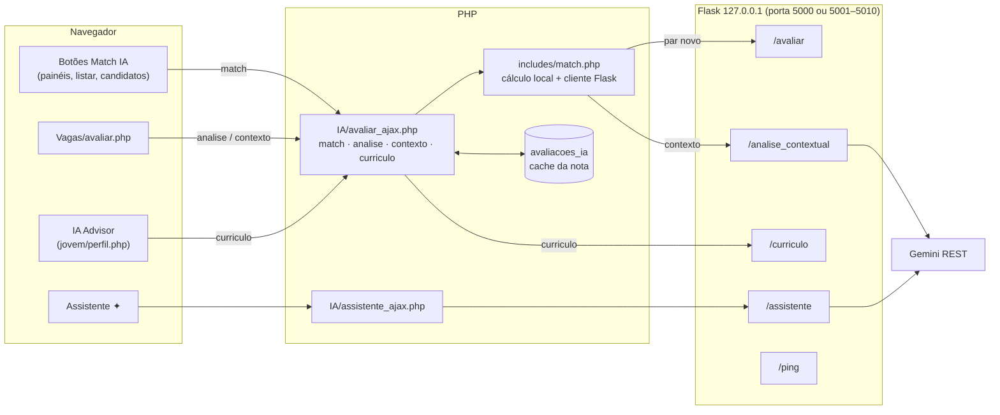
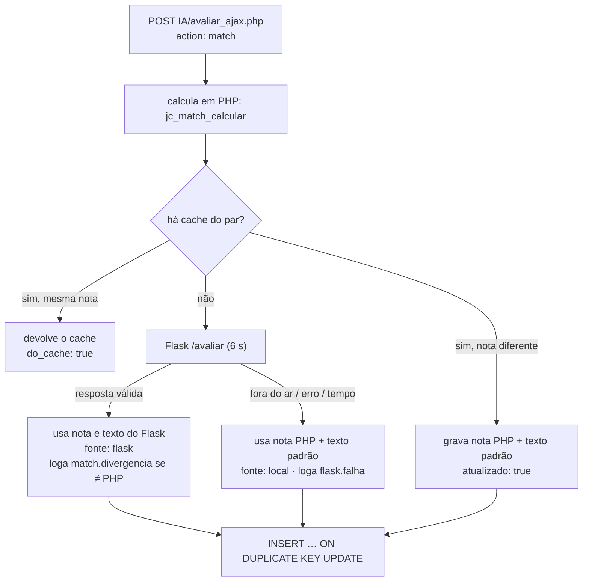

# IA e Match

> **Classificação: CONFIDENCIAL (uso interno da equipe).** Contém o algoritmo exato do Match (critérios, pontos, ajuste e normalização) e as regras da análise com IA.
> Não copie para o texto público do TCC, slides ou repositórios públicos: use a versão resumida de
> [CLASSIFICACAO.md](CLASSIFICACAO.md#versões-resumidas-para-o-tcc). Desde a v4.60 a pasta `docs/` não é
> entregue pelo Apache (confira com `scripts\seguranca\verificar_protecao.bat`).

> Auditoria de 10/10/2026, versão **v4.00**. **[C]** confirmado no código · **[T]** verificado por teste na
> réplica (com um servidor que imita o Gemini e chave falsa — **nenhuma chamada real ao Gemini foi feita**) ·
> **[I]** inferido · **[NC]** não confirmado. Complementa [ASSISTENTE_E_IA.md](ASSISTENTE_E_IA.md).

## O que é regra fixa e o que é texto gerado por IA

| Saída | Natureza | Onde |
|---|---|---|
| Nota do Match (0–100), pontos por critério, motivos, rótulo de faixa, texto padrão por faixa | **Determinística** (regras fixas) | `IA/recomendar.py` → `avaliar()` / `analise_estatica()`; espelho `includes/match.php` → `jc_match_calcular()`, `jc_match_texto_estatico()`, `jc_match_rotulo()` |
| Composição detalhada (categorias, explicações, ajuste, pontos fortes, o que reduziu, limitações) | **Determinística** | `includes/match.php` → `jc_match_categorias()`, `jc_match_ajuste()`, `jc_match_destaques()`; `IA/avaliar_ajax.php` action `analise` |
| Frase da rota `/avaliar` quando a integração antiga está ativa | Gerada por IA (`gemini-1.5-flash`, SDK `google-generativeai`) — senão texto padrão | `recomendar.py` → `analise_gemini()` |
| Sugestões de currículo | **Regras fixas** + opcionalmente 1 sugestão gerada pela integração antiga | `recomendar.py` → `analisar_curriculo()` |
| Análise contextual do Match | **Gerada por IA** (Gemini REST, `GEMINI_MODEL`); **nunca altera a nota** | `recomendar.py` → `analise_contextual()`; PHP action `contexto` |
| Resposta do assistente | Gerada por IA ou **resposta pronta** (lista `RESPOSTAS` em JS) | `recomendar.py` → `assistente()`; `includes/assistente.php` |

Apesar do nome "Match IA" nos botões, **a nota não é calculada por inteligência artificial** [C][T].

## Arquitetura da IA

## Match — algoritmo exato

### Entrada (`jc_match_carregar` → enviada ao Flask `/avaliar`)
| Campo | Origem |
|---|---|
| `cidade_jovem` | `jovens.cidade` |
| `area_interesse` | `jovens.area_interesse` |
| `escolaridade_tipo` | `jovens.escolaridade_tipo` (`regular`/`tecnico`) |
| `escolaridade_curso` | `jovens.escolaridade_curso` |
| `escolaridade_status` | `jovens.escolaridade_status` (`cursando`/`completo`) |
| `cidade_vaga` | cidade do **local efetivo** (`jc_local_efetivo`: local escolhido → endereço da empresa → campos da vaga) |
| `area_vaga` | `vagas.area` |
| `tipo_contrato` | `vagas.tipo_contrato` ("Jovem Aprendiz", "Estágio", "CLT", "PJ") |
| `descricao` | `vagas.descricao` |

**Normalização** [C]: minúsculas e remoção de espaços nas pontas. Não remove acentos, pontuação nem espaços
internos. As comparações são igualdade exata ou "contém" (substring).

### Critérios e pontos

Idênticos em `recomendar.py::avaliar` e `match.php::jc_match_calcular` [C][T].
| # | Critério (máx.) | Condição | Pontos | Motivo exibido |
|---|---|---|---|---|
| 1 | Localização (25) | cidades preenchidas e iguais | **25** | "A vaga está localizada na sua cidade" |
| | | diferentes, mas uma palavra da cidade do jovem com mais de 3 letras está contida na cidade da vaga | **12** | "A vaga está em uma cidade próxima da sua" |
| | | sem palavra comum ou alguma vazia | 0 | — |
| 2 | Área (25) | iguais | **25** | "Área de interesse (…) compatível com a vaga" |
| | | uma contém a outra | **13** | "Área da vaga tem relação com seu interesse" |
| | | diferentes ou vazias | 0 | — |
| 3 | Curso técnico (25) | só se `escolaridade_tipo = tecnico` e há curso. Conta as palavras do curso (> 3 letras) presentes na descrição ou na área da vaga: ≥ 2, ou o curso inteiro aparece | **25** | "Seu curso técnico em … é um diferencial para esta vaga" |
| | | 1 palavra | **12** | "Seu curso técnico tem relação parcial com a vaga" |
| | | nenhuma | **5** | "Ensino técnico é valorizado pelos empregadores" |
| 4 | Escolaridade × contrato (15) | Jovem Aprendiz + cursando | **15** | "Você está no perfil ideal para Jovem Aprendiz (EM em curso)" |
| | | Jovem Aprendiz + completo | **8** | "Ensino Médio completo é aceito em vagas de Jovem Aprendiz" |
| | | outro contrato + completo | **10** | "Ensino Médio concluído é um diferencial" |
| | | outro contrato + cursando, ou sem situação | 0 | — |
| 5 | Tipo de contrato (10) | Jovem Aprendiz ou contrato contém "estágio" (com acento) | **10** | "Contrato adequado para início de carreira" |
| — | Ajuste | descrição contém "concluído" **e** jovem cursando | **−10** | "Atenção: esta vaga pode preferir candidatos com EM concluído" |

- Resultado limitado a 0–100. Teto real: **100** para Jovem Aprendiz, **95** para Estágio, **85** para CLT/PJ [T: MATCH-03].
- Faixas do texto padrão: ≥ 80, ≥ 60, ≥ 40 e < 40.
- **Não entram na nota:** habilidades, experiências, formações adicionais, distância real, transporte, salário [C].

### Efeitos das regras de substring (limitações conhecidas)
| Caso | Resultado | Teste |
|---|---|---|
| Interesse "TI" × vaga "Administrativo" (também "Logística", "Marketing") | +13 em área ("ti" está dentro da palavra) | MATCH-01 |
| "Santo André" × "Santos" | +12 como "cidade próxima" (não há cálculo de distância) | MATCH-02 |
| "Estagio" sem acento | perde os 10 pontos de contrato | MATCH-04 |
| Descrição com "concluído" e jovem cursando | −10 | MATCH-05 |

Melhorias possíveis estão em [MANUTENCAO_E_EVOLUCAO.md](MANUTENCAO_E_EVOLUCAO.md) — mudar as regras exige mudar
**os dois lados** (Python e PHP) e repetir o teste de paridade.

### Cache em `avaliacoes_ia`

- `analise` (página de detalhe) nunca chama o Flask; `contexto` lê o cache mas não grava [C].
- A detecção de mudança compara só a **nota**: alterações que não mudam a nota mantêm o texto antigo [C].
- Com o Flask fora do ar a nota continua aparecendo normalmente (só o log registra `flask.falha`) [T: fallback 7/7].

### Paridade Python × PHP
Na réplica, 1.205 combinações de entrada foram avaliadas pelos dois lados: **0 divergências**, notas de 0 a 100
(script de teste da réplica, não versionado no repositório).

## Análise contextual (`action: "contexto"`)
1. Só na página `Vagas/avaliar.php`, ao abrir "Ver análise detalhada".
2. Limite: **20 chamadas a cada 600 s por sessão**.
3. `jc_match_payload_ia` monta o que vai ao Gemini: dados do jovem (cidade, UF, área, formação, situação,
   curso técnico, até 15 habilidades, até 5 experiências e 5 formações adicionais), da vaga (título, área,
   contrato, carga horária, descrição ≤ 1.500, requisitos, tipo/bairro/cidade/UF do local) e o resultado do
   Match. **Não vão:** nome, e-mail, CPF, telefone, nascimento, CEP/rua do jovem, resumo, currículo, IDs,
   nome da empresa, salário.
4. Flask: limite de 24.000 caracteres, cache em memória de 6 h (chave SHA-256 do conteúdo), temperatura 0.2,
   resposta em JSON validada por esquema; o PHP valida de novo (`jc_match_validar_ia`).
5. Indisponível (sem chave, Flask fora, erro/limite/tempo do Gemini, resposta inválida, limite da sessão) →
   o navegador recebe só `{disponivel:false}` e mostra "A análise contextual por IA não está disponível
   agora…". O motivo fica em `logs/site/app.log` (`match.contexto`) e `logs/ia/ia.log` (`gemini.falha`).
6. O texto aparece com o selo "Gerada por IA (Gemini) · confiança … · não altera a nota", sempre via
   `textContent`.

## Assistente

Fluxo e regras completos em [ASSISTENTE_E_IA.md](ASSISTENTE_E_IA.md) e em
[FLUXOS_E_FLUXOGRAMAS.md](FLUXOS_E_FLUXOGRAMAS.md#f-15--assistente). Pontos principais [C][T]:

- Visitantes também podem usar (não exige login).
- Limites: 8/min e 60/h por sessão; 40/min por IP; mensagem ≤ 500 caracteres; histórico de 6 falas.
- Dados pessoais (e-mail, CPF, CNPJ, telefone, CEP, números longos) trocados por `[dado removido]` antes de sair do servidor.
- Mensagens sem chave ou com Flask fora não contam no limite ("reembolso").
- Respostas prontas (palavras-chave: candidat, curricul, senha, perfil, contato, aprendiz, empresa, vaga, ia, jove) só quando a IA não respondeu.
- A conversa não é gravada em banco nem em log.

## Sugestões de currículo (IA Advisor e Mentor de Currículo)

| Recurso | Onde | Sem Flask |
|---|---|---|
| IA Advisor | botão no `jovem/perfil.php` → `avaliar_ajax.php` (`curriculo`) → Flask `/curriculo` | **HTTP 503** → "IA temporariamente indisponível." (não há regras em PHP) |
| Mentor de Currículo | `Vagas/curriculoIA.php` (**nenhuma página aponta para ela**) | mensagem de erro |

As regras fixas de sugestão ficam só dentro do Flask (`analisar_curriculo`). O IA Advisor insere o texto com
`innerHTML` — pendência SEG-05 em [SEGURANCA_E_PRIVACIDADE.md](SEGURANCA_E_PRIVACIDADE.md).

## Integração antiga `google-generativeai`
- Só ativa se `GEMINI_API_KEY` estiver nas **variáveis de ambiente reais** quando o Flask inicia (linha 34 de
  `recomendar.py`) **e** o pacote `google-generativeai` estiver instalado (não está em `requirements.txt`).
  A chave apenas no `.env` ativa só as rotas novas (`/analise_contextual`, `/assistente`).
- Usa o modelo fixo `gemini-1.5-flash` (o próprio comentário do código diz que foi desativado pelo Google);
  falhas caem no texto padrão.
- `/ping` → `"gemini": true/false` indica só esta integração; `"analise_contextual"` e `"assistente"` indicam as rotas novas.
- A mensagem de inicialização "Gemini: ✗ Inativo (sem GEMINI_API_KEY)" pode aparecer mesmo com a chave no
  `.env` e as rotas novas ativas.

## Configuração

| Variável | Efeito | Padrão |
|---|---|---|
| `GEMINI_API_KEY` | Ativa análise contextual e assistente (lida do ambiente ou do `.env`) | vazio = sem IA |
| `GEMINI_MODEL` | Modelo das rotas novas (validado por expressão regular) | `gemini-3.5-flash-lite` [NC: existência do modelo não testada] |
| `GEMINI_TIMEOUT` | Tempo máximo da chamada ao Gemini (3–30 s) | 12 |
| `FLASK_DEBUG` | Modo debug do Flask (só ambiente real; **manter 0**) | 0 |
| `JC_GEMINI_API_BASE` | Só para testes: endereço de um Gemini simulado em `127.0.0.1`/`localhost` | — |

Onde colocar a chave e como iniciar: [CONFIGURACAO.md](CONFIGURACAO.md) e
[INSTALACAO_E_EXECUCAO.md](INSTALACAO_E_EXECUCAO.md).

## Rotas do Flask

| Rota | Método | Entrada | Saída | Gemini |
|---|---|---|---|---|
| `/avaliar` | POST | 9 campos do Match | `{score, analise, motivos, status}` | só integração antiga |
| `/curriculo` | POST | `resumo`, `habilidades`, `formacoes` | `{mensagem, sugestoes, status}` | só integração antiga |
| `/analise_contextual` | POST | payload de `jc_match_payload_ia` | `{disponivel, analise?, do_cache?, motivo?}` | sim |
| `/assistente` | POST | `mensagem`, `historico`, `contexto` | `{disponivel, resposta?, motivo?}` | sim |
| `/ping` | GET | — | estado em booleanos, modelo, versão | não |

O Flask não tem autenticação; aceita conexões só de `127.0.0.1` (SEG-06). Desde a v4.60 também não tem CORS,
recusa com 403 pedidos cujo cabeçalho `Host` não seja local (proteção contra *DNS rebinding*) e com 413 corpos
acima de 512 KB; as rotas POST só aceitam JSON, que outro site não consegue enviar sem CORS.
