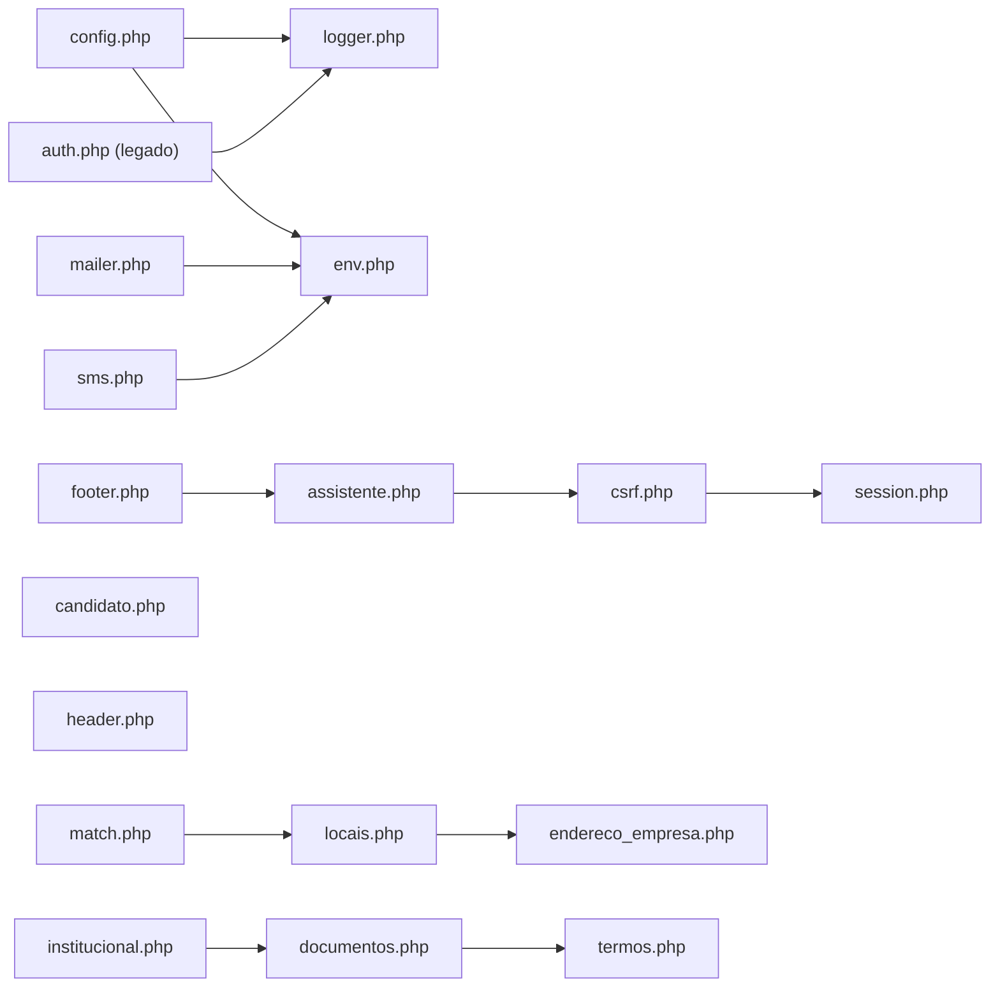

# Matriz de dependências

> Auditoria de 10/10/2026, versão **v4.00**. Tabelas geradas por scripts de levantamento sobre o código
> (tokens do PHP para funções e SQL; expressões regulares para `require`, `Location`, `fetch` e
> formulários). Limites do método: SQL montado com nome de tabela em variável foi incluído à mão (marcado);
> chamadas feitas por caminho calculado em JavaScript podem não aparecer.

## Dependências externas

| Dependência | Tipo | Usada por | Obrigatória? | Sem ela |
|---|---|---|---|---|
| PHP ≥ 8.1, extensões `mysqli`, `curl`, `mbstring`, `json` | runtime | tudo; `curl` em `includes/match.php`, `IA/avaliar_ajax.php`, `Vagas/curriculoIA.php` | sim | site não roda; sem `curl` não há Flask (Match local continua) [I] |
| MariaDB 10.4+ / MySQL 8.0+ | banco | `includes/config.php` | sim | 503 "temporariamente indisponível" |
| Apache com `AllowOverride` | servidor | `.htaccess` de `logs/` e `uploads/curriculos/` | recomendado | pastas protegidas ficam públicas (SEG-10) |
| `phpmailer/phpmailer ^6.9` (Composer) | biblioteca | `includes/mailer.php` | para e-mail | verificação de e-mail e recuperação não enviam nada |
| `twilio/sdk ^8.3` (Composer) | biblioteca | `includes/sms.php` | para SMS | verificação de telefone não envia |
| Python 3 + `flask`, `flask-cors` | serviço | `IA/recomendar.py` | não | Match em PHP; assistente com respostas prontas; IA Advisor indisponível |
| `pandas`, `scikit-learn`, `mysql-connector-python` | listadas em `requirements.txt` | **nenhum código** | não | — (podem sair do `requirements.txt`) |
| `google-generativeai` | biblioteca opcional | integração antiga em `recomendar.py` | não | ausente de `requirements.txt`; integração fica inativa |
| Google Gemini (REST) | API | `/analise_contextual`, `/assistente` | não | recursos de IA indisponíveis, com aviso |
| SMTP, Twilio | serviços | mailer, sms | não | ver acima |
| ViaCEP, BrasilAPI | APIs públicas, chamadas **pelo navegador** | `jovem/cadastro.php`, `empresa/cadastro.php`, `empresa/perfil.php`, `includes/locais_campos.php` (usado em `empresa/locais.php` e `Vagas/criar.php`), `Vagas/criar.php` | não | preenchimento manual |
| Google Fonts | CSS externo | `assets/css/style.css`, `includes/header.php` | não | fonte do sistema |
| Google Maps (link) | link | `Vagas/listar.php` | não | — |

## Dependências entre bibliotecas internas

> O diagrama mostra as dependências declaradas por `require`/`include` dentro de `includes/` e as de uso
> direto de funções verificadas na tabela abaixo; ver a tabela para a lista exata de cada arquivo.

## Arquivo → includes, redirecionamentos, chamadas e formulários

| Arquivo | Inclui (require/include) | Redireciona para (Location) | Chama via fetch | Formulários (método → ação) |
|---|---|---|---|---|
| `IA/assistente_ajax.php` | `includes/csrf.php`, `includes/env.php`, `includes/logger.php`, `includes/match.php` | — | — | — |
| `IA/avaliar_ajax.php` | `includes/candidato.php`, `includes/config.php`, `includes/csrf.php`, `includes/match.php` | — | — | — |
| `Vagas/avaliar.php` | `includes/assistente.php`, `includes/candidato.php`, `includes/config.php`, `includes/locais.php` | `../index.php` | `../IA/avaliar_ajax.php` | — |
| `Vagas/candidatar.php` | `includes/assistente.php`, `includes/config.php`, `includes/csrf.php` | `../dashboard/jovem.php`, `../jovem/login.php`, `candidatar.php?vaga_id={$vaga_id}&result=duplicate{$voltar_qs}`, `candidatar.php?vaga_id={$vaga_id}&result=error{$voltar_qs}`, `candidatar.php?vaga_id={$vaga_id}&result=ok{$voltar_qs}` | — | `POST → candidatar.php` |
| `Vagas/candidatos.php` | `includes/assistente.php`, `includes/config.php`, `includes/csrf.php` | `../empresa/login.php`, `../empresa/perfil.php`, `candidatos.php?vaga={$vaga_id}&saved=1` | `../IA/avaliar_ajax.php`, `candidatos.php?vaga=<?= $vaga_id ?>` | `POST → (própria página)` |
| `Vagas/criar.php` | `includes/assistente.php`, `includes/config.php`, `includes/csrf.php`, `includes/locais.php`, `includes/locais_campos.php` | `../empresa/login.php`, `criar.php?error=db`, `criar.php?error=local`, `criar.php?error=missing`, `minhas.php?publicada=1` | ``https://viacep.com.br/ws/${cepRaw}/json/`` | `POST → (própria página)` |
| `Vagas/curriculoIA.php` | `includes/assistente.php`, `includes/config.php`, `includes/csrf.php` | `../jovem/login.php` | — | `POST → (própria página)` |
| `Vagas/favoritar.php` | `includes/config.php`, `includes/csrf.php` | `../dashboard/jovem.php`, `../dashboard/jovem.php?erro=favorito`, `../jovem/login.php`, `listar.php?id={$vaga_id}&favorito={$action}` | — | — |
| `Vagas/favoritos.php` | `includes/assistente.php`, `includes/config.php`, `includes/csrf.php` | `../jovem/login.php` | `favoritar.php` | `POST → favoritar.php` |
| `Vagas/listar.php` | `includes/assistente.php`, `includes/config.php`, `includes/csrf.php`, `includes/locais.php` | `../jovem/login.php`, `listar.php` | `../IA/avaliar_ajax.php`, `favoritar.php` | `GET → listar.php` |
| `Vagas/minhas.php` | `includes/assistente.php`, `includes/config.php`, `includes/csrf.php` | `../empresa/login.php`, `minhas.php?deleted=1` | — | `POST → minhas.php` |
| `candidaturas/minhas.php` | `../includes/config.php`, `../includes/footer.php`, `../includes/header.php`, `includes/session.php` | `../jovem/login.php` | — | — |
| `comecar.php` | `includes/assistente.php`, `includes/session.php` | `dashboard/empresa.php`, `dashboard/jovem.php` | — | — |
| `dashboard/empresa.php` | `includes/assistente.php`, `includes/config.php`, `includes/csrf.php` | `../empresa/login.php` | `../IA/avaliar_ajax.php` | — |
| `dashboard/index.php` | `includes/session.php` | `../index.php`, `empresa.php`, `jovem.php` | — | — |
| `dashboard/jovem.php` | `includes/assistente.php`, `includes/config.php`, `includes/csrf.php` | `../jovem/login.php` | `../IA/avaliar_ajax.php` | — |
| `documentos.php` | — | — | — | — |
| `empresa/cadastro.php` | `includes/assistente.php`, `includes/config.php`, `includes/csrf.php`, `includes/endereco_empresa.php`, `includes/etapas.php`, `includes/institucional.php`, `includes/termos.php` | `../dashboard/empresa.php`, `../dashboard/jovem.php`, `../verificacoes/escolher_verificacao.php` | ``https://brasilapi.com.br/api/cnpj/v1/${cnpjRaw}``, ``https://viacep.com.br/ws/${raw}/json/`` | `POST → (própria página)` |
| `empresa/excluir_conta.php` | `includes/config.php`, `includes/csrf.php` | `../index.php?conta=excluida`, `login.php`, `perfil.php` | — | — |
| `empresa/locais.php` | `../includes/locais_campos.php`, `includes/assistente.php`, `includes/config.php`, `includes/csrf.php`, `includes/locais.php` | `locais.php`, `locais.php?ok=`, `locais.php?ok=editado`, `locais.php?ok=em_uso`, `locais.php?ok=erro`, `locais.php?ok=removido`, `login.php` | — | `POST → locais.php` |
| `empresa/login.php` | — | `../dashboard/empresa.php`, `../dashboard/jovem.php` | — | `POST → processar_login.php` |
| `empresa/perfil.php` | `includes/assistente.php`, `includes/config.php`, `includes/csrf.php`, `includes/endereco_empresa.php`, `includes/locais.php` | `login.php`, `perfil.php?saved=1`, `perfil.php?saved=2`, `perfil.php?saved=3` | ``https://viacep.com.br/ws/${raw}/json/`` | `POST → excluir_conta.php`, `POST → perfil.php` |
| `empresa/processar_login.php` | `includes/config.php`, `includes/csrf.php` | `../dashboard/empresa.php`, `login.php` | — | — |
| `functions.php` | — | — | — | — |
| `includes/assistente.php` | `csrf.php`, `includes/assistente.php` | — | `chatWidget.dataset.endpoint` | `GET → (própria página)` |
| `includes/auth.php` | `logger.php` | `../dashboard/empresa.php`, `../dashboard/jovem.php`, `../index.php`, `../{$tipo}/login.php` | — | — |
| `includes/candidato.php` | — | — | — | — |
| `includes/config.php` | `env.php` | — | — | — |
| `includes/csrf.php` | `session.php` | — | — | `GET → (própria página)` |
| `includes/documentos.php` | `termos.php` | — | — | — |
| `includes/endereco_empresa.php` | — | — | — | — |
| `includes/env.php` | — | — | — | — |
| `includes/etapas.php` | `../includes/etapas.php` | — | — | `GET → (própria página)` |
| `includes/footer.php` | — | — | — | — |
| `includes/formacao.php` | — | — | — | `GET → (própria página)` |
| `includes/header.php` | `../includes/header.php` | — | — | `GET → ../Vagas/listar.php` |
| `includes/institucional.php` | `documentos.php` | — | — | — |
| `includes/locais.php` | `endereco_empresa.php` | — | — | — |
| `includes/locais_campos.php` | — | — | ``https://viacep.com.br/ws/${raw}/json/`` | — |
| `includes/logger.php` | — | — | — | — |
| `includes/mailer.php` | — | — | — | — |
| `includes/match.php` | `locais.php` | — | — | — |
| `includes/session.php` | — | — | — | — |
| `includes/sms.php` | — | — | — | — |
| `includes/termos.php` | — | — | — | — |
| `index.php` | `includes/assistente.php` | `dashboard/empresa.php`, `dashboard/jovem.php` | — | — |
| `jovem/cadastro.php` | `includes/assistente.php`, `includes/config.php`, `includes/csrf.php`, `includes/etapas.php`, `includes/formacao.php`, `includes/institucional.php`, `includes/termos.php` | `../dashboard/empresa.php`, `../dashboard/jovem.php`, `../verificacoes/escolher_verificacao.php` | ``https://viacep.com.br/ws/${raw}/json/`` | `POST → (própria página)` |
| `jovem/excluir_conta.php` | `includes/config.php`, `includes/csrf.php` | `../index.php?conta=excluida`, `login.php`, `perfil.php` | — | — |
| `jovem/login.php` | `includes/csrf.php` | `../dashboard/empresa.php`, `../dashboard/jovem.php` | — | `POST → processar_login.php` |
| `jovem/perfil.php` | `includes/assistente.php`, `includes/candidato.php`, `includes/config.php`, `includes/csrf.php`, `includes/formacao.php` | `../dashboard/empresa.php`, `login.php`, `perfil.php`, `perfil.php#experiencias`, `perfil.php#formacao`, `perfil.php#habilidades`, `perfil.php?saved=1`, `perfil.php?saved=2`, `perfil.php?saved=3`, `perfil.php?saved=4`, `perfil.php?saved=4#formacao` | `../IA/avaliar_ajax.php` | `POST → ../uploads/curriculos.php`, `POST → excluir_conta.php`, `POST → perfil.php` |
| `jovem/processar_login.php` | `includes/config.php` | `../dashboard/jovem.php`, `login.php` | — | — |
| `logout.php` | `includes/logger.php` | `index.php` | — | — |
| `processar_login.php` | `includes/session.php` | `dashboard/empresa.php`, `dashboard/jovem.php`, `jovem/login.php` | — | — |
| `recuperar_senha.php` | `includes/assistente.php`, `includes/config.php`, `includes/csrf.php`, `includes/mailer.php` | `recuperar_senha.php`, `{$tipoLogin}/login.php` | — | `POST → recuperar_senha.php` |
| `uploads/curriculos.php` | `includes/config.php`, `includes/csrf.php` | `../jovem/login.php`, `../jovem/perfil.php`, `../jovem/perfil.php?saved=1`, `../jovem/perfil.php?saved=2` | — | — |
| `uploads/ver_curriculo.php` | `includes/candidato.php`, `includes/config.php` | `../jovem/login.php` | — | — |
| `verificacoes/escolher_verificacao.php` | `includes/auth.php`, `includes/config.php`, `includes/csrf.php`, `includes/footer.php`, `includes/header.php` | `../dashboard/index.php`, `../index.php` | — | — |
| `verificacoes/validacoes_nomes.php` | — | — | — | — |
| `verificacoes/verificar_email.php` | `includes/config.php`, `includes/csrf.php`, `includes/footer.php`, `includes/header.php`, `includes/mailer.php` | `../dashboard/index.php`, `../dashboard/index.php?verified=1`, `../index.php` | — | `POST → verificar_email.php` |
| `verificacoes/verificar_telefone.php` | `includes/auth.php`, `includes/config.php`, `includes/csrf.php`, `includes/footer.php`, `includes/header.php`, `includes/sms.php` | `../dashboard/index.php`, `../dashboard/index.php?phone_verified=1`, `../index.php` | — | `POST → verificar_telefone.php` |

## Arquivo → função → tabela

Operações SQL encontradas em cada função (ou no corpo do arquivo, fora de funções). Linhas com
"jovens / empresas" usam nome de tabela em variável e foram levantadas à mão.

| Arquivo | Função (ou nível de arquivo) | Tabela | Operações |
|---|---|---|---|
| `IA/avaliar_ajax.php` | (nível de arquivo) | `avaliacoes_ia` | INSERT … ON DUPLICATE KEY UPDATE (grava/atualiza o cache) |
| `IA/avaliar_ajax.php` | (nível de arquivo) | `avaliacoes_ia` | INSERT/SELECT |
| `IA/avaliar_ajax.php` | (nível de arquivo) | `formacao_jovem` | SELECT |
| `IA/avaliar_ajax.php` | (nível de arquivo) | `habilidades_jovem` | SELECT |
| `IA/avaliar_ajax.php` | (nível de arquivo) | `jovens` | SELECT |
| `IA/avaliar_ajax.php` | (nível de arquivo) | `vagas` | SELECT |
| `Vagas/avaliar.php` | (nível de arquivo) | `jovens` | SELECT |
| `Vagas/avaliar.php` | (nível de arquivo) | `vagas` | SELECT |
| `Vagas/candidatar.php` | (nível de arquivo) | `candidaturas` | INSERT/SELECT |
| `Vagas/candidatar.php` | (nível de arquivo) | `empresas` | SELECT |
| `Vagas/candidatar.php` | (nível de arquivo) | `vagas` | SELECT |
| `Vagas/candidatos.php` | (nível de arquivo) | `candidaturas` | SELECT/UPDATE |
| `Vagas/candidatos.php` | (nível de arquivo) | `jovens` | SELECT |
| `Vagas/candidatos.php` | (nível de arquivo) | `vagas` | SELECT |
| `Vagas/criar.php` | (nível de arquivo) | `beneficios_vaga` | INSERT |
| `Vagas/criar.php` | (nível de arquivo) | `requisitos_vaga` | INSERT |
| `Vagas/criar.php` | (nível de arquivo) | `vagas` | INSERT |
| `Vagas/curriculoIA.php` | (nível de arquivo) | `formacao_jovem` | SELECT |
| `Vagas/curriculoIA.php` | (nível de arquivo) | `habilidades_jovem` | SELECT |
| `Vagas/curriculoIA.php` | (nível de arquivo) | `jovens` | SELECT/UPDATE |
| `Vagas/favoritar.php` | (nível de arquivo) | `favoritos` | DELETE/INSERT/SELECT |
| `Vagas/favoritar.php` | (nível de arquivo) | `vagas` | SELECT |
| `Vagas/favoritos.php` | (nível de arquivo) | `empresas` | SELECT |
| `Vagas/favoritos.php` | (nível de arquivo) | `favoritos` | SELECT |
| `Vagas/favoritos.php` | (nível de arquivo) | `vagas` | SELECT |
| `Vagas/listar.php` | (nível de arquivo) | `avaliacoes_ia` | SELECT |
| `Vagas/listar.php` | (nível de arquivo) | `beneficios_vaga` | SELECT |
| `Vagas/listar.php` | (nível de arquivo) | `candidaturas` | SELECT |
| `Vagas/listar.php` | (nível de arquivo) | `empresas` | SELECT |
| `Vagas/listar.php` | (nível de arquivo) | `favoritos` | SELECT |
| `Vagas/listar.php` | (nível de arquivo) | `requisitos_vaga` | SELECT |
| `Vagas/listar.php` | (nível de arquivo) | `vagas` | SELECT |
| `Vagas/minhas.php` | (nível de arquivo) | `candidaturas` | SELECT |
| `Vagas/minhas.php` | (nível de arquivo) | `vagas` | DELETE/SELECT |
| `candidaturas/minhas.php` | (nível de arquivo) | `candidaturas` | SELECT |
| `candidaturas/minhas.php` | (nível de arquivo) | `empresas` | SELECT |
| `candidaturas/minhas.php` | (nível de arquivo) | `vagas` | SELECT |
| `dashboard/empresa.php` | (nível de arquivo) | `candidaturas` | SELECT |
| `dashboard/empresa.php` | (nível de arquivo) | `empresas` | SELECT |
| `dashboard/empresa.php` | (nível de arquivo) | `jovens` | SELECT |
| `dashboard/empresa.php` | (nível de arquivo) | `vagas` | SELECT |
| `dashboard/jovem.php` | (nível de arquivo) | `empresas` | SELECT |
| `dashboard/jovem.php` | (nível de arquivo) | `vagas` | SELECT |
| `empresa/cadastro.php` | (nível de arquivo) | `empresas` | INSERT/SELECT |
| `empresa/excluir_conta.php` | (nível de arquivo) | `empresas` | DELETE |
| `empresa/locais.php` | (nível de arquivo) | `empresa_locais` | DELETE/SELECT/UPDATE |
| `empresa/locais.php` | (nível de arquivo) | `vagas` | SELECT |
| `empresa/perfil.php` | (nível de arquivo) | `empresas` | SELECT/UPDATE |
| `empresa/perfil.php` | (nível de arquivo) | `vagas` | SELECT |
| `empresa/processar_login.php` | (nível de arquivo) | `empresas` | SELECT |
| `includes/candidato.php` | `jc_empresa_acesso_candidato` | `candidaturas` | SELECT |
| `includes/candidato.php` | `jc_empresa_acesso_candidato` | `jovens` | SELECT |
| `includes/candidato.php` | `jc_empresa_acesso_candidato` | `vagas` | SELECT |
| `includes/endereco_empresa.php` | `empresa_tem_endereco` | `empresas` | SELECT/SHOW |
| `includes/locais.php` | `jc_endereco_principal` | `empresas` | SELECT |
| `includes/locais.php` | `jc_locais_da_empresa` | `empresa_locais` | SELECT |
| `includes/locais.php` | `jc_locais_da_empresa` | `vagas` | SELECT |
| `includes/locais.php` | `jc_locais_disponiveis` | `empresa_locais` | SHOW |
| `includes/locais.php` | `jc_locais_disponiveis` | `vagas` | SELECT/SHOW |
| `includes/locais.php` | `jc_local_efetivo` | `empresa_locais` | SELECT |
| `includes/locais.php` | `jc_local_efetivo` | `empresas` | SELECT |
| `includes/locais.php` | `jc_local_efetivo` | `vagas` | SELECT |
| `includes/locais.php` | `jc_local_inserir` | `empresa_locais` | INSERT |
| `includes/locais.php` | `jc_vagas_sincronizar_empresa` | `vagas` | UPDATE |
| `includes/locais.php` | `jc_vagas_sincronizar_local` | `vagas` | UPDATE |
| `includes/match.php` | `jc_match_carregar` | `jovens` | SELECT |
| `includes/match.php` | `jc_match_carregar` | `vagas` | SELECT |
| `includes/match.php` | `jc_match_payload_ia` | `experiencias_jovem` | SELECT |
| `includes/match.php` | `jc_match_payload_ia` | `formacao_jovem` | SELECT |
| `includes/match.php` | `jc_match_payload_ia` | `habilidades_jovem` | SELECT |
| `includes/match.php` | `jc_match_payload_ia` | `requisitos_vaga` | SELECT |
| `includes/termos.php` | `jc_termos_registrar` | jovens / empresas | SHOW COLUMNS/UPDATE |
| `jovem/cadastro.php` | (nível de arquivo) | `habilidades_jovem` | INSERT |
| `jovem/cadastro.php` | (nível de arquivo) | `jovens` | INSERT/SELECT |
| `jovem/excluir_conta.php` | (nível de arquivo) | `jovens` | DELETE/SELECT |
| `jovem/perfil.php` | (nível de arquivo) | `experiencias_jovem` | DELETE/INSERT/SELECT |
| `jovem/perfil.php` | (nível de arquivo) | `formacao_jovem` | DELETE/INSERT/SELECT |
| `jovem/perfil.php` | (nível de arquivo) | `habilidades_jovem` | DELETE/INSERT/SELECT |
| `jovem/perfil.php` | (nível de arquivo) | `jovens` | SELECT/UPDATE |
| `jovem/processar_login.php` | (nível de arquivo) | `jovens` | SELECT/UPDATE |
| `recuperar_senha.php` | (nível de arquivo) | `empresas` | SELECT |
| `recuperar_senha.php` | (nível de arquivo) | `jovens` | SELECT |
| `recuperar_senha.php` | (nível de arquivo) | jovens / empresas | SELECT/UPDATE (tabela escolhida em tempo de execução) |
| `uploads/curriculos.php` | (nível de arquivo) | `jovens` | UPDATE |
| `uploads/ver_curriculo.php` | (nível de arquivo) | `jovens` | SELECT |
| `verificacoes/escolher_verificacao.php` | (nível de arquivo) | jovens / empresas | SELECT |
| `verificacoes/verificar_email.php` | (nível de arquivo) e `gerarEEnviarCodigoEmail` | jovens / empresas | SELECT/UPDATE |
| `verificacoes/verificar_telefone.php` | (nível de arquivo) | jovens / empresas | SELECT/UPDATE |

## Quem chama cada função

O índice completo (115 funções PHP, 20 funções Python, com linha e chamadores) está em
[ARQUIVOS_E_FUNCOES.md](ARQUIVOS_E_FUNCOES.md#índice-de-funções-php).

## Página → endpoint (chamadas do navegador)

| Página | Chama | Para quê |
|---|---|---|
| `dashboard/jovem.php`, `Vagas/listar.php`, `dashboard/empresa.php`, `Vagas/candidatos.php` | `IA/avaliar_ajax.php` (`match`) | botão Match |
| `Vagas/avaliar.php` | `IA/avaliar_ajax.php` (`analise`, `contexto`) | detalhe e análise contextual |
| `jovem/perfil.php` | `IA/avaliar_ajax.php` (`curriculo`) | IA Advisor |
| quase todas as páginas (via `includes/assistente.php`) | `IA/assistente_ajax.php` | assistente |
| `Vagas/listar.php`, `Vagas/favoritos.php` | `Vagas/favoritar.php` | favoritar |
| `Vagas/candidatos.php` | `Vagas/candidatos.php` (POST XHR) | status da candidatura |
| `jovem/cadastro.php`, `empresa/cadastro.php`, `empresa/perfil.php`, `empresa/locais.php`, `Vagas/criar.php` | `viacep.com.br` | CEP |
| `empresa/cadastro.php` | `brasilapi.com.br` | CNPJ |

## PHP → Flask

| Origem PHP | Rota | Timeout | Sem resposta |
|---|---|---|---|
| `IA/avaliar_ajax.php` (`match`, par novo) via `jc_flask_post` | `/avaliar` | 6 s | cálculo local |
| `IA/avaliar_ajax.php` (`contexto`) via `jc_flask_post` | `/analise_contextual` | 20 s | `{disponivel:false}` |
| `IA/avaliar_ajax.php` (`curriculo`, cURL direto) | `/curriculo` | 6 s | HTTP 503 |
| `IA/assistente_ajax.php` via `jc_flask_post` | `/assistente` | 20 s | `{fonte:"local"}` |
| `Vagas/curriculoIA.php` (cURL direto) | `/curriculo` | 10 s | mensagem de erro |
