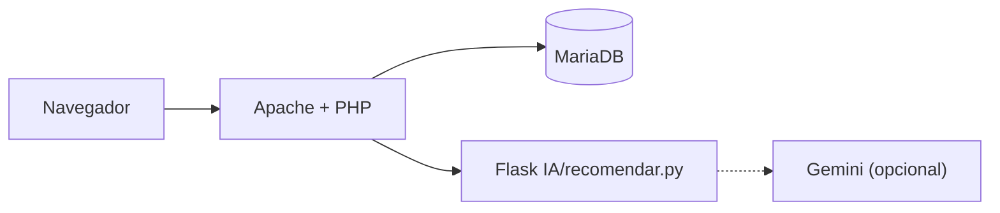

# Documentação técnica do JovemConnect

Ponto de entrada da documentação. Versão documentada: **v4.00** (tag `v4.00`), auditoria de 10/10/2026,
mais a **Stage 7** (11/10/2026: Central administrativa, moderação e auditoria — ver
[ADMINISTRACAO_E_MODERACAO.md](ADMINISTRACAO_E_MODERACAO.md)).
O `README.md` da raiz do projeto continua sendo o guia rápido de instalação.

> **Atualização v4.56 (26/10/2026).** Os documentos foram revistos para as versões 4.55 e 4.56: tema claro
> off-white, card do Match centralizado, painel do jovem com as 6 vagas mais recentes, card de vaga padrão com
> estrela de favoritar (`includes/card_vaga.php`), inicialização da IA só com o `venv` oficial (versões fixas em
> `IA/requirements-ia.txt`), porta da IA com alternativa automática (`includes/ia_endereco.php`) e os scripts
> `iniciar_jovemconnect.bat` / `parar_jovemconnect.bat`. Os resultados dos testes estão em
> [TESTES_RESULTADOS.md](TESTES_RESULTADOS.md#v456--versões-455-e-456). Contagens como "135 funções" e "962
> verificações" são da auditoria da v4.00.

## O projeto em poucas linhas

**JovemConnect** é uma plataforma web de empregabilidade que conecta **jovens em busca do primeiro emprego**
(Jovem Aprendiz, Estágio, CLT, PJ) a **empresas**. O jovem monta o perfil, envia o currículo, procura vagas,
candidata-se e vê uma nota de compatibilidade (Match); a empresa publica vagas por local de trabalho,
acompanha candidatos e muda o status das candidaturas. Há um assistente de dúvidas com IA opcional.
Projeto acadêmico (TCC).

| | |
|---|---|
| Público-alvo | jovens (candidatos) e empresas (contratantes); visitantes para conhecer e tirar dúvidas |
| Tecnologias | PHP 8.1+ (mysqli, sem framework), MariaDB/MySQL, HTML/CSS/JS sem bibliotecas, Python 3.10+ com Flask, Google Gemini (opcional), PHPMailer/Twilio (opcionais) |
| Arquitetura | navegador → Apache/PHP → MariaDB; PHP → Flask local (`127.0.0.1:5000`, ou a próxima porta livre) → Gemini |
| Requisitos básicos | XAMPP no Windows com PHP 8.1+; Python 3.10+ só para a IA; Composer só para e-mail/SMS |

## Documentos

| Documento | Para quê |
|---|---|
| [VISAO_GERAL.md](VISAO_GERAL.md) | produto, usuários, jornadas, ciclo de vida de vagas e candidaturas, funcionalidades existentes/parciais/ausentes, regras de negócio |
| [ARQUITETURA.md](ARQUITETURA.md) | componentes, camadas, ciclo da requisição, autenticação/autorização, erros, configuração, acoplamentos |
| [REQUISITOS.md](REQUISITOS.md) | versões, extensões, pacotes, portas, variáveis, integrações, requisitos de qualidade |
| [INSTALACAO_E_EXECUCAO.md](INSTALACAO_E_EXECUCAO.md) | passo a passo, scripts SQL, iniciar/encerrar, problemas comuns, uso sem integrações |
| [FLUXOS_E_FLUXOGRAMAS.md](FLUXOS_E_FLUXOGRAMAS.md) | fluxograma mestre e 18 fluxos com diagramas |
| [BANCO_DE_DADOS.md](BANCO_DE_DADOS.md) | diagrama ER, dicionário de dados das 15 tabelas, cascatas, migrações |
| [ARQUIVOS_E_FUNCOES.md](ARQUIVOS_E_FUNCOES.md) | catálogo de todos os arquivos e funções, com índice de 135 funções |
| [ROTAS_E_ENDPOINTS.md](ROTAS_E_ENDPOINTS.md) | todas as páginas, endpoints AJAX e rotas Flask |
| [SEGURANCA_E_PRIVACIDADE.md](SEGURANCA_E_PRIVACIDADE.md) | mecanismos classificados, 27 riscos com evidência e recomendação |
| [IA_E_MATCH.md](IA_E_MATCH.md) | algoritmo exato do Match, cache, análise contextual, assistente, Flask |
| [LOGS_E_DIAGNOSTICO.md](LOGS_E_DIAGNOSTICO.md) | onde olhar e como investigar cada tipo de problema |
| [TESTES.md](TESTES.md) | estratégia e casos de teste por área, com status |
| [TESTES_RESULTADOS.md](TESTES_RESULTADOS.md) | as 962 verificações executadas na réplica, uma por linha |
| [ADMINISTRACAO_E_MODERACAO.md](ADMINISTRACAO_E_MODERACAO.md) | **Stage 7**: Central administrativa, provisionamento pela linha de comando, permissões, validação e moderação de conteúdo, fila, denúncias, IA consultiva, trilha de auditoria |
| [MANUTENCAO_E_EVOLUCAO.md](MANUTENCAO_E_EVOLUCAO.md) | convenções, áreas de risco, como evoluir, **pendências** |
| [GLOSSARIO.md](GLOSSARIO.md) | termos do projeto |
| [MATRIZ_DE_DEPENDENCIAS.md](MATRIZ_DE_DEPENDENCIAS.md) | quem inclui/chama o quê; arquivo → função → tabela |

Documentos temáticos anteriores (mantidos e revisados):
[CONFIGURACAO.md](CONFIGURACAO.md) (`.env`) · [MIGRACOES.md](MIGRACOES.md) · [SEED_DEMO.md](SEED_DEMO.md) ·
[ASSISTENTE_E_IA.md](ASSISTENTE_E_IA.md) · [LOGS.md](LOGS.md).

## Como procurar

| Pergunta | Onde |
|---|---|
| Qual arquivo controla esta tela? | [ROTAS_E_ENDPOINTS.md](ROTAS_E_ENDPOINTS.md) e [ARQUIVOS_E_FUNCOES.md](ARQUIVOS_E_FUNCOES.md) |
| Quem chama esta função? | [índice de funções](ARQUIVOS_E_FUNCOES.md#índice-de-funções-php) |
| Que tabela este arquivo altera? | [MATRIZ_DE_DEPENDENCIAS.md](MATRIZ_DE_DEPENDENCIAS.md#arquivo--função--tabela) |
| Por que a nota do Match deu X? | [IA_E_MATCH.md](IA_E_MATCH.md#match--algoritmo-exato) |
| Deu erro, onde olho? | [LOGS_E_DIAGNOSTICO.md](LOGS_E_DIAGNOSTICO.md) |
| O que falta corrigir? | [MANUTENCAO_E_EVOLUCAO.md](MANUTENCAO_E_EVOLUCAO.md#pendências-que-exigem-mudança-de-código) |
| Como criar um administrador ou moderar uma vaga? | [ADMINISTRACAO_E_MODERACAO.md](ADMINISTRACAO_E_MODERACAO.md) |
| Quem fez esta ação administrativa? | Central → Histórico; [trilha de auditoria](ADMINISTRACAO_E_MODERACAO.md#histórico-trilha-de-auditoria) |

## Estado da documentação

- Cobertura: **todos os 88 arquivos versionados** foram inventariados; os 69 arquivos de código e
  configuração (60 PHP, 1 Python, 1 CSS, `.bat`, 2 `.htaccess`, `.env.example`, `.gitignore`, `composer.json`,
  `requirements.txt`) e as 7 imagens têm entrada no catálogo; os SQL e documentos estão descritos em
  [BANCO_DE_DADOS.md](BANCO_DE_DADOS.md) e aqui. Todas as 115 funções PHP e 20 Python estão no índice.
- Marcadores usados: **[C]** confirmado no código · **[T]** verificado por teste · **[I]** inferido ·
  **[NC]** não confirmado.
- Testes: executados numa réplica de desenvolvimento (Linux, Gemini simulado); ver [TESTES.md](TESTES.md).
- Stage 7: os documentos [ADMINISTRACAO_E_MODERACAO.md](ADMINISTRACAO_E_MODERACAO.md), [MIGRACOES.md](MIGRACOES.md),
  [ROTAS_E_ENDPOINTS.md](ROTAS_E_ENDPOINTS.md), [BANCO_DE_DADOS.md](BANCO_DE_DADOS.md), [SEGURANCA_E_PRIVACIDADE.md](SEGURANCA_E_PRIVACIDADE.md),
  [LOGS.md](LOGS.md), [LOGS_E_DIAGNOSTICO.md](LOGS_E_DIAGNOSTICO.md), [CONFIGURACAO.md](CONFIGURACAO.md), [TESTES.md](TESTES.md),
  [ARQUITETURA.md](ARQUITETURA.md), [INSTALACAO_E_EXECUCAO.md](INSTALACAO_E_EXECUCAO.md) e
  [MANUTENCAO_E_EVOLUCAO.md](MANUTENCAO_E_EVOLUCAO.md) receberam as seções da Stage 7. O catálogo
  [ARQUIVOS_E_FUNCOES.md](ARQUIVOS_E_FUNCOES.md), a [matriz](MATRIZ_DE_DEPENDENCIAS.md), os
  [fluxos](FLUXOS_E_FLUXOGRAMAS.md) e as contagens acima continuam descrevendo a v4.00; os arquivos novos da Stage 7
  estão listados em [ADMINISTRACAO_E_MODERACAO.md](ADMINISTRACAO_E_MODERACAO.md#arquitetura-dos-arquivos).
- Não foram acessados: o banco real, o `.env`, os arquivos de log reais, o Apache/XAMPP do projeto e a API real do Gemini.

## Atenção

- **Falha crítica pendente:** a recuperação de senha permite trocar a senha de outra conta
  ([SEG-01](SEGURANCA_E_PRIVACIDADE.md#seg-01)). Não foi corrigida — aguarda autorização (continua
  pendente depois da Stage 7, que não mexeu nesse fluxo).
- A Central administrativa só funciona depois da migração da Stage 7 e da criação do primeiro
  administrador pela linha de comando (não existe conta padrão).
- Nunca importe o `schema.sql` num banco com dados.

## Ainda a confirmar no ambiente real

| Item | Como confirmar |
|---|---|
| Apache bloqueia `/.env` e `/schema.sql`? | abrir no navegador do XAMPP (ver SEG-04) |
| `.htaccess` de `logs/` e `uploads/curriculos/` funcionam? | abrir `logs/app.log` pelo navegador (esperado 403) |
| Envio real de e-mail/SMS | `composer install` + credenciais de teste |
| Modelo `GEMINI_MODEL` padrão existe e aceita esquema JSON | `/ping` + análise contextual com chave nova |
| `iniciar_ia.bat` em outro computador/pen drive | executar no Windows |
| `display_errors` e `session.gc_maxlifetime` do php.ini | `phpinfo()` local |
| Extensão `intl` ativa (normalização NFC de nomes) | `php -m` no terminal do XAMPP |
| `scripts/.htaccess` bloqueia `scripts/admin.php` | abrir no navegador (esperado 403/404) |
| Cookie da Central com `Secure` | publicar com HTTPS e conferir o cookie `JCADMIN` no navegador |
