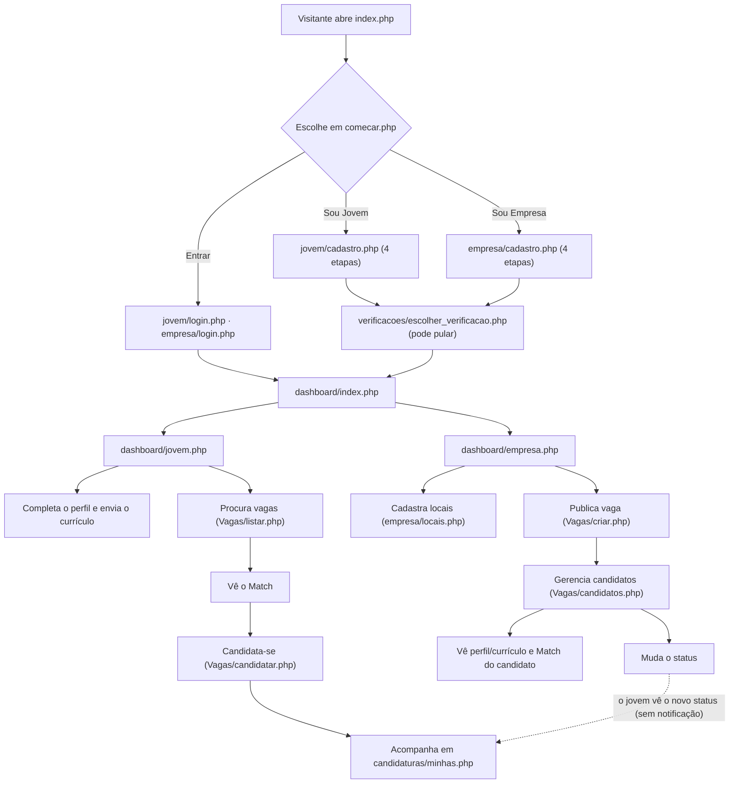
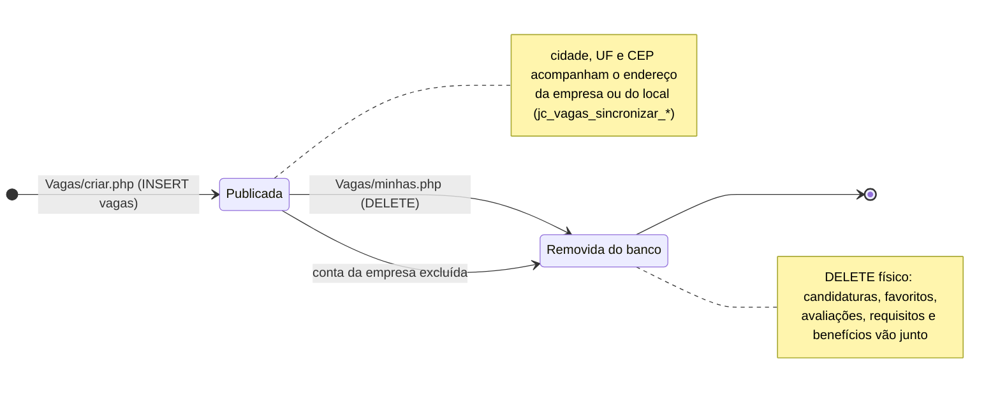
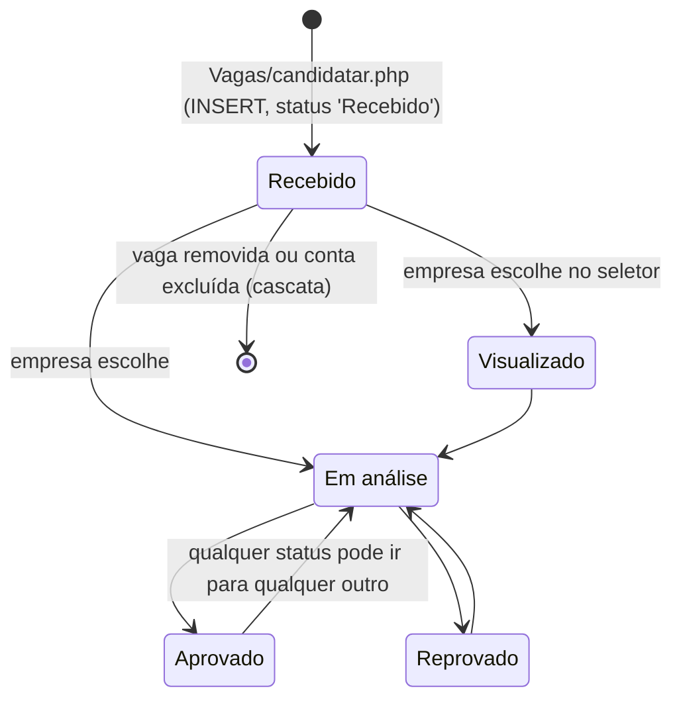

# Visão geral do JovemConnect

> Documento da auditoria de 10/10/2026 sobre a versão **v4.00**, atualizado para a **v4.56** (26/10/2026) nas
> funcionalidades e tecnologias; a tabela "Números do código" continua sendo a medição da v4.00. Afirmações marcadas com **[C]** foram
> confirmadas no código; **[T]** foram verificadas por teste na réplica de desenvolvimento; **[I]** são
> inferências com a evidência indicada; **[NC]** não puderam ser confirmadas.

## O que é

O JovemConnect é uma plataforma web de empregabilidade para jovens em busca do primeiro emprego (Jovem
Aprendiz, Estágio, CLT e PJ) e para as empresas que os contratam. É um projeto acadêmico (TCC) feito em
**PHP 8 + MariaDB/MySQL**, com um serviço auxiliar em **Python/Flask** para o Match e para os recursos de IA
(Google Gemini, opcional).

## Quem usa

| Perfil | O que faz no sistema |
|---|---|
| **Visitante** | Vê a página inicial, lê Termos de Uso e Política de Privacidade, fala com o assistente, cria uma conta. |
| **Jovem** | Cria a conta em 4 etapas, completa o perfil (formação, habilidades, experiências, currículo em PDF), procura vagas, favorita, candidata-se, acompanha o status e vê a compatibilidade (Match) com cada vaga. |
| **Empresa** | Cria a conta em 4 etapas (com busca de CNPJ e CEP), cadastra locais de trabalho, publica e remove vagas, acompanha candidatos, muda o status das candidaturas e vê o Match de cada candidato. |

Na v4.00 não existia perfil de administrador. Desde a Stage 7 existe a Central administrativa, com contas criadas pela linha de comando — ver [ADMINISTRACAO_E_MODERACAO.md](ADMINISTRACAO_E_MODERACAO.md).

## Funcionalidades principais

| Funcionalidade | Onde começa | Situação |
|---|---|---|
| Cadastro em 4 etapas com revisão e aceite dos Termos | `jovem/cadastro.php`, `empresa/cadastro.php` | [C] [T] |
| Login, logout, sessão endurecida, CSRF | `*/login.php`, `*/processar_login.php`, `logout.php` | [C] [T] |
| Verificação de e-mail e telefone (opcional) | `verificacoes/` | [C]; **não funciona sem `composer install`** (PHPMailer/Twilio ausentes) |
| Recuperação de senha por código | `recuperar_senha.php` | [C]; **falha crítica de segurança** — ver [SEGURANCA_E_PRIVACIDADE.md](SEGURANCA_E_PRIVACIDADE.md#seg-01) |
| Perfil do jovem (formação estruturada, habilidades, experiências, currículo PDF, visibilidade) | `jovem/perfil.php`, `uploads/curriculos.php` | [C] [T] |
| Perfil da empresa e locais de trabalho | `empresa/perfil.php`, `empresa/locais.php` | [C] [T] |
| Vagas: listar, filtrar, detalhar, publicar, remover | `Vagas/` | [C] [T]; não há edição nem encerramento de vaga |
| Candidaturas e status (Recebido, Visualizado, Em análise, Aprovado, Reprovado) | `Vagas/candidatar.php`, `Vagas/candidatos.php`, `candidaturas/minhas.php` | [C] [T] |
| Favoritos (estrela em todos os cards de vaga do jovem, desde a v4.56) | `Vagas/favoritar.php`, `Vagas/favoritos.php`, `includes/card_vaga.php` | [C] [T] |
| Painel do jovem com as 6 vagas mais recentes e "Ver todas as vagas" (v4.56) | `dashboard/jovem.php` → `Vagas/listar.php` | [C] [T] |
| Match (nota 0–100 por regras fixas) | `IA/avaliar_ajax.php` → Flask `/avaliar` ou cálculo em PHP | [C] [T] — ver [IA_E_MATCH.md](IA_E_MATCH.md) |
| Análise contextual do Match (texto gerado por IA, não altera a nota) | `Vagas/avaliar.php` | [C] [T com Gemini simulado] |
| Assistente com IA e respostas prontas | botão ✦ em quase todas as páginas | [C] [T com Gemini simulado] |
| Acessibilidade (tamanho do texto, fonte para dislexia, filtros de cor, alto contraste, tema claro/escuro) | painel ♿ | [C] [T] |
| Logs JSON de aplicação, segurança e IA | `logs/` | [C] [T] |
| Iniciar e parar tudo no XAMPP (Apache, MySQL, banco, IA; apagar banco e pasta no fim) (v4.56; versões `.sh` para Linux na v4.59) | `iniciar_jovemconnect.bat`/`.sh`, `parar_jovemconnect.bat`/`.sh`, `scripts/jovemconnect.php` | [C]; ajudante [T] 26/26; `.sh` [T] na réplica Linux; os `.bat` só rodam no Windows |

## Tecnologias

| Camada | Tecnologia | Evidência |
|---|---|---|
| Servidor web | Apache (XAMPP no Windows) | `iniciar_ia.bat`, `.htaccess` em `logs/` e `uploads/curriculos/` |
| Aplicação | PHP 8.1+ recomendado; 7.4 e 8.0 em modo de compatibilidade desde a v4.58 (`includes/compat.php`), `mysqli` | `composer.json` declara `>=8.0` |
| Banco | MariaDB 10.4+ / MySQL 8.0+, InnoDB, `utf8mb4` | cabeçalho do `schema.sql` |
| Dependências PHP opcionais | PHPMailer 6.9, Twilio SDK 8.3 (via Composer) | `composer.json`; pasta `vendor/` não versionada |
| Serviço de IA | Python 3.10+ + Flask (versões fixas; o flask-cors segue na lista, sem uso desde a v4.60), porta 5000 por padrão (ou a próxima livre de 5001–5010), só `127.0.0.1` e só pedidos com `Host` local | `IA/recomendar.py`, `IA/requirements-ia.txt` |
| IA generativa (opcional) | Google Gemini via REST (`GEMINI_MODEL`, padrão `gemini-3.5-flash-lite`) | `IA/recomendar.py` |
| Front-end | HTML gerado pelo PHP, CSS único (`assets/css/style.css`, 3.153 linhas), JavaScript sem framework | — |
| Serviços de terceiros no navegador | ViaCEP, BrasilAPI (CNPJ), Google Fonts, link do Google Maps | `jovem/cadastro.php`, `empresa/cadastro.php`, `style.css`, `Vagas/listar.php` |

## Números do código (v4.00)

| Item | Quantidade | Como foi medido |
|---|---|---|
| Arquivos versionados | 88 | listagem da cópia da tag `v4.00` |
| Arquivos PHP | 60 (15.282 linhas) | extrator de tokens (`token_get_all`) |
| Funções PHP nomeadas | 115 | idem |
| Funções Python | 20 em `IA/recomendar.py` (780 linhas) | `ast` |
| Tabelas | 15 (12 usadas pelo código, 3 sem uso) | `information_schema` de um banco criado com o `schema.sql` |
| Migrações | 3 aditivas | pasta `migrations/` |

## Problema e proposta de valor

**[I]** — inferido dos textos da página inicial (`index.php`: "O seu primeiro passo para o sucesso
profissional", "Conectamos jovens talentos em busca de oportunidades com empresas que valorizam o aprendizado",
"Simplificando o Programa Jovem Aprendiz") e dos links oficiais que ela oferece (Guia do Jovem Aprendiz, Lei
10.097, CLT):

- **Problema:** jovens sem experiência têm dificuldade de encontrar e entender vagas de primeiro emprego
  (principalmente Jovem Aprendiz e Estágio), e empresas precisam encontrar candidatos compatíveis.
- **Para o jovem:** um perfil único (formação, habilidades, experiências, currículo), busca por cidade/área,
  candidatura com um clique, acompanhamento do status e uma nota de compatibilidade com explicação.
- **Para a empresa:** publicação rápida de vagas por local de trabalho, lista de candidatos por vaga com nota
  de compatibilidade, acesso controlado ao perfil e ao currículo, sugestões de jovens da sua área.

Promessas da página inicial comparadas com o código:

| Texto na home | O que existe |
|---|---|
| "Análise de compatibilidade via IA" | Nota por **regras fixas**; a IA (Gemini) só escreve a explicação opcional [C] |
| "Gerador de currículos profissional" | **Não existe gerador**: há envio de PDF e sugestões de texto (IA Advisor). A página `Vagas/curriculoIA.php` ("Mentor de Currículo") existe, mas nenhuma página aponta para ela [C] |
| "Filtros geográficos e de área" | Filtros por texto, cidade, UF e área em `Vagas/listar.php` [C] |

## Tipos de usuário e objetivos

| Tipo | Objetivo | Identificação no código |
|---|---|---|
| Visitante | conhecer, ler os documentos, tirar dúvidas, criar conta | sem `jovem_id`/`empresa_id` na sessão |
| Jovem | ser encontrado e contratado | `$_SESSION['jovem_id']`, tabela `jovens` |
| Empresa | publicar vagas e escolher candidatos | `$_SESSION['empresa_id']`, tabela `empresas` |

Não existem administrador, moderador nem usuário de suporte [C].

## Jornadas principais

## Ciclo de vida de uma vaga

Não existem rascunho, moderação, edição, pausa, encerramento nem data de expiração [C]. Toda vaga criada fica
visível imediatamente para todos os jovens.

## Ciclo de vida de uma candidatura

O status é texto livre no banco, mas o servidor só aceita os 5 valores de `$statuses_validos` em
`Vagas/candidatos.php`; não há ordem obrigatória entre eles [C]. "Visualizado" **não** é marcado
automaticamente quando a empresa abre o perfil [C]. O jovem não pode retirar a candidatura e não recebe
notificação [C]. A coluna `candidaturas.etapa` existe no banco mas nunca é usada [C].

## Match: pretendido × implementado

| Aspecto | Pretendido (textos da interface) | Implementado |
|---|---|---|
| Natureza | "Match IA", "análise de compatibilidade via IA" | regras fixas e determinísticas (5 critérios + ajuste) [C][T] |
| Localização | "cidade próxima" | comparação de nomes (substring), sem distância [C][T] |
| Habilidades/experiência | sugerido pelo assistente ("analisa formação, localização e área") | não entram na nota [C] |
| Explicação | — | texto padrão por faixa; análise contextual opcional do Gemini que não altera a nota [C][T] |

Detalhes: [IA_E_MATCH.md](IA_E_MATCH.md).

## Papel da inteligência artificial

A IA generativa (Google Gemini) é **opcional** e serve para **explicar e orientar**: análise contextual do
Match, assistente de dúvidas e, na integração antiga, frases e sugestões de currículo. Ela **não executa
ações** (não candidata, não altera dados, não envia mensagens) e **não decide** a nota [C][T]. Sem chave ou
sem o Flask, o sistema continua funcionando com regras fixas e respostas prontas.

## Funcionalidades existentes, parciais e ausentes

Levantamento por engenharia reversa (não havia documento de requisitos no repositório). Situação: **Verificado por teste** (código + teste na réplica, ver [TESTES.md](TESTES.md)) · **Confirmado no código** · **Parcial** (limitação relevante descrita) · **Ausente** (não existe; registrado porque a interface, um comentário ou a documentação sugere).

### Contas e acesso

| ID | Requisito | Situação | Evidência |
|---|---|---|---|
| RF-01 | O jovem cria a conta em 4 etapas (dados básicos; formação; habilidades/resumo; localização, revisão e aceite). | Verificado por teste | `jovem/cadastro.php`, `includes/etapas.php`; suíte cadastro (50/50) |
| RF-02 | A empresa cria a conta em 4 etapas, com preenchimento por CNPJ (BrasilAPI) e CEP (ViaCEP). | Verificado por teste | `empresa/cadastro.php`; suíte cadastro |
| RF-03 | E-mail, CPF e CNPJ são únicos por tipo de conta. | Verificado por teste | índices `uq_email_jovem`, `uq_cpf`, `uq_email_empresa`, `uq_cnpj`; SELECT prévio; suíte cadastro |
| RF-04 | O cadastro exige marcar o aceite dos Termos de Uso e da Política de Privacidade e registra versão e data. | Verificado por teste | `includes/termos.php` → `jc_termos_registrar`; suíte termos (38/38) |
| RF-05 | Login separado para jovem e empresa, com e-mail e senha. | Verificado por teste | `jovem/processar_login.php`, `empresa/processar_login.php`; S3 regressão |
| RF-06 | Logout encerra a sessão e apaga o cookie. | Verificado por teste | `logout.php`; S4 navegação ("depois de sair, páginas internas mandam para o login") |
| RF-07 | Verificação opcional de e-mail por código de 6 dígitos (15 min). | Parcial | `verificacoes/verificar_email.php`; **sem `composer install` o e-mail não é enviado** (`includes/mailer.php` retorna `false`) |
| RF-08 | Verificação opcional de telefone por SMS (15 min). | Parcial | `verificacoes/verificar_telefone.php`; **depende do SDK Twilio e de credenciais** |
| RF-09 | Recuperação de senha em 3 etapas (e-mail → código → nova senha). | Parcial | `recuperar_senha.php`; **falha crítica SEG-01** (troca de senha de outra conta) e envio depende do PHPMailer |
| RF-10 | Exclusão da própria conta, com confirmação, apagando os dados ligados e o PDF do currículo. | Verificado por teste | `jovem/excluir_conta.php`, `empresa/excluir_conta.php`; S3 regressão |

### Perfil do jovem

| ID | Requisito | Situação | Evidência |
|---|---|---|---|
| RF-11 | Editar dados pessoais, formação principal estruturada, área de interesse, resumo e visibilidade. | Verificado por teste | `jovem/perfil.php` (`update_perfil`); suítes formação (46/46), perfil (36/36) |
| RF-12 | Adicionar/remover formações adicionais, habilidades e experiências. | Verificado por teste | `jovem/perfil.php` (`add_*`/`del_*`); S3 regressão |
| RF-13 | Enviar currículo em PDF (até 5 MB, assinatura `%PDF`), substituindo o anterior. | Verificado por teste | `uploads/curriculos.php`; S3 parte B |
| RF-14 | Trocar o e-mail zera a verificação de e-mail. | Confirmado no código | `jovem/perfil.php` → `update_perfil` |
| RF-15 | Pedir sugestões de currículo à IA (IA Advisor). | Parcial | `jovem/perfil.php` → `IA/avaliar_ajax.php` (`curriculo`); sem Flask → 503; resposta inserida com `innerHTML` (SEG-05) |

### Empresa

| ID | Requisito | Situação | Evidência |
|---|---|---|---|
| RF-16 | Editar perfil da empresa e endereço principal; as vagas "no endereço da empresa" acompanham a mudança. | Verificado por teste | `empresa/perfil.php`, `jc_vagas_sincronizar_empresa`; suíte S5.1 match (90/90) |
| RF-17 | Cadastrar, editar e remover locais de trabalho; não remover local em uso. | Verificado por teste | `empresa/locais.php`; suíte S5.1 |
| RF-18 | Publicar vaga (título, descrição, contrato, área, salário, carga horária, local, requisitos, benefícios). | Verificado por teste | `Vagas/criar.php`; S3 regressão, S5.1 |
| RF-19 | Remover vaga própria (remoção definitiva com as candidaturas). | Verificado por teste | `Vagas/minhas.php`; S3 regressão |
| RF-20 | Editar, pausar ou encerrar vaga. | **Ausente** | nenhum UPDATE de vaga além da sincronização de endereço; não há coluna de status em `vagas` |
| RF-21 | Ver candidatos de cada vaga própria e mudar o status (Recebido, Visualizado, Em análise, Aprovado, Reprovado). | Verificado por teste | `Vagas/candidatos.php`; S3 regressão |
| RF-22 | Ver o perfil e o currículo de um candidato somente quando há candidatura à vaga da empresa ou perfil público. | Verificado por teste | `includes/candidato.php`; suíte perfil (36/36) |
| RF-23 | Painel da empresa com candidatos recentes e, sem candidatos, sugestões de jovens da área. | Confirmado no código | `dashboard/empresa.php` (modo normal × fallback de até 12 jovens) |

### Vagas e candidaturas (jovem)

| ID | Requisito | Situação | Evidência |
|---|---|---|---|
| RF-24 | Listar vagas com busca por texto, cidade, UF e área; ver detalhes. | Verificado por teste | `Vagas/listar.php`; S3 regressão, S4 navegação |
| RF-25 | Candidatar-se uma única vez por vaga, com confirmação. | Verificado por teste | `Vagas/candidatar.php`, `uq_candidatura`; S3 regressão |
| RF-26 | Acompanhar as próprias candidaturas e o status. | Verificado por teste | `candidaturas/minhas.php`; S4 navegação |
| RF-27 | Retirar candidatura. | **Ausente** | nenhum DELETE de `candidaturas` pelo jovem |
| RF-28 | Favoritar/desfavoritar vagas e listar favoritos. | Verificado por teste | `Vagas/favoritar.php`, `Vagas/favoritos.php`; S3 regressão |
| RF-29 | Ser notificado (e-mail/SMS) quando o status da candidatura muda. | **Ausente** | nenhuma chamada a mailer/sms fora de verificação/recuperação |

### IA e Match

| ID | Requisito | Situação | Evidência |
|---|---|---|---|
| RF-30 | Calcular a compatibilidade jovem × vaga (0–100) por regras fixas, também sem o Flask. | Verificado por teste | `IA/recomendar.py::avaliar`, `includes/match.php`; paridade 0 divergências; fallback 7/7 ×2; MATCH-01..05 |
| RF-31 | Guardar a nota por par jovem × vaga e recalcular quando os dados mudam a nota. | Verificado por teste | `avaliacoes_ia`, `IA/avaliar_ajax.php`; S5.1 match |
| RF-32 | Mostrar a composição da nota por categoria, ajuste, pontos fortes e limitações. | Verificado por teste | `Vagas/avaliar.php` (`action:"analise"`); S5.1 UI (101/101) |
| RF-33 | Mostrar uma análise contextual gerada por IA que não altera a nota. | Verificado por teste (Gemini simulado) | `action:"contexto"` → Flask `/analise_contextual`; contexto 33/33 |
| RF-34 | Assistente de dúvidas com IA, com respostas prontas quando a IA não está disponível. | Verificado por teste (Gemini simulado) | `includes/assistente.php`, `IA/assistente_ajax.php`, Flask `/assistente`; assistente 34/34 |

### Interface e acessibilidade

| ID | Requisito | Situação | Evidência |
|---|---|---|---|
| RF-35 | Tema claro/escuro persistente. | Verificado por teste | chave `jc-theme`; S4 interface |
| RF-36 | Painel de acessibilidade: tamanho do texto, fonte para dislexia, filtros de daltonismo, escala de cinza, alto contraste. | Parcial | `includes/assistente.php`; a fonte OpenDyslexic **não é carregada** (cai em Comic Sans) [C] |
| RF-37 | Termos de Uso e Política de Privacidade em modal (resumo + texto completo) e em página própria. | Verificado por teste | `includes/institucional.php`, `documentos.php`; S5 modais (65/65), termos |
| RF-38 | Contato por e-mail no rodapé. | Verificado por teste | `JC_CONTATO_EMAIL` em `includes/documentos.php`; S5 modais |

## Regras de negócio

| ID | Regra | Onde |
|---|---|---|
| RN-01 | Senha com no mínimo 8 caracteres (cadastro e recuperação). | `jovem/cadastro.php`, `empresa/cadastro.php`, `recuperar_senha.php` |
| RN-02 | Códigos de verificação e recuperação têm 6 dígitos e valem 15 minutos. | `recuperar_senha.php`, `verificacoes/*` |
| RN-03 | No cadastro do jovem: até 15 habilidades; resumo até 1.000 caracteres. No perfil não há limite de habilidades. | `jovem/cadastro.php`, `jovem/perfil.php` |
| RN-04 | Currículo: só PDF, até 5 MB, um por jovem (`curriculo_{id}.pdf`). | `uploads/curriculos.php` |
| RN-05 | Status de candidatura aceitos: Recebido, Visualizado, Em análise, Aprovado, Reprovado. Toda candidatura nasce "Recebido". | `Vagas/candidatos.php`, `Vagas/candidatar.php` |
| RN-06 | A empresa só vê/edita candidaturas de vagas próprias (dono no `WHERE`). | `Vagas/candidatos.php`, `Vagas/minhas.php` |
| RN-07 | A empresa vê o perfil do jovem se houver candidatura a uma vaga dela **ou** perfil público; e-mail só com candidatura. | `includes/candidato.php` |
| RN-08 | Local efetivo da vaga: local escolhido → endereço principal da empresa → cidade/UF digitadas na vaga. | `includes/locais.php` → `jc_local_resolver`/`jc_local_efetivo` |
| RN-09 | Local de trabalho em uso por alguma vaga não pode ser removido. | `empresa/locais.php` |
| RN-10 | Nota do Match: pesos 25/25/25/15/10 e ajuste −10, limitada a 0–100. | `IA/recomendar.py`, `includes/match.php` |
| RN-11 | Análise contextual: até 20 chamadas a cada 10 minutos por sessão. | `IA/avaliar_ajax.php` |
| RN-12 | Assistente: 8 mensagens/minuto e 60/hora por sessão; 40/minuto por IP; mensagem até 500 caracteres; dados pessoais mascarados antes de sair do servidor. | `IA/assistente_ajax.php` |

## Limites conhecidos (resumo)

- Sem `composer install`, **nenhum e-mail ou SMS é enviado** (verificação e recuperação de senha ficam inúteis) [C].
- ~~**Recuperação de senha permite tomar a conta de outra pessoa**~~: corrigido no Lote A (12/10/2026) [C][T].
- Vagas só podem ser publicadas e removidas (remoção física, apaga candidaturas) [C].
- Listagens sem paginação [C].
- ~~O perfil do jovem nasce **público para empresas** (`perfil_publico = 1`)~~: desde a v4.60 nasce **privado** e só o jovem o torna visível; contas antigas não mudaram [C].
- A nota do Match usa comparação de texto (substring), sem distância real nem habilidades [C][T].
- ~~O caminho `../Assets/css/style.css` (com "A" maiúsculo) só funcionava em sistemas que não diferenciam maiúsculas~~: corrigido na v4.59, e o projeto roda no Linux [C].

A lista completa, com evidências e recomendações, está em [SEGURANCA_E_PRIVACIDADE.md](SEGURANCA_E_PRIVACIDADE.md)
e em [MANUTENCAO_E_EVOLUCAO.md](MANUTENCAO_E_EVOLUCAO.md#pendências-que-exigem-mudança-de-código).

## Por onde continuar

- Para instalar: [INSTALACAO_E_EXECUCAO.md](INSTALACAO_E_EXECUCAO.md).
- Para entender a estrutura: [ARQUITETURA.md](ARQUITETURA.md) e [FLUXOS_E_FLUXOGRAMAS.md](FLUXOS_E_FLUXOGRAMAS.md).
- Para mexer no código: [ARQUIVOS_E_FUNCOES.md](ARQUIVOS_E_FUNCOES.md) e [MATRIZ_DE_DEPENDENCIAS.md](MATRIZ_DE_DEPENDENCIAS.md).
